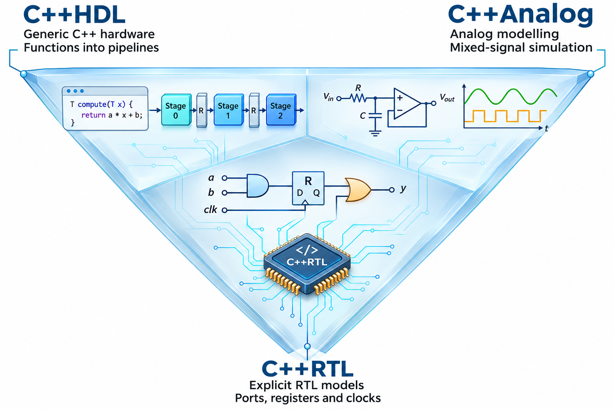

# C++HDL

C++HDL is a Hardware Description Language for description of C++RTL models

Slides: https://github.com/user-attachments/files/24297702/cpphdl.pdf

Spec: https://github.com/mirekez/cpphdl/blob/main/doc/cpphdl.pdf

Best practice: https://github.com/mirekez/cpphdl/blob/main/doc/best_practice.pdf

The book: https://github.com/mirekez/cpphdl/blob/main/doc/cpphdl_book.pdf

Analog part: https://github.com/mirekez/cpphdl/blob/main/doc/analog.pdf

Some resources on wiki: https://github.com/mirekez/cpphdl/wiki



- **C++HLS:** Describe hardware in generic C++ and use HLS scheduling and retiming to spread computations across pipeline stages.
- **C++Analog:** Describe analog behaviour in C++ and connect the models to mixed-signal simulations.
- **C++RTL:** Describe explicit RTL models in C++, with ports, registers, combinational logic, and clocks.

## build

Win64 requires the following to be done:

 - Install msys2-x86_64-20240727.exe, Miniconda3-py39_24.7.1-0-Windows-x86_64.exe, run MSYS2 MSYS console
 - git clone https://github.com/mirekez/cpphdl; cd cpphdl

And for Linux:

 - git clone ssh://github.com/mirekez/cpphdl; cd cpphdl
 - wget https://repo.anaconda.com/miniconda/Miniconda3-latest-Linux-x86_64.sh; chmod a+x Miniconda3-latest-Linux-x86_64.sh; ./Miniconda3-latest-Linux-x86_64.sh
 - source ~/miniconda3/bin/activate; conda init

Then for both Win&Lin:

 - conda create -p ./.conda; source activate base; conda activate ./.conda; conda env update --file requirements.yaml
 - mkdir build; cd build; cmake -DCMAKE_BUILD_TYPE=Release -G "Unix Makefiles" ..; make

### Build cpphdl and hdlcpp together

`cpphdl` converts C++ RTL to Verilog. `hdlcpp` converts Verilog/SystemVerilog
back to C++ and also provides the `--native-graph` simulation conversion mode.
The `hdlcpp` target is optional and must be enabled explicitly.

Run the following from the **cpphdl repository root**, with the compiler
environment activated. Building hdlcpp requires **CMake 3.28 or newer**, a
C++23 compiler, and Git. Building cpphdl also requires the LLVM/Clang development
packages described above. The current `requirements.yaml` pins CMake 3.26.4;
if you use that Conda environment, upgrade CMake first:

```sh
conda install -p ./.conda -c conda-forge 'cmake>=3.28,<4'
conda activate ./.conda
cmake --version
```

Fetch the Slang revision pinned by `hdlcpp/slang-revision.txt`, configure both
converters, and build them:

```sh
bash ./hdlcpp/setup_slang.sh

cmake -S . -B build \
  -DCMAKE_BUILD_TYPE=Release \
  -DCMAKE_CXX_FLAGS_RELEASE='-O1 -DNDEBUG -g0' \
  -DCPPHDL_BUILD_HDLCPP=ON \
  -DCPPHDL_BUILD_EXAMPLES_TESTS=OFF \
  -DCPPHDL_BUILD_LIB_TESTS=OFF \
  -DCPPHDL_BUILD_TESTS=OFF \
  -DCPPHDL_BUILD_HLS_TESTS=OFF \
  -DCPPHDL_BUILD_SYNTH_TESTS=OFF \
  -DCPPHDL_BUILD_TRIBE=OFF \
  -DCPPHDL_BUILD_ANALOG=OFF

cmake --build build --config Release --target cpphdl hdlcpp -j2
```

With Unix Makefiles or Ninja, the executables are:

```text
build/cpphdl
build/hdlcpp/hdlcpp
```

Multi-configuration generators place them in `build/Release/cpphdl` and
`build/hdlcpp/Release/hdlcpp`. The commands above select only the converter
targets; they do not run FPGA builds or RTL simulation tests. `-O1` keeps
conversion optimized while limiting compiler memory use, and `-j2` limits
concurrent compilation jobs.

Shared RTL buffering, memory and math implementations live in [lib/](lib/README.md), with
embedded native C++ and Verilator tests. `CPPHDL_BUILD_LIB_TESTS` enables their
build and test registration, independently of `CPPHDL_BUILD_EXAMPLES_TESTS`
for the examples. Both default to `ON`; neither is needed to include the headers
in your own design. The old option names are accepted with a deprecation warning
and migrated to the new names; explicitly supplied new values take precedence.

For example, convert a SystemVerilog top to a native graph:

```sh
./build/hdlcpp/hdlcpp --native-graph --top MyTop \
  --output /tmp/mytop-native.cc /path/to/MyTop.sv
```

The output path must not already exist. The regular `hdlcpp` executable handles
native graph conversion; no separate executable named `hdlcpp-native` or
`hdlcpp-toolchain/toolchain.json` is required by this CMake build.

When using this repository through the `cpphdl` symlink in `harpy/hlsgen`,
configure with `cmake -S ./cpphdl -B ./cpphdl/build` and the options above, then
use `--cpphdl ./cpphdl/build/cpphdl` and
`--hdlcpp ./cpphdl/build/hdlcpp/hdlcpp` in the Llama build command. Run the Slang
setup as `bash ./cpphdl/hdlcpp/setup_slang.sh` from that directory.

### Build only hdlcpp

The standalone converter build needs CMake 3.28+, Git, and a C++23 compiler;
it does not need the cpphdl frontend's LLVM/Clang development libraries.
From the cpphdl repository root:

```sh
bash ./hdlcpp/setup_slang.sh
cmake -S hdlcpp -B build-hdlcpp \
  -DCMAKE_BUILD_TYPE=Release \
  -DCMAKE_CXX_FLAGS_RELEASE='-O1 -DNDEBUG -g0' \
  -DCMAKE_CXX_COMPILER="$(command -v g++)"
cmake --build build-hdlcpp --config Release --target hdlcpp -j2
```

The executable is `build-hdlcpp/hdlcpp` for Unix Makefiles or Ninja, or
`build-hdlcpp/Release/hdlcpp` for a multi-configuration generator.

### Fully static Linux converter

Linux test builds use `build/cpphdl-static` by default. Install the static
dependencies through `requirements.yaml`, then configure and build (from the
repository root):

```sh
conda install -p ./.conda -c conda-forge zstd-static
cmake -S . -B build -G "Unix Makefiles" -DCPPHDL_STATIC_TESTS=ON
cmake --build build --target cpphdl-static -j2
ctest --test-dir build -R '^cpphdl_static_cli_' --output-on-failure
```

This requires static Clang, LLVM, zlib, zstd and C/C++ runtime libraries.
The normal `cpphdl` target remains available. The static target verifies that
its ELF binary has no interpreter or shared-library dependencies and applies
the same GNU ISA-note workaround as `cpphdl`. Static linkage does not remove
unsupported CPU instructions from dependency archives. Headers, Python scripts
and external tools used by particular conversion modes are still required;
this target does not bundle them or support loading shared Clang plugins.
Static glibc can still load NSS modules for account lookups (for example,
expanding `~user`); a static ELF does not guarantee those optional operations
work on a filesystem without shared libraries.

`CPPHDL_STATIC_TESTS=ON` selects this converter for tests and example conversion,
and links test-generated executables with static C++ and GCC runtimes. This
includes native-graph helpers, Verilator harnesses and HLS libc++ tests. CMake
generates compiler wrappers under `build/test-toolchain/` so nested builds use
the same linkage. Test executables can still depend on libc, libatomic, OpenMP or other
external libraries; shared-library fixtures and sanitizer checks remain enabled.
They are not all fully static ELF files like `cpphdl-static`. Use
`-DCPPHDL_STATIC_TESTS=OFF` to test with the ordinary converter/compiler instead;
`CPPHDL_BUILD_STATIC=ON` can still build the static converter independently.
When enabled, the `hdlcpp` converter also builds as a fully static Linux binary
by default (`HDLCPP_STATIC=ON`), with the same ELF dependency check.

## tests

```
cd build
make
ctest
# be sure you provided RISCV_HOME=<> path to riscv-gnu-toolchain build if you want to run Tribe CPU tests
# you need also to run .load_sail_riscv_sim.sh and .load_spike.sh in tribe_cpu/tests/ if you want to run CPU tests
```

## Analog and mixed-signal schemas

The [analog framework](analog/README.md) describes IC intentions with shared
physical connections, device models and constraints. [basic schemas](analog/basic/README.md)
include transistor amplifiers, inverters and regulators. The
[mixed example](examples/mixed_signal/main.cpp) combines native C++HDL registers with
analog sensing, loading and charge storage. Include `<cpphdl_analog.h>` and link
`cpphdl::analog`; the shared `_PORT` selector preserves each domain's port meaning.

Run the native regression suite without building LLVM or RTL tools:

```bash
cmake -S analog -B analog/build -G "Unix Makefiles" -DCMAKE_BUILD_TYPE=Release \
  -DBUILD_TESTING=ON -DCPPHDL_BUILD_ANALOG_TESTS=ON
cmake --build analog/build -j 4
ctest --test-dir analog/build --output-on-failure -L analog
```

The package includes analog and its exporter by default (`CPPHDL_BUILD_ANALOG=ON`),
but analog tests are **disabled by default**, including in existing build trees.
Enable them in the package build with:

```bash
cmake -S . -B build -G "Unix Makefiles" -DBUILD_TESTING=ON \
  -DCPPHDL_BUILD_ANALOG=ON -DCPPHDL_BUILD_ANALOG_TESTS=ON
cmake --build build --target check-analog -j 4
```

Preinstall CMake and a C++20 compiler for standalone native analog tests. Python3
is needed for script-driven checks; RTL comparisons additionally need Verilator
and the built `cpphdl` converter. Verilog-A cross-simulator tests need **OpenVAF,
ngspice built with OSDI support, and Python3**. See the
[installation instructions](analog/VerilogA/toolchain.md) and
[test options and prerequisites](analog/tests/README.md).
`CPPHDL_ANALOG_VERILOGA_TESTS=AUTO` runs comparisons when their tools are found;
use `ON` to require them, or `OFF` to omit them. None are required just to export
Verilog-A. `-DCPPHDL_BUILD_ANALOG_TESTS=OFF` disables all analog tests without
disabling digital tests or the exporter.
Analog IC classes also export through `cpphdl --verilog-a`; see
[Verilog-A conversion and independent ngspice comparisons](analog/VerilogA/README.md).

## author

This software is developed by Mike Reznikov (https://www.linkedin.com/in/mike-reznikov) based on the results of own research.

This work is not subsidized or paid.

## development plan

- comb. hierarchy checks
- regs/luts usage estimation
- timing estimation

## verilog bugs

- this chapter is to collect verilog gotchas which are inexplicable for non verilog-guru and fixed for C++-native

1. In verilog {a*b} has size of a or b, not size(a)+size(b). In C++ this works correctly. Cpphdl will explicitly widen both operands to act as C++ and try to save result

## Enable all Tribe CPU tests

Tribe CPU models and tests are disabled by default. Install a RISC-V GNU
toolchain under `RISCV_HOME`, prepare the external Spike, Sail,
`riscv-tests`, `riscv-arch-test`, and `riscv-dv` dependencies, and configure
C++HDL with both Tribe and CTest enabled:

```bash
export RISCV_HOME="$HOME/riscv"
export PATH="$RISCV_HOME/bin:$PATH"

cd ./tribe_cpu/tests
./.load_spike.sh
./.load_sail_riscv_sim.sh
cd ../..
cmake -S . -B build -G "Unix Makefiles" \
    -DCMAKE_BUILD_TYPE=Release \
    -DCPPHDL_BUILD_TRIBE=ON \
    -DBUILD_TESTING=ON
cmake --build build -j"$(nproc)"
ctest --test-dir build --output-on-failure
```

`RISCV_HOME/bin` must contain `riscv32-unknown-elf-gcc` and
`riscv32-unknown-elf-g++`. Without the toolchain or prepared external test
repositories, the corresponding Tribe tests are listed by CTest but skipped.
