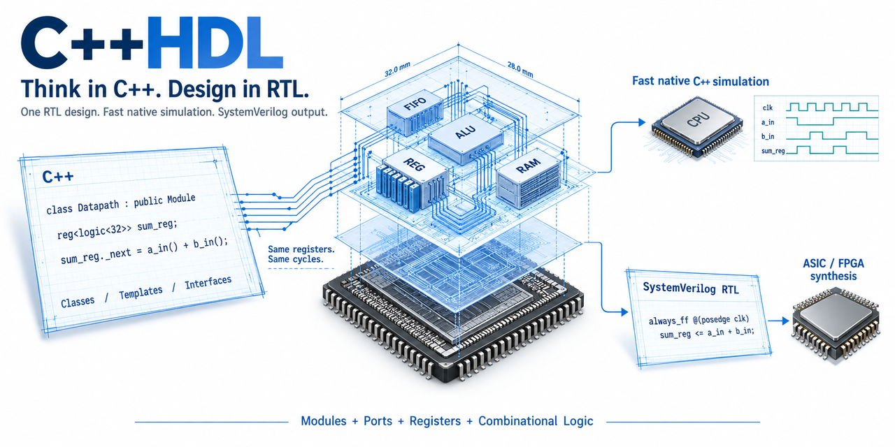

# C++HDL

C++HDL is a Hardware Description Language for description of C++RTL models

Slides: https://github.com/user-attachments/files/24297702/cpphdl.pdf

Spec: https://github.com/mirekez/cpphdl/blob/main/doc/cpphdl.pdf

Best practice: https://github.com/mirekez/cpphdl/blob/main/doc/best_practice.pdf

The book: https://github.com/mirekez/cpphdl/blob/main/doc/cpphdl_book.pdf

Some resources on wiki: https://github.com/mirekez/cpphdl/wiki



## build

Win64 requires the following to be done:

 - Install msys2-x86_64-20240727.exe, Miniconda3-py39_24.7.1-0-Windows-x86_64.exe, run MSYS2 MSYS console
 - git clone https://github.com/mirekez/cpphdl; cd cpphdl

And for Linux:

 - git clone ssh://github.com/mirekez/cpphdl; cd cpphdl
 - wget https://repo.anaconda.com/miniconda/Miniconda3-latest-Linux-x86_64.sh; chmod a+x Miniconda3-latest-Linux-x86_64.sh; ./Miniconda3-latest-Linux-x86_64.sh
 - source ~/miniconda3/bin/activate; conda init

Then for both Win&Lin:

 - conda create -p ./.conda; source activate base; conda activate ./.conda; conda env update --file requirements.yaml
 - mkdir build; cd build; cmake -DCMAKE_BUILD_TYPE=Release -G "Unix Makefiles" ..; make

## tests

```
cd build
make
ctest
# be sure you provided RISCV_HOME=<> path to riscv-gnu-toolchain build if you want to run Tribe CPU tests
# you need also to run .load_sail_riscv_sim.sh and .load_spike.sh in tribe_cpu/tests/ if you want to run CPU tests
```

## Analog and mixed-signal schemas

The [analog framework](analog/README.md) describes IC intentions with shared
physical connections, device models and constraints. [basic schemas](analog/basic/README.md)
include transistor amplifiers, inverters and regulators. The
[mixed example](examples/mixed_signal/main.cpp) combines native C++HDL registers with
analog sensing, loading and charge storage. Include `<cpphdl_analog.h>` and link
`cpphdl::analog`; the shared `_PORT` selector preserves each domain's port meaning.

Run the native regression suite without building LLVM or RTL tools:

```bash
cmake -S analog -B analog/build -DCMAKE_BUILD_TYPE=Release -DBUILD_TESTING=ON
cmake --build analog/build -j 4
ctest --test-dir analog/build --output-on-failure -L analog
```

The package build includes analog by default (`CPPHDL_BUILD_ANALOG=ON`). Its
`check-analog` target builds and runs the same regressions through CTest. See
[analog/tests](analog/tests/README.md) for coverage and build options.
Analog IC classes also export through `cpphdl --verilog-a`; see
[Verilog-A conversion and independent ngspice comparisons](analog/VerilogA/README.md).

## author

This software is developed by Mike Reznikov (https://www.linkedin.com/in/mike-reznikov) based on the results of own research.

This work is not subsidized or paid.

## development plan

- comb. hierarchy checks
- regs/luts usage estimation
- timing estimation

## verilog bugs

- this chapter is to collect verilog gotchas which are inexplicable for non verilog-guru and fixed for C++-native

1. In verilog {a*b} has size of a or b, not size(a)+size(b). In C++ this works correctly. Cpphdl will explicitly widen both operands to act as C++ and try to save result

## Enable all Tribe CPU tests

Tribe CPU models and tests are disabled by default. Install a RISC-V GNU
toolchain under `RISCV_HOME`, prepare the external Spike, Sail,
`riscv-tests`, `riscv-arch-test`, and `riscv-dv` dependencies, and configure
C++HDL with both Tribe and CTest enabled:

```bash
export RISCV_HOME="$HOME/riscv"
export PATH="$RISCV_HOME/bin:$PATH"

cd ./tribe_cpu/tests
./.load_spike.sh
./.load_sail_riscv_sim.sh
cd ../..
cmake -S . -B build -G "Unix Makefiles" \
    -DCMAKE_BUILD_TYPE=Release \
    -DCPPHDL_BUILD_TRIBE=ON \
    -DBUILD_TESTING=ON
cmake --build build -j"$(nproc)"
ctest --test-dir build --output-on-failure
```

`RISCV_HOME/bin` must contain `riscv32-unknown-elf-gcc` and
`riscv32-unknown-elf-g++`. Without the toolchain or prepared external test
repositories, the corresponding Tribe tests are listed by CTest but skipped.
