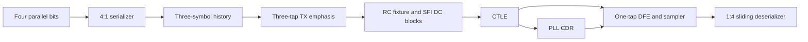

# 10GBASE-R SerDes for SFP+ SFI

This library models a 10.3125 Gb/s NRZ transmit/receive datapath in native C++ IC
classes and generated Verilog-A. One unit interval (UI) is 96.96969697 ps. The
[requirements](requirements.md) distinguish the implemented PMA experiments from
complete IEEE Ethernet PHY compliance. The selected interface is the SFP+ host electrical SFI for a limiting module.
The [SFI contract](sfi.md) records the standard and remaining compliance work.
The channel is an electrical loopback fixture; optical conversion, PCS block
alignment and module management are outside this model. KR backplane training
is not part of this target. No ISSCC performance or silicon-power claim is made.



Each box is a class derived from `IC`, with member ports and line-by-line purposes
in `_assign()`. All devices share one equation system. Loads, storage, finite drive
and receiver feedback coexist; class boundaries do not isolate electrical behavior.
The transmitter receives a coherent clock tree from its environment. **The CDR has
no reference-clock or `sys_clock` port.** Its oscillator is corrected by transitions
in the actual equalized input, and the DFE feeds back its actual stored decision.

| Description | Classes and intended purpose |
|---|---|
| [serdes](serdes.md) | `serializer`, `tap_history`, `deserializer`: finite-drive muxes and capacitor-backed storage |
| [emphasis](emphasis.md) | `tx_emphasis`: pre/main/post weighted differential drive with output impedance |
| [phy](phy.md) | `channel`, `sfi_input`, `transmitter`, `receiver`, `link`: electrical fixture and complete hierarchy |
| [ctle](ctle.md) | `ctle`: passive lead networks followed by finite-bandwidth gm stages |
| [cdr](cdr.md) | `hogge_detector`, `vco_10g`, `lock_monitor`, `pll_cdr`: explicit detector, oscillator, filter and qualification |
| [dfe](dfe.md) | `dfe`: one fixed postcursor cancellation tap and clocked decision feedback |
| [tests](tests/README.md) | Per-module and integrated tests in both simulation flows, common checks, then comparisons |

Models use 1.2 V logic and a separately connected 0.6 V common-mode port. Model
parameters are prototype values, not a process design kit. The framework's MOS
square law, ideal VCCS, piecewise-linear diode and declared R/C/L laws provide the
underlying equations. `sim_` storage and mux classes explicitly use buffered-switch
approximations: their capacitors retain state and their output drive is finite,
but input loading, power, transistor noise and metastability are not characterized.
They can be replaced by other classes with the same ports after validation.

From the package root, using the toolchain described in
[VerilogA/toolchain.md](../VerilogA/toolchain.md):

```bash
cmake -S analog -B analog/build -DCMAKE_BUILD_TYPE=Release \
  -DBUILD_TESTING=ON -DCPPHDL_BUILD_ANALOG_TESTS=ON \
  -DCPPHDL_ANALOG_VERILOGA_TESTS=ON \
  -DOPENVAF_EXECUTABLE=/absolute/path/to/openvaf \
  -DNGSPICE_EXECUTABLE=/absolute/path/to/ngspice
cmake --build analog/build -j 2
cmake --build analog/build --target generate-veriloga -j 2
cmake --build analog/build --target check-10g
```

`generate-10g-veriloga` regenerates the 15 reusable 10G modules in the shared
`generated/` directory. `generate-veriloga` also regenerates the basic ICs.
Generated modules contain the selected electrical laws, with explicit markers for
behavioral approximations. Capacitor initial conditions in reusable modules are
comments for the host analysis; the testbench bundles transfer them to SPICE UIC.
Generated binaries, waveform results and build directories remain ignored.
[Measured results](tests/validation.md) summarize solver agreement, loading,
clock recovery and the complete-block checks.
