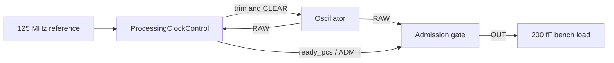

# Reference and receive-processing clocks

The receiver uses one external 125 MHz reference and two internal clock paths.

`reference_clock_generator` is an electrical IC: a MOS phase/frequency detector,
charge pump, passive loop filter, balanced current-limited ring, divide-by-two
feedback and output buffers. Its output supplies the 250 MHz ADC timing domain.
The accompanying translator supplies the higher-voltage analog control domain.
The [physical reference-clock candidate](reference-clock-layout.md) removes
the latch/pump simulation returns and provides an actual device layout. Its
revised electrical and physical qualifications are separate from the earlier
schematic results below.
`reference_clock_process.py` binds the exported generic MOS laws to 230 explicit
SG13G2 low/high-voltage transistors. That binding checks the device inventory;
generic square-law parameters are not process geometry.

`processing_clock_oscillator` supplies the separate receive DSP/PCS domain.
Two eight-bit MOS R/2R ladders provide coarse and fine tuning. `COARSE_N` and
`FINE_N` are complementary electrical controls: a high trim bit drives its
corresponding port low. `ProcessingClockControl` holds `CLEAR` during startup.
Before subsequent trim changes it withdraws readiness and gives the running
clock domain 32 reference cycles to observe that withdrawal. It then changes
the 16-bit trim word, waits for settling, and counts achieved output edges
against the sole external reference. It requires sustained qualifying
measurements before admitting traffic. The data path crosses from the ADC into
this processing domain through `ReceiveDSPCrossing`.

The processing clock's qualified band is 132–136 MHz. Acquisition requires
137 or 138 achieved edges per 128 reference periods. Once admitted, the controller
measures 512 reference periods and accepts 543–556 edges. This longer window
keeps the same frequency band while resolving the small frequency change caused
by switching the delivered clock load. A 128-period monitor previously withdrew
readiness at an electrically valid 133.773 MHz. The load-step regression rejects
that implementation and checks counter wrap and both out-of-band directions.
The new routed controller passes setup/hold, DRC/LVS, exact replay and extracted
Gray-bus checks. Its 64 µs native connected-clock run passes; connected Verilog-A,
PSP and extracted-delivery verification remain separate. This is frequency/readiness
qualification, not a claim that its phase is locked to the reference. Clock loss
and out-of-range operation withdraw readiness. It also does not implement a
1000BASE-T slave transmitter's tracking of its link partner; that remains a
separate integration requirement.

`processing_clock_process.py` binds 51 MOS devices to explicit SG13G2 dimensions.
The ring retains charge on explicit internal capacitors instead of seven
1 GΩ bias returns. These schematic storage values still require physical
realization and extracted verification. Likewise, the output test load is not
a substituted model of an unimplemented full-chip clock tree.

The clock regressions are registered with CTest:

```sh
ctest --test-dir build -R '^analog\.1g\.ihp_reference_clock\.' --output-on-failure
ctest --test-dir build -R '^analog\.1g\.ihp_processing_clock\.' --output-on-failure
ctest --test-dir build -R '^analog\.1g\.ihp_processing_clock_closed\.' --output-on-failure
ctest --test-dir build -R '^analog\.1g\.processing_clock_control\.' --output-on-failure
ctest --test-dir build -R '^analog\.1g\.ihp_processing_clock_gate\.' --output-on-failure
```

Each circuit runs in the native solver, its exported Verilog-A equations and a
separate IHP PSP circuit. Static oscillator tests cover trim range, monotonicity,
rail swing, finite supply impedance, load isolation and timestep refinement.
The closed test derives controller edges from actual simulated output voltages;
it does not replay a prerecorded trim trajectory. C++ and Verilog-A comparisons
recheck retained waveform hashes and independent electrical requirements before
comparing results. A free-running oscillator's period shape is compared after
aligning each period; cumulative phase drift is not silently treated as voltage
error. The native half-step case must reduce frequency disagreement.

The closed-loop comparison separately rechecks both complete 64 µs electrical
trajectories and controller logs, then compares the achieved late frequency,
period shape, tuning voltage, supply and sustained readiness. It uses the
static comparison's 1% frequency, 60 mV waveform RMS and 5 mV supply limits.
The 2 mV control-voltage difference applies after subtracting each commanded
DAC code's ideal divider voltage, using its achieved supply. Each 10 kΩ
ladder's output resistance and the 10 kΩ/5.09 MΩ mixing resistors give coarse
and fine weights of 255:1. A separate nodal-network test checks that formula;
nonideal MOS driver differences remain in the compared residual. The raw
voltage difference is retained for inspection. Readiness may differ by at
most one acquisition iteration:
32 withdrawal cycles, three 128-cycle measurement windows and one decision
cycle (417 reference cycles). Trim codes and
absolute free-running phase are allowed to differ because each controller
closes its own loop. Waveforms are aligned by their own final eight periods;
this does not establish phase locking or transmit-clock jitter compliance.
CTest requires both independent simulator fixtures before this comparison.

Reports retain source/tool hashes. A source change during a run invalidates its
qualification even if the electrical limits passed. All results here are
schematic evidence. They do not establish extracted clock-tree timing, full-chip
IR/EM, process/mismatch coverage or a completed repeater ASIC.

The controller's raw oscillator domain runs during acquisition, before the
132–136 MHz readiness criterion holds. A maximum-trim FF/1.32 V/−40 C PSP
trajectory reaches 645.155 MHz with the declared passives, exceeding the earlier
400 MHz budget. `processing_clock_control.cells` now checks **1.25 ns (800 MHz)**
acquisition and 8 ns reference budgets using slow-corner IHP cells. Both CTests
pass: 1,497 mapped cells, +0.172788680 ns cell setup margin, and 292,092 exactly
matching C++/RTL/mapped/resized events. The reference-loss fixture also stops
the reference exactly after a measurement changes, before its decision edge;
readiness must still withdraw within 24 raw-clock cycles. Five tunable curves and three rejected
curves include startup ranges up to 780 MHz, counter wraparound, reference loss,
and reset assertion while both clocks are stopped.

The controller captures each 128-cycle measurement before making its search
or fault decision on the following reference edge. This preserves the complete
measurement window while splitting subtraction from the late decision path.
The watchdog remains armed in that decision state. Its acquisition level is
registered in the reference domain before entering the synchronizer, so a
search-state decode cannot inject a crossing pulse. It forms both search
midpoints before selecting one. Its raw edge
counter runs continuously and uses two-bit increments with registered carry
predictions. The Gray register follows the previous binary value; its constant
extra latency cancels in sampled differences. The heartbeat comparator is
pipelined, followed by unary silence history. Measurement withdrawal clears
reference-loss qualification without resetting the Gray counter. Gray decoding
is registered before the reference-domain subtraction. A readiness register
qualifies the synchronized request with the watchdog result; immediate disable
and reference-readiness withdrawal remain at the output. Named
asynchronous reset handlers initialize both domains without an oscillator edge;
the native and XSPICE harnesses invoke those handlers on reset assertion.

The twelve-case `ihp_processing_clock_limits.psp` test measures midscale and
maximum trim at 20/200 fF output load, TT/1.2 V/27 C, SS/1.08 V/125 C and
FF/1.32 V/−40 C. It includes the first complete periods after CLEAR releases.
All twelve points pass. The fastest complete startup period corresponds to
645.421 MHz. Six checker guards reject the old 400 MHz budget, an early short
pulse, truncated or coarse traces, missing/weak maximum-trim clocks, and
unreviewed source-voltage changes. Midscale can be slow or stopped: the
reference-domain search increases its trim. Maximum trim must start and sustain
a clock above the 136 MHz target ceiling. Ten unchanged electrical trajectories
were hash-checked and fully revalidated after correcting the midscale startup
requirement; the two slow-corner midscale simulations ran fresh.
This matrix samples declared schematic operating points; it does not cover
all trim values, passive tolerances, mismatch or extracted parasitics.

These are cell-delay and schematic checks. Asynchronous clock groups exclude
crossing-path timing: synchronizer placement, Gray-bus skew, metastability,
reset recovery/removal, and clock delivery to the held receiver still require
physical integration. The current controller/oscillator loop passes the full
64 µs native, Verilog-A and nominal IHP PSP checks. PSP settles at 134.282637 MHz
with trim 38592 and all final 512 reference edges qualified. Its 8,671,136
samples were checked with bounded packed storage; the original simulation is
retained unchanged. The native/Verilog-A comparison passes with 0.21332%
frequency difference and 38.079 mV output-period RMS difference. The original
list-based comparison exceeded its memory cap; its receipt is preserved and
the maintained comparison now uses the packed reader. Receipts are under
`build/clock-integration/closed-clock-psp-compact-proof/` and
`build/clock-integration/closed-clock-compact-comparison.json`.

The controller also has a standalone physical flow. With
`CPPHDL_1G_PHYSICAL_TESTS=ON`, CTest registers
`analog.1g.ihp_processing_clock.physical` and requires the native/RTL/cell
fixtures first. The flow checks hashes and complete archived trajectories,
then places, routes, extracts, replays all 292,092 events, and runs full PDK
DRC and transistor LVS. The two clocks and the raw-domain `ready_pcs_out`
output constraint are preserved when extracted timing is rechecked. A failed
setup or hold report stops promotion before any GDS is called qualified.

The first extracted controller candidate failed setup by 1.434322 ns, although
hold passed by 0.067394 ns and the routed functional replay matched. It was not
promoted. The revised implementation removes two redundant positive-buffer
levels, sizes the retained branches, and gives the readiness register an early
clock branch. That revision completed routing with zero router violations and exact replay.
Its extracted hold margin is +0.066345 ns and its raw-domain output setup
margin is +0.041346 ns, but the reference-domain measurement/decision path
failed at −0.169423 ns. It was not promoted. The separate measurement/decision
cycles above address that failure. The new 280 × 280 µm macro passes:
+0.052648444 ns extracted setup, +0.069256634 ns extracted hold, no electrical
violations, and all 292,092 routed events exactly matching the native trace.
Full KLayout DRC reports zero violations across all 37 main rule tables plus
density and maximum-rule checks; transistor LVS matches 47 circuits, 40 top
ports and 20,432 instantiated devices. Its GDS and receipt are under
`build/clock-integration/controller-decision-watchdog-physical/ProcessingClockControl-b79hw0e2/physical/`.
Timing uses nominal routed RC with slow/fast cells; post-fill coupling is not
included. The revised electrical
budget is 0.1 pF maximum net capacitance and fanout eight, with library slew
checks; the previous candidate used 0.05 pF. The 1.25 ns acquisition period,
0.1 ns uncertainty and 0.4 ns output delay are unchanged. A real OpenROAD
regression checks selected-buffer removal, preserved data buffers, retained
roots and readiness wiring, and rejects unexpected topologies before editing.

For an existing fresh pair of digital proof receipts, run it directly:

```sh
pdk/IHPSG13G2/.cpphdl/venv/bin/python 1G/IHPSG13G2/processing_clock_physical.py \
  --native-proof build/1G/tests/hardware/processing_clock_control/checks.json \
  --cell-proof build/1G/tests/hardware/processing_clock_control_cells/checks.json \
  --work-root build/1G/IHPSG13G2/tests/physical/processing_clock_control \
  --verilator /home/me/cpphdl/.conda/bin/verilator
```

This produces a clock-controller macro candidate, not a complete clock system:
the physical receipt explicitly excludes cross-domain timing and reset release.
It cannot qualify the oscillator, analog admission gate or full repeater.

`processing_clock_crossings.py` independently checks the routed Gray-counter
buses without asynchronous clock-group cuts. Each of 22 bits is checked for
minimum/maximum paths at both slow and fast corners. Clock-to-Q, data logic,
wire delay and library setup must fit a 1 ns bound; source-clock spread must
stay below 250 ps within each corner. Common slow/fast insertion-delay changes
are not treated as bit skew within one operating condition. The conservative
arrival windows pass at 0.6918 ns for the raw counter and 0.4703 ns for the
reference counter, below the 1.25 ns acquisition period. Five checker guards
and the real extracted-path CTest pass. The initial checker mixed the two
corners' absolute clock latency and rejected the reference bus; its failed
receipt and source are retained in `build/clock-integration/controller-crossing-check/`.

To register this extracted check for a specific implementation:

```sh
cmake -S . -B build \
  -DCPPHDL_1G_PROCESSING_CLOCK_IMPLEMENTATION=/absolute/path/to/controller/physical
ctest --test-dir build -R '^analog\.1g\.ihp_processing_clock\.crossings$' --output-on-failure
```

The crossing audit retains its consumed physical receipt and requires tracked
routed netlist/SPEF files plus exact native/routed traces. It uses a separate
STA view because asynchronous clock-group cuts take precedence over maximum
delay constraints ([constraint precedence](https://docs.amd.com/r/2024.1-English/ug1387-acap-hardware-ip-platform-dev-methodology/Clock-Exceptions-Precedence-Over-set_max_delay)).
This checks Gray-bus timing only; reset release, control crossings,
metastability MTBF, on-chip variation and post-fill coupling remain outside
its scope.

`processing_clock_gate` adds an electrical admission boundary. A low-transparent
MOS latch retains `ENABLE` during the high phase of `CLOCK`; a NAND and output
inverter deliver `OUT`. It contains 38 transistors, charge storage and no weak
bias resistors. Its process binding fixes each transistor's dimensions. The
bench drives a 20 fF output load, finite source impedances and a ramped supply.
It alternates 400 MHz acquisition and 134 MHz settled intervals, requests
admission/withdrawal in both phases, and injects a high-phase request glitch.
Exactly 32 complete output pulses must survive, while all 32 acquisition
cycles remain blocked. The checks require the full raw-clock stimulus, reject
extra/runt/stretched pulses and enforce output rails and edge-delay limits.
Native and Verilog-A outputs and stored admission voltage are also compared
at common physical times, with a 20 mV RMS limit. IHP tests use TT/1.2 V/27 C,
SS/1.08 V/125 C and FF/1.32 V/−40 C. Failed or partial runs retain failed receipts.

The standalone gate's request tests deliberately stay away from the latch aperture;
they do not prove safe asynchronous requests or metastability behavior.
Integration must establish request setup/hold, withdrawal before trim changes,
clock-loss/restart behavior and extracted loading. Schematic charge values also
need physical realization. A passing standalone gate test cannot close those
chip-level requirements.

`processing_clock_delivery` connects that gate to the oscillator. Its member
ports expose `COARSE_N`, `FINE_N`, `CLEAR`, `ADMIT`, `RAW` and `OUT`, with inherited
supplies. The controller continues counting RAW during acquisition. Its
raw-domain readiness drives ADMIT; the gate's latch admits complete pulses to
OUT. Shared electrical nodes include the gate's loading and supply demand in
the oscillator solution.



The composed bench and generated Verilog-A compile, and its process binding
contains 89 MOS devices. Independent C++RTL, Verilog-A and PSP CTests require
full acquisition and complete receiver-clock pulses. Final comparison includes
period-normalized RAW, ring, delivered clock and held-request waveforms; each
flow must pass independently first. C++RTL passes the full connected test at
134.132254 MHz with 3,833 complete delivered pulses. Verilog-A independently
passes at 134.466526 MHz with 3,980 pulses. Full-resolution retained traces
were rechecked with packed doubles after the original Verilog-A checker
exhausted memory; no samples or requirements were removed. The cross-flow
comparison passes: 0.24859% frequency difference and 20.342 mV delivered-clock
period-normalized RMS difference. PSP remains in progress. The five new
checker cases pass, including missing/cut pulses and output before admission.

```sh
cmake --build build --target analog_1g_ihp_processing_clock_delivery
ctest --test-dir build --output-on-failure \
  -R '^analog\.1g\.ihp_processing_clock_delivery\.'
```

The 200 fF load is an explicit integration test budget. It does not substitute
for the receiver's routed clock tree. Reset distribution, latch aperture,
clock-loss/restart behavior, physical charge storage and extracted integration
remain to be qualified.

The admission input is a physical load on the controller. The
`processing_clock_input_charge.py` regression integrates absolute input current
over each complete 100 ps request edge, with the raw clock held low and high,
at TT, SS and FF. Its six process cases give at most 52.790 fF equivalent
capacitance. The physical controller therefore uses an 80 fF request-output
load, leaving approximately 27.21 fF for interconnect under this characterization.
This charge measurement excludes the controller's achieved edge waveform and
the gate's latch aperture; both still need connected verification.

`processing_clock_output.tcl` factors the mapped three-input readiness AND
into `allow = enable & ready`, followed by a NAND of `allow` and
`qualified_ready`, then an output inverter. This shortens the raw qualifier's
loaded path while preserving immediate withdrawal by either other input.
The flow rejects unexpected topology before changing it, formally checks the
truth table, and replays the complete routed controller trajectory afterward.
Wire-capacitance margin applies only to optimization; final extraction uses
the original PDK. The loaded 280 × 280 µm controller now passes extracted setup
(+37.748 ps), hold (+64.936 ps), electrical limits, exact routed replay, full
DRC and transistor LVS. Its separate extracted Gray-bus audit passes too.
The recorded source snapshot identifies the exact flow used for that macro;
later receiver-flow edits do not qualify a new layout automatically. These
results do not include post-fill coupling or the complete receiver clock tree.

`processing_clock_interface.py` takes the qualified routed controller's actual
AND2_1, NAND2_2 and INV8 output cells, verifies their named-pin topology and
PDK CDL hash, and connects their PSP transistors to the 38-MOS admission gate.
It preserves the original transistor widths and finger counts and adds 27 fF
of interconnect capacitance at the admission input. All three declared process
conditions pass: 32 complete intended pulses, no acquisition pulses, and a
maximum 20–80% control transition of 88.778 ps against the 500 ps budget.
Eight regressions reject changed functions, drive strengths, connections and
library definitions. The CTest uses `CPPHDL_1G_PROCESSING_CLOCK_IMPLEMENTATION`
to select the loaded macro.

This check stimulates the local qualifier input with a finite source and holds
the other two admission inputs high. It qualifies that physical output stage
and latch connection at the existing 20 fF gate-output load. Distributed wire
RC, upstream control timing, the latch aperture and the receiver clock tree
still require separate connected verification.

The `--registered` case additionally retains the actual `sg13g2_dfrbpq_1`
readiness register and its dedicated `sg13g2_buf_8` raw-clock branch. It launches
requests through those PSP devices into the output chain and admission latch.
All three declared corners pass: each launch edge stays blocked, the following
complete pulse begins admission, and withdrawal finishes the current pulse.
Each case delivers exactly 32 intended pulses. The maximum control transition
is 86.609 ps. This tests the coupled schematic handoff; distributed route RC,
aperture sweeps and metastability are still outside its scope. The registered
receipt is `build/clock-integration/admission-handoff/checks.json`; the earlier
unregistered receipt retains its original checker under
`build/clock-integration/admission-interface-before-handoff/`.

`PHYResetRelease` provides asynchronous assertion and separate two-edge
release chains for `ref_clk`, `adc_clk` and `pcs_clk`. Its implicit `reset`
input belongs to the data-path reset tree: clock-generation controllers must
remain outside that tree so they can reacquire while the PHY is held in reset.
Native C++RTL, converted RTL and IHP standard cells independently pass 2,048
stop/start/reset schedules and produce identical 30,720-event trajectories.
The mapped block contains six asynchronous-reset registers; all six RTL
registers carry the synchronizer attribute. The checks cover assertion with
every clock stopped, unequal domain progress and reset reassertion between
edges. This new block still needs top-level connection, physical distribution,
recovery/removal checks and metastability qualification.

`PHYResetControl` connects enable, power-good, ADC-clock qualification and
processing-clock qualification to that reset tree. Any withdrawal asserts the
child's physical asynchronous reset; each domain then needs two of its own
edges after all qualifications return. The clock generators remain outside
this tree. This avoids waiting for a stopped destination clock to notice loss
of qualification.

Both reset CTests pass. The connected control has 21 mapped IHP cells, including
six asynchronous-reset registers, and passes 10,240 independent stop/start
schedules with 153,600 identical native/RTL/mapped events. Every qualification
input and external reset is exercised separately, including pulses with no
clock edges and unequal destination progress. The native event harness
dispatches the child's asynchronous reset when the combined request rises;
calling only clock-edge methods would omit those physical events. The export
check also rejects a converter that drops the child's reset expression.

These are functional reset-tree checks. The new
[qualified receive wrapper](../qualified_adc_receive_phy.md) connects local
reset release and mutual acknowledgements to the SAR/recovery/FIFO/PCS path.
Its native and RTL connected regressions pass, including power loss on an
active receiver, 16 frames and 1,876,382 identical event observations.
Minimum reset-pulse width, recovery/removal timing, physical reset distribution
and metastability qualification remain open.

The clock-admission gate now has a connected transistor layout generated by
`processing_clock_gate_layout.py` from its exported C++ circuit. All 38 MOS
devices retain the explicitly characterized widths, lengths and fingers.
Parallel storage contributions are combined; 2 fF nodes use legal series
MIM pairs. Every finger, body contact and capacitor terminal is physically
routed. NMOS contacts connect to a shared p-substrate in the independent
schematic; individual PMOS wells retain their own body connections.

The current 905.83 × 42.52 µm macro passes strict five-port LVS across 67
circuits and 104 instantiated devices. The complete DRC deck reports only
the nine isolated minimum-density failures. Local geometry, pins and antenna
checks pass, and disconnecting a clock-input route fails LVS. The maintained
test is `analog.1g.ihp_processing_clock_gate.layout`.

Signal-aware placement moves capacitors beside their connected devices and
shortens the clock/enable routes. It reduces weighted signal span from
19,249 to 3,598 µm. Nominal extracted enable-wire capacitance falls from
80.735 to 15.485 fF, and clock-wire capacitance from 53.590 to 11.425 fF.
These values exclude intrinsic device charge. The separate extracted pin-charge
test integrates the full terminal current, including device and wiring charge,
at 100 ps command edges. All six cases pass: both held raw-clock states at
TT/27 °C/1.2 V, SS/125 °C/1.08 V and FF/−40 °C/1.32 V. The maximum absolute
charge-equivalent load is 71.509 fF, leaving 8.491 fF of the controller's 80 fF
budget for the external controller-to-gate route. This is a routing constraint,
not a claim that the unbuilt external connection already satisfies it. The
receipt is `build/clock-integration/clock-gate-placed-charge-v2/checks.json`;
the maintained test is `analog.1g.ihp_processing_clock_gate.extracted_charge`.

The [conserved RC extraction](analog-extraction.md) preserves all 46 MOS
fingers and 28 MIM plates. With the actual controller output-cell masters
driving ENABLE and a 200 fF output load, all three declared process conditions
pass the unchanged terminal pulse contract:

| Condition | Complete pulses | Maximum edge delay | Minimum high pulse |
| --- | ---: | ---: | ---: |
| TT, 27 °C, 1.2 V | 32 | 243.325 ps | 3.676306 ns |
| SS, 125 °C, 1.08 V | 32 | 352.431 ps | 3.640639 ns |
| FF, −40 °C, 1.32 V | 32 | 184.413 ps | 3.688460 ns |

The receipt is `build/clock-integration/clock-gate-placed-controller-pex/checks.json`.
The matching layout and extraction receipts are under
`clock-gate-placement-proof` and `clock-gate-placed-extraction` in the same
build directory. Raw extraction remains beside the capacitance-conserving
netlist. Independent interconnect calibration, density fill, the upstream
controller wires, registered aperture/MTBF, reset integration and the actual
receiver clock tree remain unqualified. This is not a complete ASIC GDS.

The [physical oscillator implementation](oscillator-layout.md) now has a
smaller resistor revision with strict LVS and local geometry/antenna checks.
Its six-case physical-device electrical regression passes. An additional
connectivity audit rejects 65 disconnected resistor-body coupling endpoints
in the raw extracted netlist. A candidate body binding passes connectivity and
DC/intrinsic-charge checks, but still fails early settling at 119.844 ps versus
80 ps. The separate controller-window electrical regression is running. The
schematic closed-clock results above do not qualify this physical oscillator;
the physical passives and extracted circuit must pass before chip integration.

The connected physical-macro experiment is implemented by
`extracted_clock_delivery.py` and
`tests/processing_clock_extracted_delivery.py`. It instantiates the oscillator's
actual PSP devices, physical passives and connected resistor-body RC together
with the admission gate's separate extracted network. Both macros share VDD
through the same 10-ohm supply impedance. The raw output carries its 20 fF
external load plus the gate's achieved input loading; the delivered output
drives 200 fF. The existing live C++ calibration controller observes actual
raw-clock voltage edges and commands the coarse/fine trim, clear and admission.

This experiment preserves the schematic bench's finite 50-ohm simulation
control drivers. It does not implement the controller's physical output
transistors or the inter-macro routes. Probe binding follows extracted net
aliases, including the actual admission latch state. Exact resistor-only
elimination protects every device, capacitor and observation terminal.

Both layout proofs and extraction receipts must match the supplied GDS and
their recorded sources. The admission gate was re-extracted with the current
extractor into `build/clock-integration/clock-gate-current-extraction/`; its
older extraction and electrical receipts remain available independently.
Configure `CPPHDL_1G_PROCESSING_GATE_LAYOUT_PROOF` alongside the existing
oscillator proof and both extraction paths to register these CTests:

```sh
ctest --test-dir build \
  -R '^analog\.1g\.ihp_processing_clock_delivery\.extracted_startup$' --output-on-failure
ctest --test-dir build \
  -R '^analog\.1g\.ihp_processing_clock_delivery\.extracted_complete$' --output-on-failure
```

The startup diagnostic covers 512 ns and checks raw oscillation, controller
events, supply and suppression of the delivered clock during acquisition.
It returns `startup_pass`, never a lock qualification. The complete test runs
64 µs and applies the existing delivery/acquisition checker to the full trace.
The 512 ns startup run passes: the raw oscillator generates nine rising edges,
all 64 reference edges reach the controller, and the delivered clock stays low.
The complete 64 µs CTest is running; no connected extracted lock result is claimed.
Field/contact calibration, physical output drivers, assembled routing, clock
distribution and PVT qualification remain separate requirements.

The latest controller revision corrects the retuning direction after a long
512-reference-cycle drift measurement. It passes both slow and fast drift
recovery without reset, and the full native/RTL/mapped/routed fixture now covers
698,640 events. Its new physical macro passes full DRC and LVS with +18.183 ps
setup and +61.225 ps hold; the extracted Gray-bus audit also passes. New 64 µs
native and Verilog-A delivery runs independently pass at 134.132 and 134.467 MHz.
PSP and extracted delivery are being renewed for this revision. Earlier
electrical results above identify their preceding circuits and controllers.

The complete Verilog-A run needs more than 1 GiB while ngspice creates output
vectors. An allocation failure after the final transient step is still a failed
simulation. `tests/processing_clock_delivery_resimulate.py` repeats the retained
circuit from time zero with a 3 GiB bound, checks every output sample using the
same electrical contract, and preserves the original failed receipt. It requires
unchanged model/tool hashes and copies the exact deck and controller library;
it does not recover a missing waveform from an incomplete run. The extracted
runner now reserves 3 GiB for the full run and 1 GiB for startup, while serializing
the full waveform checker with physical implementation jobs.
