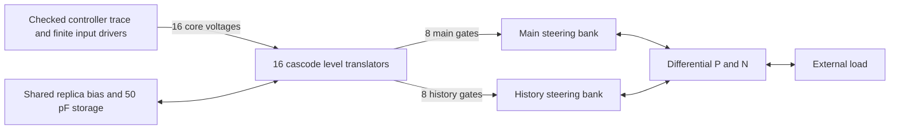

# Core controls to the PAM5 line driver

[`core_emphasized_pam5_driver`](core_transmit_driver.hpp) joins the registered
controller's sixteen independent 1.2 V unary controls to the weighted 3.3 V
main/history driver. It is an `IC` with inherited `Vdd`/`Vss`, an additional
`Vlogic` supply, four four-bit electrical control arrays and differential `P`/`N`
outputs. Each control is a wire carrying an achieved voltage.



The drawing groups devices for readability. The bias, gate, supply and output
connections all remain electrical nodes in one coupled circuit.

Each input has its own cascode level translator. Its restored output drives
one physical steering gate, including that gate's source/drain charge. Both
outputs of each translator retain their explicit capacitance even though only
one drives a steering device. Using sixteen independent translators preserves
the all-gates-low state used for disable, reset and invalid-code containment.
Eight complementary pairs would not represent that state.

All sixteen translators share one resistor/MOS replica bias and 50 pF of
explicit storage. They also share the actual logic and I/O supplies with the
output stage. Simultaneous changes therefore load the bias, rail impedances
and other translators. The capacitor is a physical component whose area and
layout remain to be implemented. The 600 pF output-current reference storage
is a separate component in the [weighted output stage](emphasized_driver.md).

The regression replays the separately qualified real `PAM5DriverControl` trace
through finite 50 Ohm, 0/1.2 V input sources. It retains every previous absolute
driver bound: all seventeen weighted levels, 20 mV plateau accuracy, output
gate rails, disabled current and finite supply operation. Additional checks
observe every low-voltage input, the shared translation bias and the finite
logic supply. Each solver must pass nominal, 80 Ohm, 120 Ohm and halved-step
cases; only then may their plateau voltages be compared within 10 mV.

The fixture sources represent the controller boundary. They are not a
transistor implementation of its output buffers, and the fixture's clock
does not prove a complete clock-distribution network. Both generic flows pass
all four cases, followed by waveform comparison. Maximum plateau error is
6.61 mV; cross-solver plateau departure is at most 7.55 µV. The reports are
`analog/build/1G/tests/results/core_transmit_driver/{cpp,veriloga}/checks.json`
and `comparison.json`. This qualifies the loaded generic bank's declared
contract, separately from process or layout qualification.

`tests/core_transmit_process.py` adds a separate complete-bank PSP experiment.
Its strict binder accepts the generated model's resistor/channel contribution
subset and preserves every branch and gate terminal. Explicit geometry tables
bind all 218 MOS devices; an unknown law, changed family count or changed
passive inventory fails before simulation. The 446 explicit host capacitors
remain connected, and PSP adds intrinsic charge. Every width is folded into
valid IHP fingers. NMOS bodies use ground; each PMOS well uses its actual
source supply. There is no generic channel or imposed high-voltage steering
gate left in the resulting SPICE deck. This nominal process experiment must
pass the same absolute bank and driver checker, without claiming identical
equations to the generic models. The nominal TT run passes: maximum plateau
error is 11.16 mV and the shared translation bias remains between 1.772 and
1.864 V. The report is
`analog/build/1G/IHPSG13G2/tests/results/core_transmit_nominal/checks.json`.
PVT, mismatch, analog layout and post-layout qualification remain open.

```sh
cmake --build analog/build --target check-1g-core-transmit-driver
```
