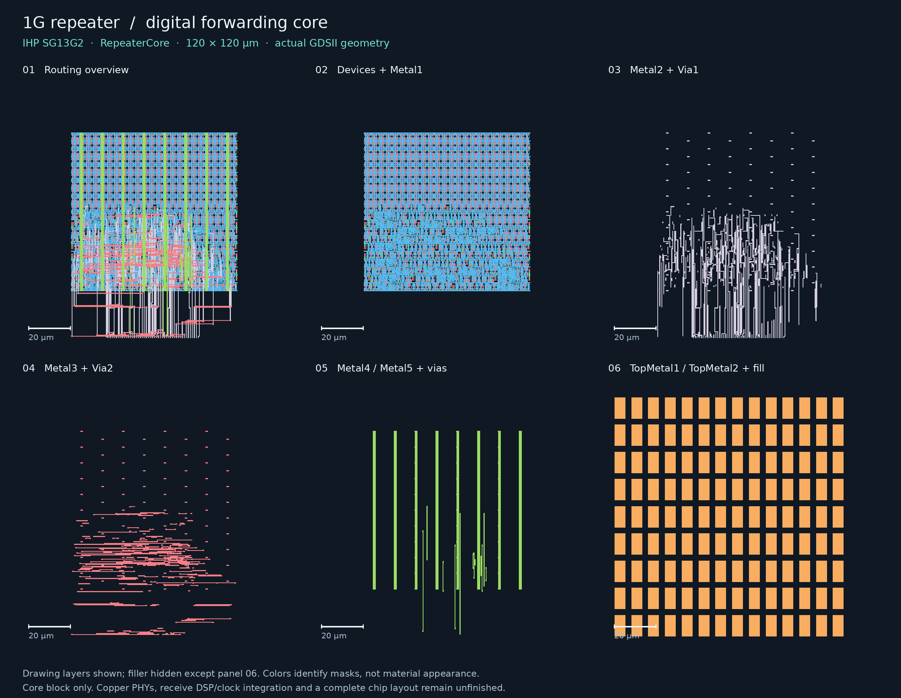
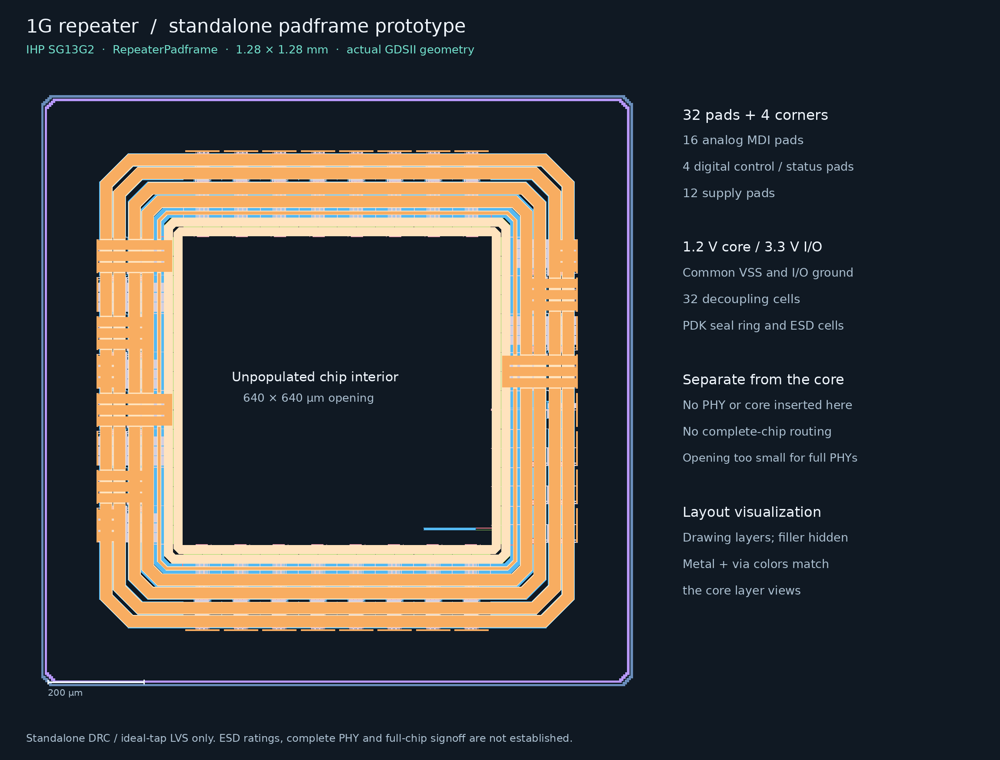
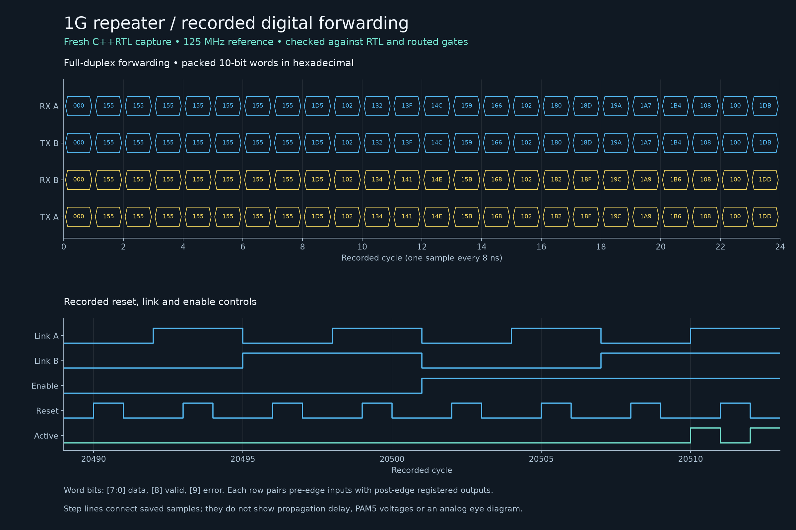
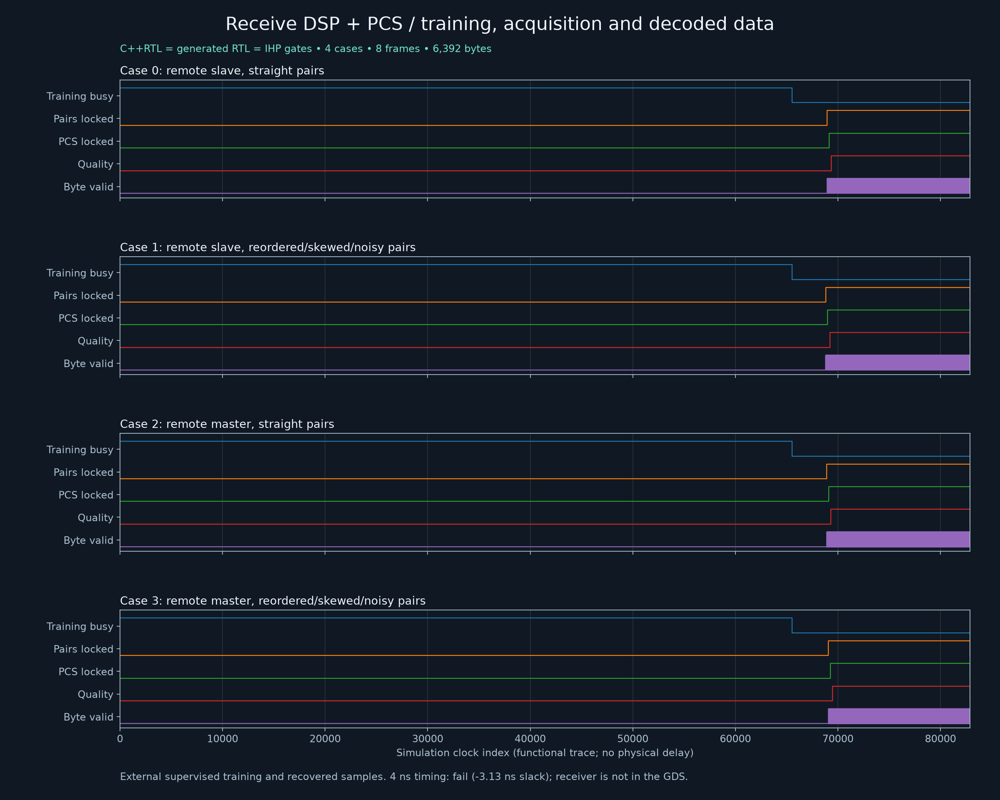

# 1G repeater ASIC development artifacts

This package contains newly regenerated IHP SG13G2 digital forwarding core and a
**separate, unpopulated padframe prototype**. These are real physical layouts.
**The integrated 1000BASE-T repeater ASIC is unfinished and is not released for
fabrication.** The core and padframe were rebuilt from the current sources,
with fresh standalone physical verification. The new receiver is committed as
source and generated RTL; it is not part of either GDS hierarchy.

Only the two final layouts, four images, provenance and the upstream license
are committed here. Build logs, raw traces and verification databases stay in
the ignored build directory. Images use actual KLayout geometry and checked
simulation samples.

## Files

| File | Content |
| --- | --- |
| [repeater_core.gds](repeater_core.gds) | Filled, routed `RepeaterCore`, 120 × 120 µm; 1 nm database unit |
| [repeater_padframe.gds.gz](repeater_padframe.gds.gz) | Losslessly compressed `RepeaterPadframe`, 1280 × 1280 µm; independent of the core |
| [core_layers.png](core_layers.png) | Six views of actual core masks, with scale bars |
| [padframe.png](padframe.png) | Actual padframe geometry and its unpopulated opening |
| [forwarding_waveforms.png](forwarding_waveforms.png) | Selected samples from the fresh digital forwarding capture |
| [receive_dsp_pcs.png](receive_dsp_pcs.png) | Receiver training, pair acquisition, PCS lock and byte-valid traces for all four functional cases |
| [provenance.json](provenance.json) | Artifact hashes, source/PDK revisions, dimensions, pinout, recorded verification summaries and limitations |
| [IHP-LICENSE.txt](IHP-LICENSE.txt) | Apache-2.0 license for the embedded IHP PDK geometry |

## Digital forwarding core



The C++RTL source is
[`RepeaterCore`](../../../pdk/1G_repeater_IHPSG13G2/repeater.hpp).
An external 125 MHz reference clocks both directions. Each input word contains
eight data bits, a valid bit and an error bit. The core registers A's received
word onto B's transmit interface and vice versa when both links and the enable
input are asserted. Reset or a lost link suppresses forwarding. Input streams
must already be aligned to the reference clock by the PHYs.

The block uses a nominal 1.2 V supply and contains 21 mapped state bits. Its
120 × 120 µm footprint is **0.0144 mm²**, not the area of a complete repeater.
It has no copper receivers, transmitters, pads, seal ring or integrated PHYs.

The masks are rendered with KLayout. Panels 01–05 show drawing-purpose geometry;
panel 06 also shows TopMetal1/TopMetal2 filler. Some upper layers serve only fill
in this core. Colors identify layers rather than physical material appearance.
Hidden layers and filler remain in the unchanged GDSII. The panel titles and
`visualization.palette` in the provenance identify the selected GDS layers.

## Standalone padframe



The common-ground padframe contains 32 pads, four corners, the PDK seal ring and
32 decoupling cells. Sixteen pads serve the planned two four-pair MDI ports;
four serve reference clock, reset, enable and active status; twelve are supply
pads. Core power is 1.2 V, I/O power is 3.3 V, and VSS/I/O ground are joined.
The package provenance records the individual placements and exposed ports.

The 640 × 640 µm central opening has no integrated forwarding core or PHYs.
This opening is too small for the complete receive hardware already estimated
in the project. The **1.6384 mm²** padframe footprint is a prototype dimension,
not a qualified full-chip die size. Its existing ESD structures do not establish
an HBM/CDM or system surge rating. The image hides filler to expose the ring;
the GDS retains it.

## Recorded digital behavior



The first panel displays the first 24 captured cycles as packed 10-bit hex
words. The second displays the final 24 cycles of the recorded control sequence.
The source capture contains 20,513 rows. Each row records inputs before a clock
edge and registered outputs after that same edge. Equal horizontal positions
therefore do not mean zero-delay combinational forwarding. Lines connect saved
samples; they do not represent measured propagation delay or analog voltage.
This is a digital core illustration, not a PAM5 waveform or eye diagram.

## Evidence and release boundary

The regenerated forwarding core passed native C++, generated RTL, mapped-gate
and routed-gate checks, full-deck KLayout DRC (zero violations) and deep
transistor LVS (48 top-level ports). Routed-RC setup/hold slack is
**+5.95388031 / +0.787586033 ns**. Timing uses nominal extracted routing with
slow/fast IHP cell corners; post-fill coupling and full-chip/package effects
were not extracted.

The newly assembled and filled padframe passed fresh full-deck KLayout DRC
(zero violations). Deep transistor LVS passes with 43 top-level ports using
the PDK's documented **ideal ohmic tap-contact model**, applied independently
to the schematic and layout. Default extracted-tap LVS failed with unmatched
circuits; that diagnostic receipt is retained in the provenance. The ideal
mode preserves non-tap devices and their parameters, but does not validate tap
area/perimeter parameters. This is the same model used by the earlier passing
padframe package; see [the tap-model explanation](../../../pdk/1G_repeater_IHPSG13G2/chip.md).
Neither standalone check verifies an integrated repeater.



The new [ReceiveDSP and ReceiveDSPPCS](../../receive_dsp.md) sources, generated
RTL, independent reference models and CTest tests accompany this package.
Native C++, generated RTL and IHP gate simulation each pass the same independent
checks and match exactly: four composed cases, eight frames and 6,392 bytes.
The image shows training, acquisition and decoded-data availability from the
checked trace. It does not assert an achieved clock frequency.

The receiver still fails the requested 4 ns cell-timing limit: DSP **−2.13 ns**,
DSP + PCS **−3.13 ns**. Its mapped cell area is **2.550 mm² per receive path**,
before routing and analog integration. External supervised training targets,
recovered-symbol samples and aligned local transmit references remain required.
The timing tests intentionally retain their failing constraint.

`provenance.json` records the fresh physical receipts, the existing receiver
functional/timing receipts with inputs rechecked, and hashes of the shipped
files. `source_base_commit` identifies the parent revision; the accompanying
source changes and exact input hashes identify the worktree used for generation.
This compact package is not a complete signoff archive.

A complete product still requires physical receive AFE/ADC/DSP implementation,
qualified continuous PCS/training and role negotiation, transmit-driver layout,
receive timing recovery and clock/reset/CDC integration, a suitably sized and
routed chip, full-chip extraction, and package/channel/interoperability and
physical qualification. See the project's
[implementation requirements](../../../pdk/1G_repeater_IHPSG13G2/requirements.md).

## Viewing

Open either layout in KLayout; the compressed GDS is directly readable:

```sh
klayout repeater_core.gds
klayout repeater_padframe.gds.gz
```

Select the named top cell and expand its hierarchy. If the IHP PDK is installed,
load `ihp-sg13g2/libs.tech/klayout/tech/sg13g2.lyp` for the full technology layer
palette. Alternatively, `gzip -dk repeater_padframe.gds.gz` creates an ordinary
GDS file. Neither viewing nor decompression runs verification.

The four PNGs can be viewed directly without the PDK or EDA tools. Their colors
are a simplified display palette; dimensions and shapes come from the GDS.

## Attribution

The GDS hierarchies embed standard-cell, I/O and seal-ring geometry from the
[IHP Open PDK](https://github.com/IHP-GmbH/IHP-Open-PDK), revision
`89d42ee6d2fd9b50b86a1aada6fee6673c3e6008`. Copyright IHP PDK Authors;
distributed under [Apache-2.0](IHP-LICENSE.txt). The custom circuit arrangement,
routing and package illustrations are cpphdl project work. The original PDK
cell geometry is preserved in the generated layouts.

## Reproducing this package

From `analog/`, with the local IHP PDK, toolchain and root converter installed:

```sh
python3 pdk/1G_repeater_IHPSG13G2/flow.py --target core --work build/asic-refresh/core
pdk/IHPSG13G2/.cpphdl/venv/bin/python pdk/1G_repeater_IHPSG13G2/padframe.py --common-ground --work build/asic-refresh/padframe
pdk/IHPSG13G2/.cpphdl/venv/bin/python pdk/1G_repeater_IHPSG13G2/fill_padframe.py --layout build/asic-refresh/padframe/repeater_padframe.gds --output build/asic-refresh/padframe/repeater_padframe_filled.gds --work build/asic-refresh/padframe/fill
pdk/IHPSG13G2/.cpphdl/venv/bin/python pdk/1G_repeater_IHPSG13G2/verify_physical.py --layout build/asic-refresh/padframe/repeater_padframe_filled.gds --netlist build/asic-refresh/padframe/lvs.cir --interface build/asic-refresh/padframe/interface.json --top RepeaterPadframe --work build/asic-refresh/padframe/verification
# The default extracted-tap LVS run above records a mismatch. Reuse its passing
# DRC only after the verification runner checks identical layout and rule hashes.
pdk/IHPSG13G2/.cpphdl/venv/bin/python pdk/1G_repeater_IHPSG13G2/verify_physical.py --layout build/asic-refresh/padframe/repeater_padframe_filled.gds --netlist build/asic-refresh/padframe/lvs.cir --interface build/asic-refresh/padframe/interface.json --top RepeaterPadframe --work build/asic-refresh/padframe/verification_ideal --ideal-tap-contacts --drc-evidence build/asic-refresh/padframe/verification/physical_checks.json
pdk/IHPSG13G2/.cpphdl/venv/bin/python pdk/1G_repeater_IHPSG13G2/package_results.py --work build/asic-refresh
```

The first command needs `verilator` on `PATH`. The final renderer needs KLayout,
Pillow and matplotlib in its Python environment (or on `PYTHONPATH`). It also
requires receiver functional, mapped-gate and timing receipts in
`build/1G/tests/hardware`; reproduce those with the CTests documented in
[receive_dsp.md](../../receive_dsp.md). Timing failures remain recorded failures.
The packager rejects changed verification inputs or layout bytes and does not
run tests itself. It replaces the artifacts in this directory only after its
input checks pass.
