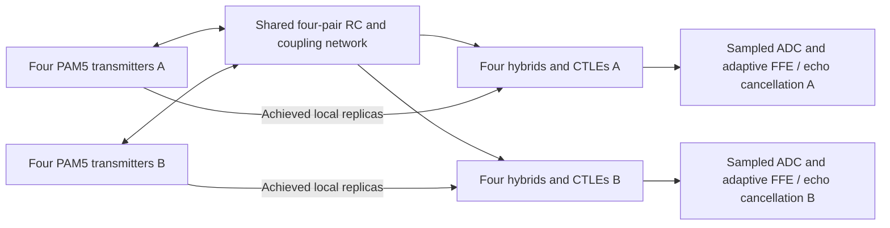

# 1000BASE-T PAM5 PHY development model

This is the `1G/` counterpart of the [10G prototype](../10G/README.md): reusable
electrical IC classes, generated Verilog-A, module tests and a coupled system
test. It develops the PAM5/PMA signal path for **four pairs at 125 MBd**, with
simultaneous transmission in both directions. It is not a complete interoperable
IEEE 802.3 Clause 40 PHY. [Requirements and coverage](requirements.md) identify
the implemented boundary precisely.

Generic modules are flat in this directory; their exports share `generated/`.
Process-specific modules, tests and exports live in
[IHPSG13G2/](IHPSG13G2/README.md). Main system regression is in [tests/](tests/README.md).
The [recorded validation](tests/validation.md) reports measured results and limitations.



The shared network and receive front ends run in each electrical simulator.
The sampled receiver consumes each simulation's resulting voltages separately.

| Source | Purpose |
| --- | --- |
| `parameters.hpp` | 125 MHz symbol clock, 8 ns UI, four pairs and voltage conventions |
| `mapping.hpp` | All 512 normal-data 4D constellation points from IEEE Tables 40-1/40-2; inverse mapping |
| `pam5.hpp` | Thermometer-code DAC and explicitly approximate four-threshold slicer |
| `symbol_memory.hpp` | Two-phase charge storage for the previous analog symbol |
| `transmitter.hpp` | Partial-response pulse filter, finite-impedance differential driver and composed transmitter |
| `channel.hpp` | Reciprocal loaded pair and four-pair network with coupling |
| `hybrid.hpp` | Local transmit-replica subtraction, with configurable balance error |
| `equalizer.hpp` | Passive lead network and finite-bandwidth gain stage |
| `dfe.hpp` | One postcursor tap using the receiver's own held PAM5 decisions |
| `phy.hpp` | Receive front end, one bidirectional pair, and four simultaneous bidirectional pairs |
| `adaptation.hpp` | Sampled ADC, joint receive FFE and adaptive local echo/coupling cancellation |
| `timing_recovery.hpp` | Sampled Gardner timing-loop reference |
| `receive_alignment.hpp` | Hardware GMII crossing from a recovered clock to the reference domain, with frame buffering and fault containment |
| `pcs.hpp` | Hardware normal/control symbol mapper and master/slave LFSRs; complete PCS state machines and trellis coding remain open |

All electrical modules derive from `IC`, declare member ports and define purposes
line by line in `_assign()`. They share actual nodes: changing another device's
load changes the solution. DSP reference classes operate on samples and are
identified separately; they are not hidden electrical primitives.

```cpp
#include <1G/phy.hpp>
using namespace analog;
using namespace analog::one_g;

simulation sim;
electrical vdd, vss, vcm, vref, clock;
sim.reference(vss);
vdd = sim_voltage_source(vss, voltage(3.3));
vcm = sim_voltage_source(vss, voltage(1.65));
vref = sim_voltage_source(vss, voltage(.6));
// The bench supplies a 1.2 V boundary clock and thermometer controls.
link cable_link;
cable_link.Vdd = vdd;
cable_link.Vss = vss;
cable_link.VCM = vcm;
cable_link.VREF = vref;
cable_link.CLOCK = clock;
// Connect A[pair][bit] and B[pair][bit] before elaborate().
// OUTA[pair] receives B; OUTB[pair] receives A, while both transmitters remain active.
```

Read [PAM5 and transmit shaping](pam5.md), [physical topology](phy.md),
[sampling and adaptation](adaptation.md), and [timing boundaries](timing.md)
before modifying an IC or interpreting a test result.

## Build and test

Use the existing [OpenVAF/ngspice toolchain](../VerilogA/toolchain.md):

```bash
cd ~/cpphdl
cmake -S analog -B analog/build -DCMAKE_BUILD_TYPE=Release \
    -DCPPHDL_ANALOG_VERILOGA_TESTS=ON \
    -DOPENVAF_EXECUTABLE="$PWD/analog/out/veriloga-toolchain/openvaf-compatible/openvaf" \
    -DNGSPICE_EXECUTABLE="$PWD/analog/out/veriloga-toolchain/install/bin/ngspice"
cmake --build analog/build --target generate-1g-veriloga -j 2
cmake --build analog/build --target check-1g -j 2
```

Each electrical case runs in native C++RTL and independently compiled
Verilog-A/ngspice. Both outputs pass the same absolute checker separately before
waveform and trained-coefficient comparison. The mixed system runs the same C++
sampled-DSP implementation separately on each solver's actual waveform.
This tests the analog-backend boundary; it does not claim a Verilog-A hardware
implementation of that sampled DSP. Pure DSP algorithms have separate unit tests.
The transient deck places unchanged capacitor laws in native SPICE stamps;
the reusable Verilog-A exports retain them. See [numerical conditions](timing.md).

The IHP-specific driver adds PSP-based transistor tests when the prepared PDK is
available. Its physical compact model differs from the generic square-law model,
so it passes the common output-level contract separately, without an invalid
same-equation solver-equivalence claim.

The [PCS hardware](pcs.md) and [receive clock alignment](receive_alignment.md)
also run in native C++, generated SystemVerilog and mapped IHP gates. Each
implementation passes the same absolute checks, followed by exact output-trace
comparison. Run them with `ctest --test-dir analog/build -L hardware
--output-on-failure -j 2` after building `analog_1g_alignment`, `analog_1g_pcs`
and `analog_1g_scrambler`. IHP gate simulation is enabled when the prepared
repeater toolchain and standard-cell library exist.

The new [MOS-biased drivers](IHPSG13G2/biased_driver.md) replace the ideal tail
bias with a resistor/diode MOS reference and optional six-bit PMOS-switched
resistor bank. Native and Verilog-A equations are compared; separate actual-PSP
tests cover nominal fixed bias and externally trimmed TT/SS/FF process corners.
These schematic blocks do not yet supply a layout-ready complete PHY macro.

## Primary references

- [IEEE Clause 40 machine-readable extracts](https://www.ieee802.org/3/publication/index.html),
  specifically [Table 40-1](https://www.ieee802.org/3/publication/ab/table40_1.txt)
  and [Table 40-2](https://www.ieee802.org/3/publication/ab/table40_2.txt): normal-data mapping facts in `mapping.hpp`.
- [IEEE 802.3ab development tutorial](https://www.ieee802.org/3/tutorial/march98/mick_170398.pdf):
  architecture and partial-response transmit filter. This is historical design
  material, not a substitute for the current normative standard.
- [TI Gigabit Ethernet design reference](https://www.ti.com/lit/ug/tidu832b/tidu832b.pdf):
  four-pair, 125 MBd PAM5 operation, isolation magnetics and differential termination.

Source material checked 2026-10-17. No waveform in this prototype is asserted to
meet a normative transmit template or the complete 100 m cable specification.
