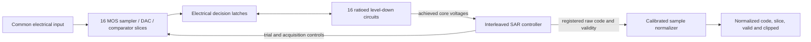

# Electrical ADC decisions to calibrated receive samples

[`SARADCCoreArray<Count>`](adc_core.hpp) extends the existing SAR array as an
`IC`. It inherits its input, clock, clear, trial-control and 3.3 V supply ports,
then adds `Vlogic` and one `CORE_DECISION` port per slice. Each retained 3.3 V
decision drives an actual [level-down circuit](../basic/level_down.md), powered
from the common core supply. Its input charge loads the comparator latch;
its output load and static current affect the shared core rail.

[`ADCReceiveController`](adc_receive.hpp) is the corresponding digital `Module`.
It composes sixteen SAR sequencers and the eight-stage sample normalizer.
There is no ideal analog comparison inside the controller.



The electrical fixture still supplies the evaluation clock and high-voltage
control buffers. Its native clock callback and paused ngspice server each read
their own solved `CORE_DECISION` voltages, using 0.36/0.84 V decision bounds.
They step the same C++RTL controller and return its actual control outputs.
The ideal input value is used only by the independent checker.

| Controller ports | Meaning |
| --- | --- |
| `enable_in`, `sample_enable_in` | Reset/disable flushing and per-clock conversion launch |
| `comparisons_in` | Sixteen resolved **core-domain** electrical decisions |
| `trial_out`, `acquire_out`, `convert_out` | Per-slice controls and decision-read windows |
| `data_out`, `slice_out`, `valid_out`, `fault_out` | Registered raw conversion stream and schedule fault |
| `offset_in`, `gain_in` | Zero-code offset and unsigned Q8.8 normalization gain |
| `normalized_out`, `normalized_slice_out`, `normalized_valid_out`, `clipped_out` | Calibrated stream with aligned slice identity |

An acquisition launched on edge n produces raw data on n+13. The child-to-child
register boundary and normalizer add eight clocks, delivering its normalized
result on n+21. Calibration is captured when that raw result enters the
normalizer, on n+14. It is a global programmable calibration interface;
per-slice calibration estimation is still needed. Output throughput is one
sample per 250 MHz clock after filling. Reset or disable flushes both stages;
invalid normalized outputs retain their preceding data with clipping clear.

The digital unit test independently synthesizes SAR decisions from held integer
inputs and computes normalization with real-valued scaling and `lround`.
Native, RTL and IHP gates pass the 12,000-cycle controller contract, including
11,742 calibrated conversions, changing calibration, saturation, launch gaps
and in-flight reset/disable. Valid-result selection uses a balanced four-group
network. The normalizer limits rounding carry propagation to nine bits and
selects precomputed upper-word alternatives when separating the integral and
fractional product. These changes preserve latency and exact output values.

Physical timing uses a 4 ns clock and a 160 fF load on all 160 trial,
acquisition and conversion control outputs. The latter is an interface design
budget: the existing 150-case IHP clock-translator sweep measures at most
140.525 fF of absolute input charge divided by input swing. The reproducible
[`input_charge.py`](IHPSG13G2/input_charge.py) checks source and artifact hashes
before integrating those traces. It characterizes that translator, rather
than qualifying a connected ADC control interface. Interconnect has a 250 fF
total budget; individual Liberty pin limits, 0.5 ns slew and fanout eight still
apply. Earlier routes used an inadequate 5 fF output load and cannot establish
this interface. The current loaded implementation uses a rotating one-hot launch register and
explicit output buffers. It passes exact postroute vectors, extracted setup
with +0.20 ns slack, hold with +0.06 ns, and all slew/capacitance/fanout limits.
Its footprint is 500 × 500 µm. The protected loaded route passes all 868 DRC
categories, including antenna and density, and strict transistor LVS with
234 ports, 45 matched circuits and 70,884 devices. Small hold-gate inputs get
local PDK protection diodes because global-route estimates missed a long
comparison-input antenna after detailed routing. The resulting setup/hold
slacks are +0.20/+0.06 ns, with 6,597 extracted routed nets. This
standalone controller area excludes analog circuitry and the rest of the PHY.

The separate electrical tests cover one slice, four slices and two consecutive
bursts across sixteen slices. Each solver must independently pass the original
ADC accuracy, hold and supply checks, plus core voltage delivery, normalized
sample identity, cadence and four-count constellation accuracy. Cross-solver
comparison then allows one raw ADC count or two normalized counts. These
one-slice, four-slice and repeated sixteen-slice integrations passed all nine
native/Verilog-A/comparison checks with balanced selection and the preceding
rounding expression. The latest carry-select expression passes the standalone native, RTL and
mapped tests; complete electrical regression remains required for that revision.

```sh
cmake --build analog/build --target analog_1g_adc_receive analog_1g_adc_core
ctest --test-dir analog/build --output-on-failure -R 'analog.1g.adc_receive\.'
ctest --test-dir analog/build --output-on-failure -R 'analog.1g.adc_core_'
```

The connected clock, physical high-voltage control buffers, receive filtering,
recovered-clock actuation and complete four-pair PHY remain separate integration
steps. The generic electrical result and standalone PSP voltage-interface
sweep do not establish an IHP ADC macro or a complete PHY layout.
