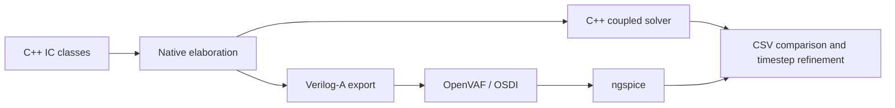

# C++HDL analog to Verilog-A

The root command `cpphdl --verilog-a` converts a C++ class derived from
`analog::IC` into an electrical Verilog-A module. The backend lives here;
[VerilogA.h](../../VerilogA.h) is its root driver interface and
[cpphdl_veriloga.h](../../include/cpphdl_veriloga.h) its public C++ export header.
The standalone `cpphdl-veriloga` command uses the same driver and requires no LLVM.

For large ICs, [partitioned compilation](hierarchy.md) preserves the connected
equations while compiling repeated component models separately.

The checked-in catalogs are [basic/generated](../basic/generated/README.md) and
[examples/generated](../examples/generated/README.md): reusable basic circuits,
example IC classes, complete analog benches and a bounded mixed-signal analog
partition. From the package root:

```bash
cmake --build analog/build --target generate-veriloga -j 4
ctest --test-dir analog/build -R 'analog.veriloga.generated' --output-on-failure
```

The generator elaborates the original classes and testbenches; it does not maintain
a second hand-written circuit description. The freshness test regenerates into a
temporary directory and compares every model and bench input. With OpenVAF enabled,
the compile test also compiles every catalog module. Generated simulation results and OSDI
binaries remain ignored. The pure digital pipeline and diagnostic suite have
documented export limits instead of placeholder Verilog-A models.

Verilog-A describes continuous electrical branch relations. Its contribution
operator `<+` adds voltage or current relations to the simulator's equation system;
it does not perform a procedural wire assignment. Capacitor current uses `ddt`.
This matches the C++HDL purpose declarations: connected devices coexist and can
alter each other's behavior. See the official
[Verilog-AMS language standard](https://www.accellera.org/downloads/standards/v-ams).

## Convert an IC

From the package root:

```bash
cmake -S analog -B analog/build -DCMAKE_BUILD_TYPE=Release
cmake --build analog/build --target cpphdl-veriloga
./analog/build/VerilogA/cpphdl-veriloga analog/VerilogA/examples/inverter.hpp \
  --top circuits::Inverter --ports Vdd,Vss,A,Y --module Inverter \
  --output analog/out/Inverter.va
```

With the normal package build:

```bash
cmake --build build --target cpphdl
./build/cpphdl --verilog-a analog/basic/ldo.hpp \
  --top analog::ldo --ports Vdd,Vss,REF,OUT --module LDO \
  --output analog/out/LDO.va
./build/cpphdl --verilog-a --help
```

`--top` accepts a qualified class or template specialization. `--ports` lists its
electrical member ports, including inherited supply ports. These names are checked
by the C++ compiler; a bit port or missing member is an error. The current IC API
does not reflect member names, so the external interface is explicit. No regular
expression parser infers circuitry from source text.

The driver compiles and executes a temporary native elaboration harness. It
constructs the selected IC, optionally calls `--configure qualified_function` with
that instance, then calls `elaborate()`. The configure function comes from the
source and may set model parameters before elaboration. `--cxx` selects a compiler;
arguments after `--` are passed as separate compiler arguments. Source and flags
are ordinary trusted native C++. No shell evaluates them. The driver currently
runs on POSIX systems; the C++ export API does not require POSIX process handling.

The commented [inverter class](examples/inverter.hpp) and
[direct export example](examples/export.cpp) demonstrate the native API:

```cpp
#include <cpphdl_veriloga.h>

analog::simulation context;
MyIC component;
component.elaborate();
analog::verilog_a::write_module(component, "MyIC.va", "MyIC",
    {{"Vdd", component.Vdd}, {"Vss", component.Vss},
     {"IN", component.IN}, {"OUT", component.OUT}});
```

Use a dedicated context containing the IC and its children. The exporter writes
all physical relations in that context, including any external loads declared
there. A bench voltage source in this context is rejected. A simulation reference
used by the network must be exposed as an explicit port; reusable IC rails normally
remain ordinary ungrounded ports until the host testbench connects them.

## Lowering contract

C++ elaboration resolves templates, configuration choices and nested classes.
Wire aliases become common electrical nodes. The backend flattens the resulting
network into one Verilog-A module, retaining component names and source locations
as comments. It does not synthesize a new circuit or replace feedback with an
ideal transfer function. OpenVAF can then compile this flat module without
requiring structural hierarchy support.

| C++ relation | Generated relation |
|---|---|
| `resistor(a, R)` | `I(a, b) <+ V(a, b) / R;` |
| `capacitor(b, C, initial)` | `I(a, b) <+ C * ddt(V(a, b));` plus documented bench initial voltage |
| `nmos`, `pmos` | Square-law channel current contribution, including polarity and reverse conduction |
| Aliased external ports | Zero-voltage branch joining the ports; no direction is imposed |
| Nested IC | Its transistor/passive relations enter the same flat network |

Quantities become SI numeric literals with 17 significant digits. The MOS law
preserves cutoff, triode and saturation behavior from the framework. It has no
body terminal, intrinsic charge, leakage or temperature dependence. The exporter
has a separately written Verilog-A channel function; it never calls the C++ solver.
Twelve MOS-region/direction/polarity cases compare its behavior independently.

A reusable IC export rejects `sim_voltage_source`, `sim_driver`,
`sim_controlled_resistor`, managed bit operations and native digital callbacks.
They cannot silently become physical hardware. The experiment API below explicitly
supports the first three simulation models and directly declared bit stimuli;
it still rejects digital computations and analog-to-bit sensing. This is
Verilog-A export, not a Verilog-AMS digital simulator.

Two opt-in APIs support the catalog without weakening this default:
`render_simulation_model` accepts controlled-resistor IC approximations, marks
their fidelity in the output, and rejects ideal sources and bit drivers.
`render_analog_partition` explicitly exports only a mixed bench's electrical
relations. Both terminals of every omitted bench source must be external ports;
each `sim_driver` control becomes a `cpphdl_bit<ID>` electrical input driven at
0/1 V relative to host ground. Its generated header declares that sensing,
registers and digital computations remain in the host. This partition cannot be
used as the complete mixed receiver. Full IC/experiment export still rejects such
digital operations.

Initial capacitor voltage is an **analysis condition**, not a permanent constraint
in the generated current law. Reusable modules record it in comments for the host
bench. To transfer those initial conditions automatically, use an experiment bundle,
which exposes the internal nodes and emits SPICE UIC conditions. Do not assume a
host DC operating-point calculation reproduces the C++ initial-charge experiment.

## Independent simulation and common outputs

[OpenVAF](https://openvaf.github.io/docs/getting-started/usage/) compiles `.va`
into an OSDI shared model library. [Ngspice's OSDI interface](https://ngspice.sourceforge.io/osdi.html)
loads that model; a SPICE deck supplies stimulus, initial conditions and analysis.
The regression tests compile and simulate the actual generated Verilog-A. They do
not replace it with native SPICE transistor models or a second C++ implementation.



For a bench with electrical observations declared before integration:

```cpp
#include <VerilogA/experiment.hpp>

analog::verilog_a::write_experiment(sim, "results",
    {stop, cpp_step, maximum_spice_step});
sim.run(stop, cpp_step);
sim.write("results/cpp");
```

`write_experiment` validates supported laws before writing its bundle. It emits:

| File | Meaning |
|---|---|
| `design.va` | Physical relations and explicitly identified simulation driver/control paths |
| `bench.cir` | OSDI instance, source stimuli, initial voltages, observations and transient analysis |
| `columns.csv` | Native observation names in their exact column order |
| `conditions.json` | Stop time, native/output step, SPICE maximum step, finite driver edge and initialization policy |
| `cpp/trace.csv` | Native time in seconds and observed voltages in volts |
| `spice.dat` | ngspice's independently integrated sample times and voltages |
| `spice.csv` | The same data normalized to the native CSV column names and SI units |
| `difference.csv` | Native fine samples minus interpolated SPICE values, at native timestamps |
| `comparison.json` | Quantitative errors, refinement checks, sample counts and evidence limits |

Run a bundle manually from its directory:

```bash
openvaf design.va -o design.osdi
ngspice -n -b bench.cir
```

Use an ngspice build with OSDI enabled. `-n` avoids user initialization files that
could change settings or disable OSDI. The generated deck uses `pre_osdi` before
netlist resolution. OSDI model instances use the `N` prefix. Ngspice integrates
with adaptive second-order Gear and tighter steps; C++ retains fixed-step backward
Euler and finite-difference Newton. These are independent numerical paths.

Initial source/capacitor differences form a voltage-constraint graph. Known source
voltages anchor it; a free initial common mode is seeded at zero. The seed is not
an extra circuit source: declared capacitor differences are the physical state.
Conflicting voltage constraints are rejected. Host initial conditions use `.ic`
and `tran ... uic`, preserving the intended charge rather than running a DC bias
solve first. SPICE's first sample is positive; comparisons do not invent a t=0 value.

Voltage steps use duplicate-time SPICE PWL points. Ngspice 47 accepts them with a
non-increasing-time warning; both entries explicitly describe the discontinuity.
Clock-driven `sim_driver` uses SPICE PULSE with a finite rise/fall time recorded in
`conditions.json`, much shorter than either requested integration step. This is an
explicit approximation to the native ideal clock edge. Loop comparisons measure
frequency, phase, peaks and control/detector windows rather than demanding identical
samples at a discontinuity.

## Run regressions

The exporter and CLI tests run without an external simulator. Cross-simulator tests
need OpenVAF, OSDI-enabled ngspice and Python 3 (standard library only):

```bash
cmake -S analog -B analog/build -DCMAKE_BUILD_TYPE=Release \
  -DCPPHDL_ANALOG_VERILOGA_TESTS=ON \
  -DOPENVAF_EXECUTABLE=/absolute/path/to/openvaf \
  -DNGSPICE_EXECUTABLE=/absolute/path/to/ngspice
cmake --build analog/build -j 4
ctest --test-dir analog/build --output-on-failure -L veriloga -j 3
```

The normal package build accepts the same options and exposes the same tests,
including a root `cpphdl --verilog-a` command test. `check-veriloga` builds its
executables and runs this group; `check-analog` includes it in the complete analog
suite. `CPPHDL_ANALOG_VERILOGA_TESTS=AUTO` is the default: missing external tools
are reported during configuration and independent simulation tests are not
registered. `ON` requires them and fails configuration if missing; `OFF` retains
exporter/CLI tests only. No network download occurs during normal builds or tests.

Each circuit runs at native h and h/2 against the same independently simulated
network. Comparisons check both absolute error and reduction under refinement,
with a numerical floor for already converged values. Passive RC also checks the
analytic exponential. The resistor fault-injection test doubles R only in the
emitted Verilog-A: compilation/simulation must succeed and the comparison must
report a quantitative failure. A simulator crash or missing trace cannot count as
successful detection. Outputs live below `build/VerilogA/results/` for standalone
builds and `build/analog/VerilogA/results/` for package builds.

See [tests and numerical limits](tests/README.md) and
[toolchain setup and primary references](toolchain.md).
The [continuous-window and trace-storage helpers](time-grid.md) preserve circuit
state and complete waveform samples while bounding integration gaps and disk use.

Agreement validates the selected equations and trajectories within measured bounds.
It cannot prove every topology, the physical accuracy of the square-law MOS model,
or all C++ elaboration: both paths share the elaborated connectivity. BSIM is not
substituted in these equivalence tests because that would change the device law.

## 10G SFP+ experiments

[10G/](../10G/README.md) adds 15 reusable modules and per-module/system electrical
experiments. These use explicit simulation approximations for buffered storage and
muxes. The API `render_simulation_model` records that choice; strict physical export
continues to reject those `sim_` devices. The experiment generator uses the same
elaborated IC topology as the native solver, then compiles and simulates the emitted
Verilog-A independently. [10G test documentation](../10G/tests/README.md) lists the
absolute checks, comparison tolerances and numerical settings.

`transient::spice_capacitance_threshold` is an explicit experiment option: a
positive threshold places capacitors at or above that value in the SPICE deck,
omitting their duplicate Verilog-A contributions. Zero (the default) leaves all
capacitors in Verilog-A. This preserves the linear law and initial charge while
using ngspice's native capacitor implementation for numerically stiff mixed-scale
experiments. The 10G integrated SFI link uses it for its two 100 nF DC blocks; its
standalone SFI tests retain complete Verilog-A. Reusable exports are unaffected.
