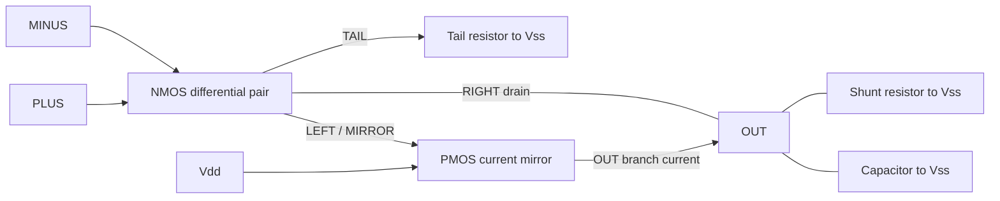

# Basic circuit schemas

Each basic IC also has a checked-in [generated Verilog-A module](generated/README.md).
The C++ class is its source; `generate-veriloga` regenerates the catalog and CTest
checks freshness and, when OpenVAF is enabled, compilation.

These are reusable C++ circuit definitions. Each schema derives from `IC`, inherits
its own Vdd/Vss member ports, declares additional ports, and adds device purposes in
`_assign()`. Configure parameters, bind ports, then call `elaborate()`. All connected
devices enter one physical equation system. The inverter, op-amp and regulator have no special
solver equations or hidden behavioral state.

Include `<basic/basic.hpp>` for the library, or an individual `<basic/name.hpp>`.
CMake's `analog` target exposes both required include roots. For direct compilation
use `-Iinclude -I. -I../include` from `analog/`. All classes are in namespace `analog`;
unit literals are in `analog::literals`.

| Header / class | Ports beyond Vdd/Vss | Devices and intended purpose |
|---|---|---|
| [inverter.hpp](inverter.hpp), `cmos<Model>` | A, Y | Two complementary MOS purposes enable and disable Y; a selectable fast policy approximates the channels |
| [level_inverter.hpp](level_inverter.hpp), `level_inverter` | A, Y | Two complementary voltage-controlled resistor paths approximate finite inverter drive |
| [level_shifter.hpp](level_shifter.hpp), `level_shifter` | Vlogic, A, Y, Y_N | Ten-MOS interface from low-voltage logic to the inherited high-voltage supply; finite loading and cross-coupled restoration |
| [level_down.hpp](level_down.hpp), `level_down` | A, Y | [Ratioed high-voltage input and core inverter](level_down.md); inherited supply is the core rail, and input charge/static current remain physical |
| [differential_source_follower.hpp](differential_source_follower.hpp), `differential_source_follower` | PLUS, MINUS, OUTP, OUTN | Two biased MOS followers lower common mode; [shared-supply loading, charge and tests](differential_source_follower.md) |
| [phase_frequency_detector.hpp](phase_frequency_detector.hpp), `cmos_phase_frequency_detector` | REF, FEEDBACK, CLEAR, UP, UP_N, DOWN, DOWN_N | Two MOS flip-flops and a finite common reset path; [operation and tests](phase_frequency_detector.md) |
| [cascoded_level_shifter.hpp](cascoded_level_shifter.hpp), `level_shift_bias`, `cascoded_level_shifter` | Vlogic, BIAS; translator A, Y, Y_N | [Replica-biased cascodes](cascoded_level_shifter.md) translate low input swings; explicit gate charge loads the shared bias |
| [rc_filter.hpp](rc_filter.hpp), `rc_filter` | IN, OUT | Series resistor delivers input; a capacitor opposes rapid output changes |
| [resistor_divider.hpp](resistor_divider.hpp), `resistor_divider` | TOP, BOTTOM, TAP | Two resistors establish a loaded fraction of the terminal difference |
| [nmos_differential_pair.hpp](nmos_differential_pair.hpp), `nmos_differential_pair` | PLUS, MINUS, LEFT, RIGHT, TAIL | Two NMOS devices steer the shared tail current between drain branches |
| [nmos_resistor_amplifier.hpp](nmos_resistor_amplifier.hpp), `nmos_resistor_amplifier` | PLUS, MINUS, OUTP, OUTN | Source degeneration and load resistors give differential gain; explicit gate/output charge couples input loading and bandwidth |
| [strongarm_comparator.hpp](strongarm_comparator.hpp), `strongarm_comparator` | PLUS, MINUS, CLOCK, OUTP, OUTN | Eleven MOS devices precharge then regenerate a differential decision; [operation and tests](../1G/comparator.md) |
| [mos_track_hold.hpp](mos_track_hold.hpp), `mos_track_hold` | IN, CLOCK, OUT | CMOS transmission gate, clock inverter, half-width dummy switches and a real hold capacitor; input loading and held-node disturbances remain electrical |
| [mos_r2r_dac.hpp](mos_r2r_dac.hpp), `mos_r2r_dac` | BIT_N[8], OUT | Eight complementary MOS rail drivers feed an R/2R resistor ladder; finite output resistance preserves loading |
| [pmos_current_mirror.hpp](pmos_current_mirror.hpp), `pmos_current_mirror` | IN, OUT | A diode-connected PMOS establishes the gate voltage of a matched sourcing PMOS |
| [opamp.hpp](opamp.hpp), `opamp` | PLUS, MINUS, OUT | Differential pair and mirror provide differential gain; explicit resistors and capacitor set bias and dynamics |
| [non_inverting_amplifier.hpp](non_inverting_amplifier.hpp), `non_inverting_amplifier` | IN, OUT | An op-amp and divider intend a closed-loop gain of `1 + upper / lower` |
| [ldo.hpp](ldo.hpp), `ldo` | REF, OUT | PMOS pass channel plus divider and transistor error amplifier request an output/reference ratio |
| [cmos_logic.hpp](cmos_logic.hpp), `cmos_nand`, `cmos_xor` | A, B, Y | MOS gate networks with explicit output charge and weak return paths |
| [cmos_storage.hpp](cmos_storage.hpp), `cmos_d_latch`, `cmos_dff`, `cmos_divide2` | D/ENABLE or CLOCK, CLEAR, Q/Q_N | [MOS storage, rising-edge transfer and electrical divide-by-two feedback](cmos_storage.md) |
| [ring_vco.hpp](ring_vco.hpp), `current_starved_inverter`, `ring_vco` | CONTROL, OUT (stage also A, Y) | Three charge-storing inverter stages form a voltage-controlled oscillator |
| [pll.hpp](pll.hpp), `lead_lag_filter`, `pll` | IN/OUT or REF/OUT | Passive filter and transistor phase comparison correct physical oscillator timing |
| [agc.hpp](agc.hpp), `agc` and its constituent classes | IN, OUT, BIAS, REF | MOS attenuation, amplifier, peak detector and error integrator correct positive output peaks |
| [regulator.hpp](regulator.hpp), `regulator` | REF, OUT | A pass PMOS supplies the output; an op-amp corrects its gate using output/reference feedback |

Pass ports directly to primitive/model calls: `pmos(A, Vdd)` or
`sim_controlled_resistor(Vdd, A, Vss, R, low, high)`. A port inherits its underlying
wire or signal type; no getter call is required. Analog binding retains the node
identity, and digital templates preserve width deduction.

Ports are bidirectional connections. Child rails connect explicitly to parent rails;
unused rails do not introduce equations. Parameter changes apply during declaration,
before elaboration. They are not runtime knob changes. Circuit voltages and stored
charge continue evolving during the simulation.

## Level inverter topology and purposes

[level_inverter.hpp](level_inverter.hpp) defines the fast approximation as an IC
with A/Y member ports and inherited Vdd/Vss. Its `_assign()` declares:

```cpp
Y = sim_controlled_resistor(Vdd, A, Vss, drive_resistance, low, high, control_response::falling);
Vss = sim_controlled_resistor(Y, A, Vss, drive_resistance, low, high, control_response::rising);
```

The first path supplies Y from Vdd at low input; the second pulls Y toward Vss at
high input. Both are present throughout simulation. The parameters default to
2 kOhm on resistance and a [0.35 V, 0.85 V] control window relative to Vss.
The window interpolates conductance; it does not interpret A as a discrete bit.
No storage is hidden in this schema. Output capacitance comes from connected
components, as in [model variants example](../examples/class_variants/README.md).

The framework's `sim_controlled_resistor` is an elementary, bidirectional path with
a separate control/reference voltage. It returns its other path terminal, like
`resistor`. Its general law is:

```text
f = clamp((Vcontrol - Vreference - low) / (high - low), 0, 1)
G = f / Ron          for a rising response
G = (1 - f) / Ron    for a falling response
I(a -> b) = G * (Va - Vb)
```

The control terminals draw no current in this ideal approximation. An off path
has zero conductance; an isolated node can therefore be indeterminate. Both
control terminals remain part of the solve, including a nonzero/moving reference.
The model can be used independently for a voltage-controlled load or switch;
it has no inverter-specific rail names or topology.

For the two complementary paths, their total conductance is `1 / Ron`. An
unloaded output approaches `Vss + (1 - f) * (Vdd - Vss)`. An external load changes
that equilibrium. For example, a load equal to Ron tied to Vss halves the output
relative to Vss. Current can also flow backward through either path if an external
source drives Y. No output clamp forces the intended voltage.

`cmos<fast_model>` constructs a `level_inverter` child, binds its ports and model
parameters, and elaborates it. The simulation retains that child's device
relations and metadata after its local C++ declaration handle leaves scope.
`cmos<channel_model>` uses PMOS/NMOS laws instead. This is an explicit model-detail
choice, with no claim that the approximation is a validated transistor response
or that two paths are universally faster than the channel model.

## Op-amp topology and purposes

This is a single-stage operational transconductance amplifier (OTA), usable as a
basic op-amp in feedback. It has four MOS devices. It has no separate output buffer.



The PLUS transistor drains at MIRROR. The MINUS transistor drains at OUT. Their
sources join TAIL. A resistor returns TAIL to Vss, so the bias current depends on
input common mode. The PMOS mirror sources both drain branches from Vdd.

Increasing PLUS relative to MINUS increases left-branch current. The mirror then
supplies more current to OUT while the MINUS branch sinks less. OUT rises until
its capacitor, shunt, external load and feedback reach a consistent trajectory.
The opposite differential input reduces OUT. Feedback polarity follows from this
connection graph, not from a named op-amp formula.

The mirror also includes a 1 GOhm resistor from IN to Vdd. With an ideal cutoff MOS
law, its input would otherwise be indeterminate when the input branch is off. The
resistor establishes the off-state voltage and contributes its actual current to
KCL. The output shunt similarly gives finite gain without a hidden leakage term.

| Op-amp parameter | Default | Effect |
|---|---|---|
| `input.model` | beta = 200 mA/V², threshold = 0.35 V | NMOS pair current and transconductance |
| `load.model` | beta = 200 mA/V², threshold = 0.35 V | PMOS mirror current and compliance |
| `tail_resistance` | 10 Ohm | Common-mode-dependent bias return |
| `load.bias_return` | 1 GOhm | Defines the mirror's off-state gate voltage |
| `output_shunt` | 100 kOhm | Explicit load to Vss, bounding unloaded gain |
| `compensation` | 10 nF | Explicit output charge storage and dynamics |
| `initial_output` | 0 V relative to Vss | Initial voltage across the compensation capacitor |

The large educational MOS strengths and small tail resistance produce substantial
bias current: around 2.9 mA near 0.5 V common mode and 40 mA near 1.2 V common mode.
They are not specifications for a low-power physical amplifier. Bias and pass current
both load the supply wire. Gain, settling, swing and available output current change
with bias, supply impedance, device parameters and external load. There is no
`gain = 1000` or `tau = 1_ms` parameter to force an amplifier response.

For an operating point where all four devices are saturated and both input devices
conduct, let `P = V(PLUS, Vss)`, `N = V(MINUS, Vss)`, `S = V(TAIL, Vss)`:

```text
Ileft  = beta_n / 2 * (P - S - Vtn)^2
Iright = beta_n / 2 * (N - S - Vtn)^2
S / Rtail = Ileft + Iright
Ileft = Imirror + (Vdd - Vmirror) / Rbias_return
Cout * dVout/dt = Imirror - Iright - Vout / Rshunt - Iexternal
```

These are consequences of the connections and framework terminal laws. Outside that
region the normal MOS triode, cutoff or reverse-channel law applies. The framework
assembles the corresponding KCL automatically. Startup clamps only the declared
capacitor voltage; other node voltages and capacitor branch current are solved.

## Compose and use

For a gain-two stage, the [non-inverting amplifier](non_inverting_amplifier.hpp)
binds the divider's TOP to OUT, BOTTOM to Vss, and TAP to the op-amp MINUS port.
The external input connects to PLUS. Divider resistors default to 10 kOhm each.
Both resistors load OUT, and the amplifier still needs differential input error to
supply that current. [Feedback example](../examples/opamp_feedback/README.md) includes
an external 100 kOhm load and reaches about 0.994192 V from a 0.5 V input.

The [regulator](regulator.hpp) connects OUT to a pass PMOS drain and to the error
amplifier PLUS port. REF connects to MINUS. The amplifier OUT connects to CONTROL,
the pass gate. An excess output raises the gate and reduces pass current. The
reference source, load and output capacitor are external to the regulator.

```cpp
#include <basic/regulator.hpp>

using namespace analog;
using namespace analog::literals;

int main() {
    simulation sim;
    electrical VIN, REF, Vss;
    sim.reference(Vss);
    VIN = sim_voltage_source(Vss, 3.3_V);
    REF = sim_voltage_source(Vss, 1.2_V);
    capacitance OUT(100_nF, Vss);

    regulator supply;
    supply.Vdd = VIN;
    supply.Vss = Vss;
    supply.REF = REF;
    supply.OUT = OUT;
    supply.elaborate();

    Vss = resistor(OUT, 100_Ohm); // Competing load demand.
    sim.run(500_us, 500_ns);
}
```

A regulator expands into five MOS devices, three resistors and one capacitor; the
experiment adds its own sources, output capacitor and load. No class boundary
separates these equations. [Regulator example](../examples/regulator/README.md) exposes
VIN, REF, OUT, CONTROL and TAIL traces, including startup overshoot and supply steps.

`rc_filter` defaults to 1 kOhm and 1 nF. `resistor_divider` defaults to 10 kOhm on
each side. The `cmos<channel_model>` inverter uses beta = 1 mA/V² and threshold =
0.35 V; `cmos<fast_model>` selects the documented finite-conductance approximation.
The differential pair leaves its drains and tail externally accessible. The current
mirror supplies equal channel currents only while its matched devices have suitable
terminal voltages; loading and the weak return path remain visible. These contracts
are physical operating conditions, not C++ type guarantees.

## Numerical and physical limits

This amplifier is not rail-to-rail. The NMOS pair needs input headroom to conduct;
the mirror needs voltage compliance. Large differential inputs steer or shut off
branches. The tail resistor is not a constant-current bias source. No protection,
soft start, body diodes, intrinsic MOS capacitances, channel-length modulation,
noise, thermal limits or damage models are provided. Explicit capacitors describe
selected storage only. This is a documented prototype topology, not a validated
fabricated op-amp or regulator.

The fixed-step Newton/backward-Euler engine checks sampled trajectories. The ideal
supply examples run with 100 ns (amplifier) and 500 ns (regulator) steps. The supply
impedance semantic test uses a 50 ns step to resolve coupled supply/bias startup;
a 500 ns step fails Newton convergence for that experiment. Better initial voltage
guesses do not replace step selection or establish trajectory accuracy. Optional convergence-driven step bisection is available through
`simulation::minimum_step`; it retries a failed Newton step, with no local-error
estimate. The default retains fixed steps and explicit convergence failure. Passing a final voltage constraint does
not establish a startup bound or all-load stability.

Separate parallel ideal capacitors currently produce redundant voltage constraints
during initialization or charge-holding solves and can report E_SINGULAR even when
their initial voltages agree. Represent identical-voltage parallel storage as one
capacitor with summed capacitance, or model the actual series impedances. The PLL
load experiment uses a resistive load and does not exercise this unsupported case.

## Verification and reproducible results

From the `analog/` directory:

```bash
cmake -S . -B build -DCMAKE_BUILD_TYPE=Release
cmake --build build -j 4
ctest --test-dir build --output-on-failure
```

The semantic checks cover independent differential-pair/output KCL, loaded divider
ratio, RC equivalence, finite amplifier drive, regulator overload, and supply KCL
including amplifier bias and shunt currents. Commented sources remain under
[examples/](../examples/). Running an example generates equations, CSV traces and
reports in its requested output directory. CTest checks each example's exit code
and report status, including deliberately unsuccessful physical requirements.

## Feedback examples

[`nmos_source_follower`](nmos_source_follower.md) provides a MOS output buffer
with resistor bias and explicit input/output charge. Its native and Verilog-A
tests independently check delivery and overload, then compare trajectories.
The explicitly sized IHP PSP counterpart passes 90 PVT/load cases. Connected
amplifier/ADC performance requires its own integration check.

The [LDO](../examples/ldo/README.md), [PLL](../examples/pll/README.md) and
[AGC](../examples/agc/README.md) document their complete hierarchies, physical
relations, initial conditions, model parameters and measured operating limits.
Their CTest scenarios include supply/load changes, oscillator loading, insufficient
headroom and insufficient input amplitude. Coarse/fine trajectory comparisons check
settled voltage, frequency/phase and positive peaks/detector/control respectively.

The PLL uses explicit asymmetric ring charge; the AGC begins from documented
biased capacitor states. These are declared experiment conditions, not proofs of
cold startup. No class adds a regulator, oscillator or gain-control equation to the
solver: every correction comes from the constituent MOS/resistor/capacitor relations.

## Reusable stages for high-speed experiments

The [10G SFP+ prototype](../10G/README.md) adds these basic IC definitions:

| Class / header | Purpose and selected fidelity |
|---|---|
| `gm_stage`, `limiting_amplifier` / [gm_stage.hpp](gm_stage.hpp) | VCCS, output R/C and optional explicit piecewise-linear diode rail clamps |
| `bridge_rectifier` / [bridge_rectifier.hpp](bridge_rectifier.hpp) | Four diode paths and an explicit load, including common-mode return |
| `sim_sample_hold`, `sim_dff`, `sim_mux2` / [sim_clocked_storage.hpp](sim_clocked_storage.hpp) | Buffered finite-conductance tracking, explicit capacitor state and nonoverlapping control windows |
| `sim_xor` / [sim_xor.hpp](sim_xor.hpp) | Finite-bandwidth inversion and a mux, used by the phase detector |

`sim_buffered_track` supplies `I(output -> reference) = G(clock) * (Voutput - Vinput)`.
The input draws zero current in this approximation. Output charge and finite drive
are real state/equations; supply power, input capacitance, transistor noise and
metastability require a more detailed replacement. Unlike a bilateral resistor,
connecting its output does not feed current into the sensed input. Every such
approximation is marked `sim_` in C++ and generated Verilog-A. The gm primitive is
an ideal VCCS with explicit sign; it is not a transistor or a power model.

The core also supports ideal inductors (branch-current state), finite PWL voltage
stimuli, and the diode law `I = max(V - drop, 0) / Ron + V / Rleak`. All enter the
shared MNA system. 10G tests check their independent analytic responses and compare
analytic-Jacobian Newton solutions with finite-difference Newton solutions.

[`nand_latch` and `cleared_nand_latch`](nand_latch.hpp) store a decision using
cross-connected MOS NAND gates. Active-low `SET_N` enables Q; active-low
`RESET_N` disables it; both high retain the state. Both low force both outputs
high. The cleared variant adds four MOS devices and a clear-inverter load.
`analog.basic.nand_latch` checks clear, set, reset, retention, simultaneous
assertion, recovery and output loading independently in native and Verilog-A
simulation, then compares the complete waveforms. Both load cases pass.

[`buffered_nand_latch`](buffered_nand_latch.md) places two inverter stages on
each active-low command before the cleared NAND storage. The stages retain
polarity and isolate a regenerative comparator from state-dependent storage
gate charge. Its own input charge, rail current and delay remain electrical
loads. The same absolute unit contract and 20 mV waveform limit apply.

[Cascode amplifier](cascode_opamp.md) exposes external bias ports and has a tested programmable-gain application.
