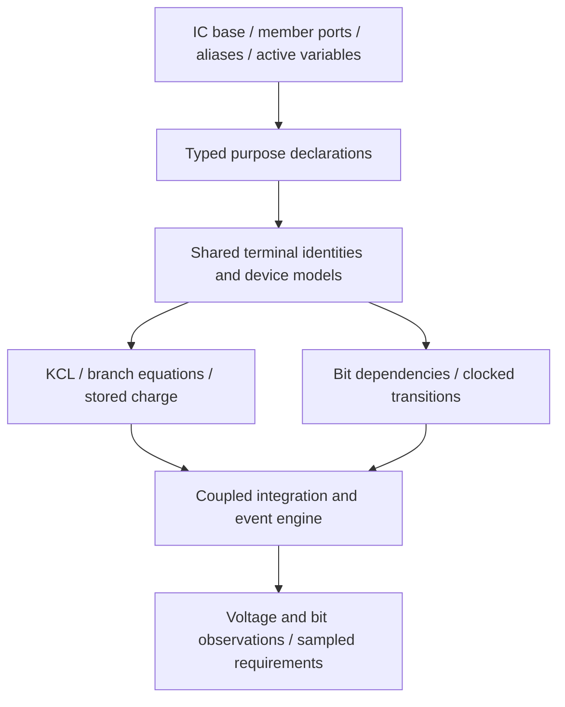

# Native C++ prototype architecture

The circuit description is compiled C++20. Classes and purpose declarations build
one shared model graph; a C++ integration engine computes the consequences.

## Public and backend boundaries

| File | Responsibility |
|---|---|
| [units.hpp](../include/units.hpp) | Distinct C++ physical quantity types and literals |
| [analog.hpp](../include/analog.hpp) | IC lifecycle, typed member ports, wires/values, device classes, purpose overloads and model policies |
| [solver.hpp](../include/solver.hpp) | Graph finalization, coupled equations, nonlinear integration, events and reports |
| [basic/](../basic/README.md) | Reusable circuit schemas: transistor amplifier, current mirror, input pair, feedback amplifier, regulator, channel/level inverter, divider, and RC filter |
| [cpphdl.hpp](../include/cpphdl.hpp) | Native C++HDL value and clocked-module bridge |
| [semantics.cpp](../tests/semantics.cpp) | Independent physical/event checks plus compile-time dimension checks |
| [RunExample.cmake](../tests/RunExample.cmake) | CTest driver checking each example's exact exit code and report status |

There is no parser or generated C++ frontend. ICs derive from `IC`, declare
`_PORT(...)` members, and override `_assign()` instead of defining constructors.
`IC` supplies per-instance public `Vdd` and `Vss` ports, inherited by every
component. Parents explicitly bind child rails; no global supply is implied.
Unused wires add no solver unknowns, while all nodes referenced by physical models,
analog sensing, observations, or voltage constraints remain in the solve.
After external port binding, `elaborate()` runs that hook once. Primitive device
expressions create model descriptors whose terminals are node handles. `Y = pmos_vdd(A)` declares the
PMOS output purpose on Y; `Vss = nmos(A, Y)` adds the correcting NMOS purpose to
the same physical network. Node union preserves both relations. The simulation
owns the model descriptors even after local C++ construction handles leave scope.

`capacitance` adds a storage model in its constructor and retains electrical
connectivity. `cmos<Model>` is a normal C++ IC class with a typed output and a
model policy. Libraries can define additional class hierarchies and policies
without changing how terminal equations are assembled. The built-in descriptors
support inspection of the declared models; there is no public model-plugin API.

Functional ICs live in root `basic/`, outside the elementary device layer.
`level_inverter` composes two complementary voltage-controlled resistor paths;
`cmos<fast_model>` elaborates it as a child IC. The generic controlled-resistor
law depends on a separate control/reference voltage and stamps a bidirectional
path current, so it can also model loads and switches outside an inverter.
`opamp` composes an NMOS input pair, PMOS current mirror, bias/shunt resistors,
and an output capacitor. `regulator` contains that op-amp and a PMOS pass device.
`non_inverting_amplifier` contains an op-amp and a resistor divider. Every child
has ordinary member ports and participates in the same solve. Neither level inverter, op-amp,
nor regulator has an entry in the backend law enumeration or a special state
coordinate. Their gain, dynamics, supply current, and loading follow from the
composed devices. CMake exposes `analog/` for `<basic/...>`, `analog/include/` for
`<analog.hpp>` and `<cpphdl.hpp>`, and the shared package `include/` for C++HDL
runtime headers.

The simulation stores stable component descriptors (ID, optional name and lifecycle
state), not pointers to temporary C++ IC handles. Descriptors and physical models
survive handle destruction during elaboration. The active declaration context
attributes primitive models to the IC whose `_assign()` created them; nested
elaboration restores its parent's context. Simulation compilation rejects incomplete
or failed components. All models remain in one global physical equation graph.

## Shared C++HDL conventions

[Buffer.cpp](../../examples/basic/Buffer.cpp) demonstrates class templates,
member ports/registers and separate `_work`/`_strobe` phases.
[Fifo.cpp](../../examples/basic/Fifo.cpp) demonstrates nested components and
compile-time variants. [Fifo2clk.cpp](../../examples/cdc/Fifo2clk.cpp)
demonstrates named clock domains and their distinct work/commit methods.
The local [spec](../../doc/spec.md) and [lowering design](../../doc/lowering.md)
preserve bit widths and distinguish execution from synthesis policy.

Analog follows the native class/type approach and shared old-state/next-state
commit semantics. Physical pins additionally need bidirectional terminal laws,
charge and simultaneous analog solving. The core shares only the typed `_PORT`
selector; `IC` is independent of the digital `Module` lifecycle. The native adapter
reuses `logic<W>`, `reg<T>`, `_work()` and `_strobe()`. It executes
registered native modules inside the analog scheduler, preserving width, old-state
snapshots and charge continuity. See [cpphdl-integration.md](cpphdl-integration.md).
Mixed-signal synthesis remains outside this native co-simulation implementation.

## Elaboration and live model behavior

1. Construct a `simulation`, then default-declare IC objects and typed member ports.
2. Bind named ports, then call `elaborate()`. The common IC lifecycle dispatches
   `_assign()` once; parent declarations bind child ports and elaborate child ICs.
   Purpose declarations register terminal relations or bit computations.
3. Freeze topology, canonicalize wire identities and validate digital writers/dependencies.
4. Assemble one voltage/KCL unknown per participating nonreference node, source/capacitor/inductor branch
   currents and explicit charge-storage state. Analog feedback is not topologically evaluated.
5. Integrate and solve the combined network while coordinating sampled conversions,
   source steps and simultaneous register events.
6. Record observations, final requirements, sampled assumptions and model limitations.

Physical behavior does not stop at C++ class boundaries. An external load changes
its IC output current, shared supply voltage and neighboring IC responses in the
same coupled solve. Lines are not rerun to simulate devices; their declared laws
remain active and interact throughout integration.

## Equation and state substrate

The general substrate is `0 = R(z, x, xdot, u, t)` plus discrete transition/reset maps.
The initial subset uses modified nodal equations and backward Euler by default.
An explicit [BDF2 option](integration.md) provides second-order accepted-state
history with first-order restarts at discontinuities. Charge
states have explicit initialization. Known stimulus events preserve
continuous state while algebraic variables settle; clocked bit next states are
computed together from the precommit snapshot. Unknown thresholds remain unknown.

The solver supports finite-difference and optional analytic piecewise Jacobians,
scaled pivot elimination and damped Newton. Capacitor evolution uses the equivalent
integral-voltage residual to avoid amplifying roundoff by C/dt for large DC blocks.
Optional `minimum_step` bisection retries failed Newton steps; it does not estimate
local integration error. The default retains fixed-step failure behavior. It checks rank even for a zero residual, diagnosing floating nets instead
of treating their zero-valued initial guess as a uniquely determined solution.
Independent sources and capacitor charges seed Newton iteration; resistor
connections propagate tentative voltage guesses without imposing extra constraints.
Consistent capacitor-voltage loops use a spanning constraint basis during startup
and zero-time holds. Dependent capacitor multipliers receive a zero-current gauge;
all capacitor voltage conditions are still checked, and every capacitor retains
its full integration equation. This avoids singular initialization without
discarding stored charge or depending on declaration order. Contradictory initial
voltages produce `E_INITIAL_CHARGE`. An ideal source jump incompatible with held
loop charge produces `E_CHARGE_DISCONTINUITY`; finite PWL edges are supported.
General impulsive charge redistribution is not implemented by this hold scheme.
Trial voltage updates are limited before backtracking, scaled to the current
voltage magnitude, to avoid enormous steps through cutoff channels with weak
return paths. This changes the iteration, not the physical network.
Numerical failure does not prove physical infeasibility. Dense cost is roughly
cubic per Newton solve; this prototype explains and tests small circuits, not chips.

## Model fidelity and future work

Fast versus detailed classes must expose the same intended interface and state
contract. A richer device model can still be less accurate for an omitted effect.
An accuracy certificate needs observations, operating envelope, metric/bound,
reference data/model, initial-state mapping and timing alignment. No class name,
C++ subtype or number of equations proves precision.

An [optional sparse QR backend](sparse_solver.md) now consumes the same Jacobian
stamps and has independent rank, circuit-response and dense-equivalence tests.
A production backend still needs adaptive DAE integration,
consistent-initialization analysis, root-localized events, validated foundry/device
models, supply energy accounting, noise and thermal coupling. Shared environmental
and technology contexts should supply defaults while retaining important local
charge/leakage/noise. The current model defaults are shared C++ value types.

Topology is currently fixed during a run. A future active/model type can switch
behavior through its state law; physically replacing a model requires charge,
flux, phase and digital-state transfer rather than copying just an output voltage.
Hard real-time wall-clock execution needs its own timing and error contract.

Formal assume/guarantee composition, all-envelope refinement and technology synthesis
remain outside the implemented scope. Basic PLL/oscillator examples and the
[10G SFP+ prototype](../10G/README.md) exercise the existing coupled solver; they
are selected-model experiments, not validated silicon libraries.

## Completed-trajectory checks

`simulation::require_trace` retains named testbench predicates until integration
finishes. They inspect immutable sample rows and report pass, failure or missing
evidence, subject to the same global assumption envelope as final-value checks.
They do not participate in the physical residual or supply ideal control behavior.
Feedback examples measure settling windows, interpolated edges/phase and positive
peaks through this interface. CTest separately compares coarse and refined traces.

## Verilog-A backend

[VerilogA/](../VerilogA/README.md) exports the elaborated physical network to
Verilog-A branch contributions. Native C++ resolves class hierarchy and model
configuration; the backend preserves canonical node aliases, device laws and
source/component attribution in one flat module. The root `cpphdl --verilog-a`
entry and standalone driver share the same native elaboration implementation.
Top electrical members are explicit compiler-checked interface arguments.

The backend reads the existing element list and node identities. The core adds
only a const observation-list accessor; no analog export traits or methods enter
digital `Module` or its port lifecycle. Simulator sources/control approximations
are rejected in reusable IC export and supported explicitly in experiment bundles.

OpenVAF compiles generated modules to OSDI; ngspice independently integrates them.
Tests normalize observations to native CSV names/units and check selected-model
agreement, analytic RC behavior, refinement and detection of an intentionally
altered exported resistor. Initial charge and clock-edge approximation are recorded
bench conditions. Shared elaborated connectivity remains a common-mode limitation
of this validation; agreement is not a proof of all source/topology/device physics.
