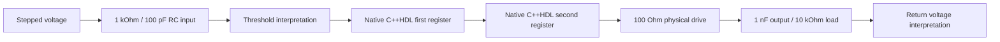

# Mixed analog and native C++HDL schemas

The source is [main.cpp](main.cpp). Include `<cpphdl_analog.h>` to use the
shared `_PORT` syntax, `cpphdl::Module`, native `logic<W>`/`reg<T>`, analog `IC`,
physical types and basic schemas. The CMake target is `analog_mixed_signal`.

The `sim_` calls expose simulation-only behavior: voltage interpretation, native
execution adapters and a behavioral finite-resistance output path. This example
does not define receiver or output-stage transistor circuits.



`SamplePipeline` is a native digital `cpphdl::Module` with two
`cpphdl::reg<cpphdl::logic<1>>` registers. `_work()` computes both next values from
one old-state snapshot; `_strobe()` commits them. `MixedReceiver` is an analog
`IC` that binds this native module through explicit input/output/clock adapters.

The input voltage starts at 0 V and steps to 1.2 V at 750 ns. It reaches the
receiver through 1 kOhm and a 100 pF node initially at 0 V. `sim_sense` interprets
<=0.35 V as low, >=0.85 V as high, and the intermediate band as unknown. The
1 us clock rises at 0.5, 1.5, 2.5 and 3.5 us; it samples known values in this run.
An unknown native input or clock would produce `E_UNKNOWN_CPPHDL`.

| Time | Native first stage | Native second stage | Physical output |
|---|---|---|---|
| 0 | Reset to 0 | Reset to 0 | Capacitor initially 0 V |
| 0.5 us | Captures 0 | Captures old 0 | Low |
| 0.75 us | Input source changes | Retains 0 | Low while input RC charges |
| 1.5 us | Captures 1 | Captures old first-stage 0 | Remains low |
| 2.5 us | Retains 1 | Captures first-stage 1 | Voltage remains continuous, then begins charging |
| 4 us | 1 | 1 | Near the loaded high equilibrium |

The output driver has 100 Ohm resistance and the output load is 10 kOhm to Vss.
At a 1.2 V supply the final equilibrium is `1.2 * 10000 / 10100`, about
**1.188119 V**. Output capacitance is 1 nF initially at 0 V. Switching the native
register does not instantly change that stored voltage; the integration engine
then evolves it with the driver and load. The return sensor interprets the achieved
output voltage, not the commanded native bit.

The example runs for 4 us at 25 ns steps. Explicit checks fail the executable if
the second native stage updates on the same edge as the first, if capacitor voltage
jumps at the second-stage commit, if the final voltage bypasses the load, or if
final interpretation/voltage requirements fail. These checks remain enabled in
Release builds. The framework retains native module ownership through the run.

From `analog/`:

```bash
cmake -S . -B build -DCMAKE_BUILD_TYPE=Release \
  -DBUILD_TESTING=ON -DCPPHDL_BUILD_ANALOG_TESTS=ON
cmake --build build --target analog_mixed_signal -j 4
./build/analog_mixed_signal examples/mixed_signal/results
```

Generated artifacts are `equations.txt`,
`trace.csv`, and `report.json`. Trace
columns are IN, DATA, FIRST, SECOND, Y and RETURN; time is in seconds and physical
voltages in volts. The equation artifact identifies threshold conversions, native
registered outputs and clocked work-before-strobe scheduling alongside shared KCL.

Run `ctest --test-dir build --output-on-failure -L analog` from `analog/` for all
tests. The executable command above regenerates this example's local artifacts.
Read the
[integration contract](../../doc/cpphdl-integration.md) for native port/cache
semantics, unknown handling and the registered-output restriction. This example
is native co-simulation; it does not claim mixed-signal RTL synthesis or prove
continuous-time bounds beyond its selected numerical model and samples.
