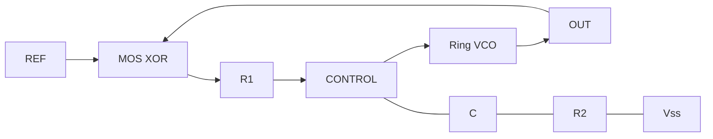

# Physical phase-locked loop

[main.cpp](main.cpp) composes [`pll`](../../basic/pll.hpp) from a MOS XOR phase
detector, a passive lead/lag filter and a three-stage current-starved ring
oscillator. All are `IC` classes with member ports and `_assign()` declarations.
There is no ideal PLL, phase detector or voltage-to-frequency primitive.



The reference is a testbench `sim.clock` delivered through a finite 100 Ohm
`sim_driver`. VCO timing comes from physical transistor current
charging/discharging explicit stage capacitors.

The XOR is four NAND classes, each built from two parallel PMOS channels and two
series NMOS channels. Each NAND includes an explicit 1 nF output capacitor and
1 GOhm output/stack return resistors. These paths and charges remain in KCL;
there is no logic threshold conversion inside the detector.

Each VCO stage has a PMOS pull-up, an NMOS input switch and an NMOS controlled
current return, plus 1 nF output storage and a 1 GOhm tail return. Its selected
MOS beta is 1 mA/V², threshold 0.35 V. Increasing CONTROL increases discharge
current and changes ring frequency. The example gives one stage 1.2 V initial
charge while the others start at zero. This explicit asymmetry is a startup
condition; deterministic symmetric initial conditions do not establish noise startup.

Filter defaults are R1 = 10 kOhm, R2 = 470 Ohm, C = 100 nF, initial capacitor
voltage = 0.6 V. For negligible control-gate current its linear transfer is:

```text
Vcontrol(s) / Vdetector(s) = (1 + s * R2 * C) / (1 + s * (R1 + R2) * C)
```

This relation is a consequence of the resistor/capacitor network. The solver
uses its terminal equations coupled to the nonlinear detector and oscillator.
TI's [CD4046B application report](https://www.ti.com/lit/an/scha002a/scha002a.pdf)
discusses the phase detector/filter/VCO organization and the limited capture
range of XOR phase comparison. This example uses a ring VCO and does not model
the CD4046B device.

From the package root:

```bash
cmake -S analog -B analog/build -DCMAKE_BUILD_TYPE=Release \
  -DBUILD_TESTING=ON -DCPPHDL_BUILD_ANALOG_TESTS=ON
cmake --build analog/build --target analog_pll
./analog/build/analog_pll analog/out/pll nominal
./analog/build/analog_pll analog/out/pll-loaded loaded
./analog/build/analog_pll analog/out/pll-refined refined
ctest --test-dir analog/build --output-on-failure -R 'analog\.(examples\.pll|feedback\.pll)'
```

Arguments are output directory, then scenario. All runs use a 1.2 V supply,
12 kHz reference and 15 ms duration. `loaded` connects an external 500 kOhm resistor from OUT to Vss,
changing oscillator current and propagation time.
`refined` halves the nominal 1 us integration step.

`trace.csv` columns are time, REF, OUT, CONTROL and PHASE_DETECTOR. Voltages use
V, time uses s. `equations.txt` identifies every device and component;
`report.json` includes the trajectory obligations. The last 5 ms must show:

- At least 20 rising edges, mean frequency within 1% of 12 kHz and reference/output counts differing by at most one.
- Each output period within 5% of the reference period.
- Phase excursion below 0.05 cycles using sequential edge pairing, with phase inside ±0.4 cycles.
- Output within supply rails and CONTROL between 0.4 and 1.1 V.

Rising edges are measured at 0.6 V using interpolation between samples. Nominal
frequency is approximately 12 kHz with a finite phase offset around 0.17 cycles.
Checks concern the sampled late trajectory; they do not prove all-start capture,
arbitrary reference tracking, jitter, noise performance or unconditional stability.
Finite detector loading/delay and numerical integration affect the measured phase.

The [Verilog-A backend tests](../../VerilogA/tests/README.md) export this physical
hierarchy and compare its measured loop behavior with an independently compiled
OpenVAF model running in ngspice, including native timestep refinement.
