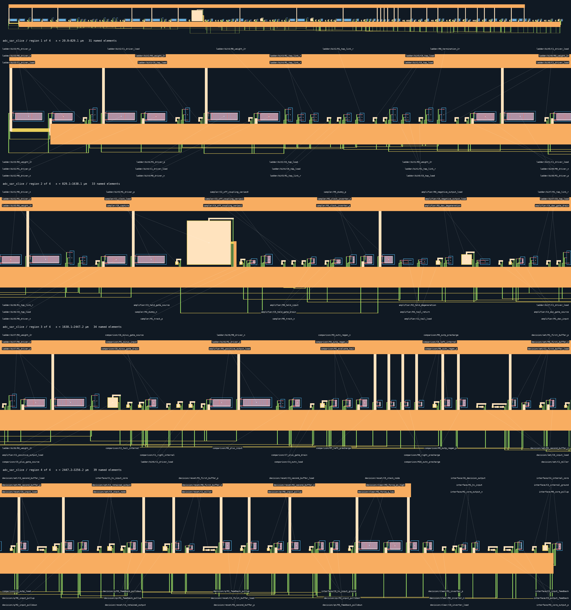

# IHP SG13G2: one 8-bit SAR ADC slice

**Physical DRC/LVS: PASS. Electrical qualification: FAIL / incomplete.**
The geometry is real, but this slice is not ready for replication or tapeout.
The tables below report passing and failing checks separately.

This source-only commit omits the generated placement, GDS, extraction, JSON
receipts and deeper candidate archives discussed below. Those measurements
describe the recorded workspace artifacts, not files delivered in this commit.

The current one-slice sizing search and measured extracted trials are in
[experiments.md](experiments.md). Earlier candidate results and the historical
PHY requirements matrix are preserved in
[qualification_history.md](qualification_history.md). The complete 15-case reference is
[gain3_hold65](candidates/gain3_hold65/pnr.md); the physical 10 pF candidates
and their receipts are archived under [candidates](candidates). The
[50 fF interface-node trial](candidates/gain3_hold10_sample15_dummy15_if50_clockp2/pnr.md)
passes four targeted conversions but fails late decisions in the full SS
matrix. Its [stronger-pullup variant](candidates/gain3_hold10_sample15_dummy15_if50_pullup3_clockp2/pnr.md)
passes 14 of 15 sequential conversions but fails the SS final read and the
fresh stepped SS case. A [45% stronger interface-input trial](candidates/gain3_hold10_sample15_dummy15_if50_pullup3_input145_clockp2/pnr.md)
passes 14 of 15 complete TT/SS/FF sequential conversions but its final SS
2.05 V sample has an invalid bit-7 read. Its 10 ps to 5 ps TT refinement
passes scalar and peak waveform limits but fails the 1 mV RMS waveform limit
at 1.345 mV. A [balanced larger-interface trial](candidates/gain3_hold10_sample15_dummy15_if50_pullup4_input200_clockp2/pnr.md)
passes physical DRC/LVS and extraction and repairs that final SS read, but
fails TT/SS low-input code accuracy and the preceding SS bit-6 read. The
[intermediate interface](candidates/gain3_hold10_sample15_dummy15_if50_pullup350_input170_clockp2/pnr.md)
and [reduced latch-load](candidates/gain3_hold10_sample15_dummy15_if50_pullup3_input145_latch30_clockp2/pnr.md)
also fail targeted gates. Layout optimization changed 119 of 137 component
positions in these sizing trials. [Fixed-order larger-interface](candidates/gain3_hold10_sample15_dummy15_if50_pullup4_input200_fixed_clockp2/pnr.md)
and [fixed-order latch-load](candidates/gain3_hold10_sample15_dummy15_if50_pullup3_input145_latch30_fixed_clockp2/pnr.md)
placements pass physical checks and their initial TT/SS/FF conversions, but
both complete slow/hot stepped conversions fail the final bit-7 validity read.
The stronger-interface full TT/SS/FF sequences have completed with 14 / 15
passing conversions; final SS acquisition has only 0.094 mV margin. An
[isolated per-bit CLEAR schedule](diagnostics/bitclear.md)
on the same fixed-order larger-interface geometry now passes the complete
slow/hot 1.75 V to 2.05 V stepped case with zero invalid reads and one-count
errors. The smaller 45% interface-input geometry also passes this stepped
case under the same control pulse, with only 5 ps setup margin on its first
conversion. The larger interface's complete per-bit-CLEAR TT/SS/FF matrices
now pass all 15 scalar conversions, but final slow/hot acquisition has only
**0.094 mV margin** and its HV terminal screen fails. The smaller geometry's
complete per-bit-CLEAR matrices also pass 15 / 15 scalar conversions, with
0.100 mV final slow/hot acquisition margin and 130 ps minimum matrix setup.
A [1.6× sampling and dummy trial](candidates/gain3_hold10_sample16_dummy16_if50_pullup4_input200_fixed_clockp2/pnr.md)
has passed physical checks, TT / FF first-cycle scalar gates and a complete
slow/hot stepped run with 18.054 mV final acquisition; its first slow/hot
decision has only 5 ps setup margin. Its verified five-input slow/hot matrix
passes 5 / 5, with 18.321 mV final acquisition and 1.679 mV margin. Its
verified TT and FF matrices also pass, making **15 / 15** scalar conversions,
but the FF 1.75 V hold margin is only 0.313 mV and HV terminal stress fails.
A [1.55× fixed-order midpoint](candidates/gain3_hold10_sample155_dummy155_if50_pullup4_input200_fixed_clockp2/pnr.md)
has passed full physical DRC/LVS, extraction and back-annotation. Its TT 0.85 V
and FF 1.75 V first cycles and verified SS 1.75 V to 2.05 V step pass. The
stepped SS final acquisition is 18.761 mV with 1.239 mV margin, and the first
decision has 50 ps setup. Its full TT/SS/FF five-input matrices now pass
**15 / 15** nominal scalar conversions. The worst matrix acquisition is
19.071 mV (SS / 2.05 V, 0.929 mV margin); the worst hold variation is
19.419 mV (FF / 1.75 V, 0.581 mV margin).
Its completed IHP passive-extreme stepped receipts fail at 2.05 V: best/best
has an invalid bit-7 read, and worst/worst has 22.355 mV acquisition.
MIM worst alone gives 22.350 mV, isolating almost all acquisition loss to
the capacitor corner; R3 worst alone gives 18.773 mV but has an invalid
first read. Shortening per-bit CLEAR from 1 to 0.5 ns does not fix the
best/best final bit-7 read.
A [stronger 1.75× sampling / 1.90× dummy trial](candidates/gain3_hold10_sample175_dummy190_if50_pullup4_input200_fixed_clockp2/pnr.md)
brings worst-passive SS acquisition to 19.329 mV, but both bit-7 reads are
invalid and FF 1.75 V hold variation fails at 20.668 mV. A [0.5 fF latch Miller
trial](candidates/gain3_hold10_sample155_dummy155_if50_pullup4_input200_fixed_clockp2_latchhalf/pnr.md)
passes the full physical checks, 11 back-annotation guards and TT scalar
conversion but leaves the HV |Vgs| peak at 3.633 V against the 3.3 V screen.
The 20 ps versus 10 ps observed-waveform
comparisons fail at all three corners. The newer [2.5 ps versus 1.25 ps
startup diagnostic](candidates/gain3_hold10_sample15_dummy15_if50_pullup3_input145_clockp2/evidence/tt-085-startup-1p25ps/startup-comparison.json)
also fails the observed-node convergence limits: 42.485 mV peak and 1.266 mV
RMS on the union of both time grids. A still finer 0.625 ps versus 0.3125 ps
startup-only comparison passes at 18.253 mV peak and 0.337 mV RMS; it is not
a complete conversion. A separate input-ramp startup experiment passes at
5 ps versus 2.5 ps (2.116 mV peak, 0.294 mV RMS). Its complete TT 0.85 V
comparison on the smaller interface GDS also passes the stated observed-node
limits: 6.446 mV peak and 0.369 mV RMS over 70 ns. The 1.55× per-bit-CLEAR
full-cycle comparison is still running and is a separate qualification.

This directory contains a physical implementation of **one analog slice**, with
sampling, a resistive R/2R DAC, preamplifier, regenerative comparator, retained
bit decision and 3.3 V to 1.2 V interface. The SAR sequencer and clock drivers
are external. This is not a four-slice ADC, complete PHY or standalone chip.

The placement/mask deliverables are:

```text
File                              Contents
--------------------------------  --------------------------------------------------
adc_sar_slice.gds                 Actual hierarchical PCells, connected metal and fill
adc_sar_slice.def                 Fixed device placement, pins and net connectivity
adc_sar_slice.cells.lef           Physical device abstracts used by the DEF
adc_sar_slice.odb                 OpenROAD database after importing that LEF/DEF
adc_sar_slice.placement.json      Exact component origins, dimensions and pin locations
adc_sar_slice.lvs.cir             Independent hierarchical schematic used for LVS
adc_sar_slice.schematic.spice     Geometry-matched PSP/R3/MIM schematic, without wire RC
adc_sar_slice.extracted.spice     Actual GDS-derived network used by Analog++
adc_sar_slice.h                   IHP-specific sizing/profile for the generic slice
```

**Use `.gds` for mask geometry and `.def` for placement.** The GDS includes
physical routes. The DEF does not contain detailed wire routes; OpenROAD imported
and checked the fixed placement/connectivity. It did not perform analog timing
signoff. The extracted SPICE subcircuit is named `ExtractedAnalog`; its explicit
16-port declaration is authoritative.

The images are rendered from the GDS drawing layers. They are not estimated
floorplan illustrations. The orange conductors are TopMetal2; cream is TopMetal1.
The full-slice image starts with an overview and then shows four enlarged mask
regions. White hierarchical names identify all 137 placed elements, with a thin
line from each name to its physical location. For example,
`sampler/C0_capture` is the sampled-voltage storage capacitor. The image and
name map declare `adc_sar_slice` as the shared top level only once.
[element_names.json](element_names.json) gives each name, its purpose, and its
physical `D#` identity. These names are declared on the device objects in
[`primitives.h`](../primitives.h); [`adc_sar_slice.h`](../adc_sar_slice.h) binds
their instance paths. Analog++ retains the names on its stamped elements, and
the exporter checks them against the image map. The existing GDS/DEF `D#`
identities remain stable for the DRC, LVS, and extraction evidence.




The physical checks use the installed IHP open PDK revision
`89d42ee6d2fd9b50b86a1aada6fee6673c3e6008`, its KLayout PCells and complete DRC/LVS
runsets, and its Magic extraction technology. The standalone fill window uses
the macro extent in place of a chip sealring opening. Consequently, these are
**block-level** density and antenna results. Placement into a chip requires
renewed extraction, density/antenna checks, pad/ESD/substrate/package checks and
chip-level power routing. No sealring, pads or ESD cells are included here.

The electrical tests run in native **Analog++ with IHP PSP103 and R3 OSDI
models** and the PDK MIM geometry/temperature law. The generic square-law model
is not presented as process qualification. `process.py` binds explicit W/L,
finger count, diffusion geometry, passive dimensions, temperature and corner.
`backannotate.py` restores diffusion sharing from actual GDS coordinates,
retains distributed device terminals and coupling capacitors, and removes only
resistor-only internal nodes by exact nodal elimination. The extracted RC is
therefore actually stamped into the C++ simulation.

The R3 body adapter removes duplicated substrate shunts and retains external
coupling at finite-resistance midpoints. Its contact-head/field partition still
needs independent calibration. Floating-fill/substrate/package effects and
foundry reliability qualification are not established by this flow.

The IHP profile differs from the generic defaults as follows:

* HV NMOS/PMOS gate lengths are at least 0.6/0.5 um, with approximately preserved
  W/L and at most 10 um per finger. These lengths follow the 3.3 V, 27 C condition
  in sections 2.4/2.5 of the installed process specification; minimum legal
  geometry alone is insufficient for that operating-voltage condition.
* Sampling storage is 6 pF. The generic 1 pF and the intermediate 4 pF physical
  candidates failed the 20 mV hold requirement.
* Sampling switches, charge-cancelling dummies and the complement driver are
  1.5 times stronger to recover slow/hot acquisition with the 6 pF store.
* Upper-metal supplies collect transistor sources directly. The main sampling
  capacitor has a dedicated bottom-plate connection to the upper ground rail.
* Decision isolation buffers and the level shifter are strengthened to address
  an observed slow/hot output-delay failure. The larger always-on core PMOS
  also provides the gate area needed by the cumulative-metal antenna check.

The connected electrical fixture is explicit: 3.3 V IO and 1.2 V core sources,
1 ns supply ramp, 0.25/10 ohm supply resistance, 20 pF external decoupling per
rail, 50 ohm analog source, 50 ohm control drivers with 50 ps edges, and 20 fF
external decision load. Those external elements are **not placed in this GDS**.
There is a 20 ns warmup, then 50 ns sample spacing (20 MS/s), 8 ns track time,
1 ns track-to-conversion gap, and eight 4 ns bit periods: 2 ns DAC settling plus
2 ns comparator evaluation. Decisions are read 25 ps before the evaluation
end. Hold is measured from the track-edge midpoint through the last decision.
The first input is present during warmup; later inputs change over 100 ps at
the start of their 8 ns acquisition window.

TT/SS/FF below mean MOS typical/slow/fast process corners at 27/125/-40 C.
Resistors and MIMs use their nominal process corners with the stated temperature.
This three-point matrix is not the full Cartesian product of process, supply,
temperature, mismatch and stimulus conditions.

<!-- measured-results: generated by report.py -->

Measurements below identify the delivered V11 geometry. Values are simulation/extraction results, not silicon measurements. Numerical precision is not a claim of foundry-qualified accuracy.

```text
Physical check / measurement      Requirement                               Measured result                         Status
--------------------------------  ----------------------------------------  --------------------------------------  --------
Full IHP DRC                      0 violations; all decks complete          0 violations / 868 categories           PASS
DRC completion                    37 main tables + maximum/density/antenna  All enabled; no waivers                 PASS
Strict hierarchical LVS           All circuits/devices/ports matched        144 circuits; 225 devices; 16 ports     PASS
OpenROAD placement import         137 cells / 56 nets / 16 ports            137 / 56 / 16                           PASS
Occupied mask bounding box        Characterize                              3236.23 x 168.99 um                     MEASURED
Occupied bounding area            Characterize                              0.5468905 mm2                           MEASURED
DEF die including 20 um margins   Characterize                              3276.23 x 208.99 um                     MEASURED
Placed inventory                  C++ topology retained                     59 MOS groups / 57 C structures / 21 R  PASS
MOS fingers / physical MIM units  Geometry preserved                        795 / 65                                PASS
Extracted wire resistors          Retain distributed device/C terminals     12496                                   PASS
Nonzero parasitic capacitors      Retain coupling and storage               6373                                    PASS
R3 physical resistor halves       Body adapter preserves midpoint RC        42                                      MEASURED
HV lengths at 3.3 V               N >= 0.6 um; P >= 0.5 um                  0.6 / 0.5 um minimum                    PASS
HV finger width                   0.3 through 10 um                         All exported fingers in range           PASS
```

The 225 LVS devices include hierarchical guard/tap elements. They are not the flattened simulation inventory. Series MIM structures produce 65 physical MIM units; 21 physical resistors become 42 R3 halves. Exact resistor-only elimination reduces 27,719 wire resistors to 12,496 without eliminating storage or compact-device terminals. 55 exactly zero capacitors are omitted; nonzero parasitics remain.

```text
Layer      Block-window density (%)  PDK density result
---------  ------------------------  ------------------
Activ      44.32                     PASS
GatPoly    26.73                     PASS
Metal1     53.63                     PASS
Metal2     54.90                     PASS
Metal3     55.01                     PASS
Metal4     52.53                     PASS
Metal5     53.82                     PASS
TopMetal1  38.02                     PASS
TopMetal2  54.64                     PASS
```

Density acceptance uses the actual installed PDK deck, including local windows and exclusions; the percentages alone do not establish acceptance.

```text
Extracted wire path  Minimum (ohm)  Maximum (ohm)  Requirement
-------------------  -------------  -------------  ----------------------------
VSS -> D3_0.MINUS    0.902383       0.902383       Characterize; devices/C open
VSS -> D4_0.S        23.122990      24.803190      Characterize; devices/C open
VSS -> D0_0.B        28.438533      28.936100      Characterize; devices/C open
VDD -> D5_0.S        23.536880      26.204180      Characterize; devices/C open
VDD -> D1_0.B        29.914653      29.914653      Characterize; devices/C open
IN -> D0_0.S         66.261142      67.509642      Characterize; devices/C open
IN -> D1_0.S         29.422842      30.148642      Characterize; devices/C open
TRACK -> D0_0.G      40.238942      41.272842      Characterize; devices/C open
TRACK -> D4_0.G      56.185162      57.651262      Characterize; devices/C open
TRACK -> D7_0.G      48.733832      49.075432      Characterize; devices/C open
```

Electrical acceptance: acquisition <= 20 mV; hold peak-to-peak <= 20 mV; absolute code error <= 2 counts; zero unresolved decisions; >= 25 ps stable decision before evaluation ends; IO >= 3.0 V and core >= 1.08 V at the supply pins. Code error is measured against floor(256 * input / 3.3), clipped to 0..255. One count is 12.890625 mV.

```text
Observed voltage  Logical net  Extracted probe node
----------------  -----------  --------------------
held              n50          D3_0.PLUS
dac               n51          D75_0.PLUS
positive          n70          D81_0.G
negative          n69          D93_0.PLUS
```

These are retained points on distributed conductors. Observation does not short the rest of each net or substitute ideal voltages at transistor terminals.

**Geometry-matched schematic**, 20 ps maximum conversion step, five successive inputs per corner. Startup before 19 ns permits 100 ps steps.

```text
Corner      Vin (V)  Acq (mV)   Hold pp (mV)  Code/ideal  Error  Invalid  Setup (ps)  Result
----------  -------  ---------  ------------  ----------  -----  -------  ----------  ------
TT / 27 C   0.85     7.524869   15.903652     65/65       0      0        930.0       PASS
TT / 27 C   1.15     7.442010   13.667561     89/89       0      0        910.0       PASS
TT / 27 C   1.45     7.663774   12.868441     112/112     0      0        990.0       PASS
TT / 27 C   1.75     7.250064   12.298721     136/135     1      0        950.0       PASS
TT / 27 C   2.05     6.636586   10.160895     159/159     0      0        1050.0      PASS
SS / 125 C  0.85     7.094012   15.668397     63/65       2      0        830.0       PASS
SS / 125 C  1.15     7.777737   13.716385     88/89       1      0        490.0       PASS
SS / 125 C  1.45     9.108709   13.185831     112/112     0      0        610.0       PASS
SS / 125 C  1.75     9.785447   12.525036     135/135     0      0        750.0       PASS
SS / 125 C  2.05     11.033106  10.826009     159/159     0      0        730.0       PASS
FF / -40 C  0.85     7.976140   16.447135     65/65       0      0        1230.0      PASS
FF / -40 C  1.15     7.807934   14.125628     89/89       0      0        1150.0      PASS
FF / -40 C  1.45     7.726341   13.581797     112/112     0      0        1210.0      PASS
FF / -40 C  1.75     7.127073   12.449174     135/135     0      0        1270.0      PASS
FF / -40 C  2.05     5.612486   11.104770     159/159     0      0        1250.0      PASS
```

```text
Corner      Min IO V  Min core V  Peak IO mA  Peak core mA  Power range mW  Energy range pJ
----------  --------  ----------  ----------  ------------  --------------  -----------------
TT / 27 C   3.254893  1.191684    180.427     0.832         15.439..20.169  771.933..1008.470
SS / 125 C  3.248603  1.193530    205.589     0.647         13.000..18.186  650.020..909.295
FF / -40 C  3.245757  1.189426    216.973     1.057         16.628..21.549  831.378..1077.468
```

**GDS-extracted connected slice**, 20 ps maximum conversion step, five successive inputs per corner. Startup before 19 ns permits 100 ps steps.

```text
Corner      Vin (V)  Acq (mV)   Hold pp (mV)  Code/ideal  Error  Invalid  Setup (ps)  Result
----------  -------  ---------  ------------  ----------  -----  -------  ----------  ------
TT / 27 C   0.85     13.082019  27.798376     83/65       18     0        370.0       FAIL
TT / 27 C   1.15     13.407071  25.367827     99/89       10     0        470.0       FAIL
TT / 27 C   1.45     13.592691  24.609675     119/112     7      0        170.0       FAIL
TT / 27 C   1.75     12.190366  24.566698     141/135     6      0        130.0       FAIL
TT / 27 C   2.05     11.208800  22.790766     163/159     4      0        510.0       FAIL
SS / 125 C  0.85     12.132927  25.751337     96/65       31     1        0.0         FAIL
SS / 125 C  1.15     14.637020  24.331440     112/89      23     1        0.0         FAIL
SS / 125 C  1.45     16.140048  19.447385     126/112     14     1        0.0         FAIL
SS / 125 C  1.75     15.458199  23.072991     143/135     8      0        130.0       FAIL
SS / 125 C  2.05     16.207947  21.545364     161/159     2      2        0.0         FAIL
FF / -40 C  0.85     13.987775  29.837491     78/65       13     0        90.0        FAIL
FF / -40 C  1.15     13.822262  27.327276     96/89       7      0        790.0       FAIL
FF / -40 C  1.45     13.606125  26.473108     117/112     5      0        610.0       FAIL
FF / -40 C  1.75     11.974599  26.340516     140/135     5      0        690.0       FAIL
FF / -40 C  2.05     9.950163   24.586434     162/159     3      0        590.0       FAIL
```

```text
Corner      Min IO V  Min core V  Peak IO mA  Peak core mA  Power range mW  Energy range pJ
----------  --------  ----------  ----------  ------------  --------------  -----------------
TT / 27 C   3.255735  1.193847    177.062     0.615         17.410..21.834  870.517..1091.689
SS / 125 C  3.256977  1.194253    172.093     0.575         15.636..20.498  781.792..1024.888
FF / -40 C  3.257274  1.192813    170.905     0.719         17.123..22.761  856.145..1138.031
```

Energy integrates both supply sources over each complete 50 ns sample cycle, including acquisition, conversion and idle time. IO/core voltage minima are acceptance gates. Peak current, energy and power are characterization only: no project budget has been specified. These pin currents do not qualify individual contacts, vias or wires for electromigration.

```text
Network    Corner  Max HV |Vgs| V  Max LV |Vgs| V  Raw card exceedances  3.3 V screen
---------  ------  --------------  --------------  --------------------  ------------
schematic  TT      3.472736        1.221924        268                   EXCEEDED
schematic  SS      3.517450        1.222108        266                   EXCEEDED
schematic  FF      3.467442        1.220302        268                   EXCEEDED
extracted  TT      3.603461        1.237592        3894                  EXCEEDED
extracted  SS      3.636809        1.237640        3892                  EXCEEDED
extracted  FF      3.583483        1.236086        3894                  EXCEEDED
```

Raw exceedances count device/quantity pairs whose recorded peak exceeds the card limit, not events or failed conversions. The documented HV 3.3 V maximum condition is specified at 27 C and the stated minimum lengths. Its strict terminal-voltage screen is exceeded. The raw PSP cards also contain 3.0 V HV gate/drain diagnostic limits and 1.6 V body diagnostics, with SWSOA disabled. Neither disabled diagnostics nor DRC acceptance permits declaring these overshoots safe. Transient lifetime limits and elevated/cold-temperature reliability remain unqualified.

```text
Numerical / reference comparison      Requirement  Current result  Status
------------------------------------  -----------  --------------  ------
TT schematic native vs ngspice, 5 ps  Same code    0.0             PASS
Acquisition measurement difference    <= 1 mV      0.003440 mV     PASS
Hold measurement difference           <= 1 mV      0.054716 mV     PASS
Decision setup difference             <= 50 ps     5.920046 ps     PASS
11 observed-node waveform peak        <= 20 mV     182.747798 mV   FAIL
Worst observed-node waveform RMS      <= 1 mV      6.268518 mV     FAIL
```

The largest reference discrepancy is on `DECISION` at 36.089703 ns. The scalar comparison does not waive this pointwise waveform failure.

**Extracted TT, first 0.85 V conversion: 20 ps versus 5 ps.** Both traces cover the same 70 ns prefix, including startup and a full sample cycle. No waveform time shift is applied.

```text
Refinement metric                 Requirement  Measured difference  Status
--------------------------------  -----------  -------------------  ------
Code                              0 counts     0 counts             PASS
Acquisition                       <= 1 mV      0.018745 mV          PASS
Hold variation                    <= 1 mV      0.211759 mV          PASS
Stable decision margin            <= 50 ps     20.000000 ps         PASS
11 observed-node waveform peak    <= 20 mV     651.132638 mV        FAIL
Worst observed-node waveform RMS  <= 1 mV      36.241971 mV         FAIL
```

The waveform comparisons use the union of both time grids and integrate the
piecewise-linear error for RMS. Agreement of a few scalar measurements does not
establish full-waveform convergence. Only eleven exported voltages are compared;
all 12,940 extracted solver unknowns have not been independently qualified.
The 20 ps corner matrix is therefore characterization evidence with unresolved
numerical accuracy, as well as the explicitly reported circuit failures.

```text
Regression / infrastructure check         Requirement                           Result
----------------------------------------  ------------------------------------  ------------------------------------
Actual-GDS back-annotation guards          Preserve fingers, junctions, RC;      11/11 PASS on this GDS
                                          reject missing/resized/duplicate
                                          devices and invalid model geometry
Frozen-RC-to-C++ reproducibility          Repeat from the same saved GDS/RC      50/50 files identical; only binding
                                                                                directory normalized in circuit.txt
Wire resistance measurement                Recover analytic networks; reject     3/3 PASS
                                          disconnected/nonphysical paths
Waveform comparison                       Detect peaks on either grid; exact    3/3 PASS
                                          linear RMS; reject invalid traces
Report/evidence guards                    Reject stale results, other netlist,  4/4 PASS
                                          incomplete run or missing stimulus
Analog++ transient regression target      Existing solver/transient/SPEF and    11/11 suites PASS
                                          new algebraic-elimination checks
Algebraic elimination                     Exact equations, original Newton      620 shuffled systems, noise constraints,
                                          residual; near-dependent fallback     singular/near-dependent controls PASS;
                                                                                max solution error 8.88178e-15
CMake registration of Python IHP guards    Executable test entries               2/2 suites PASS
Campaign suite inventory                  Runner expects every registered test  40/40 registrations match; not a
                                                                                new 40-suite electrical campaign
```

The solver improvement performs exact algebraic elimination before the existing
Eigen backend. It retains dynamic states, capacitor history and the original
Newton residual checks. Near-dependent elimination falls back to the backend's
rank policy. It is not a capacitance-removal approximation. The full generic
ADC campaign recorded in the parent document remains separate historical
38/38 evidence; it has not been relabelled as physical qualification.

Repeating junction restoration and C++ lowering from the same saved extraction
reproduced 50 files exactly (the binding directory is normalized). Independently
rerunning Magic on the same GDS produced a different mesh: 12,533 wire resistors
and 6,397 nonzero parasitic capacitors, versus 12,496 and 6,373 in the tested
network. Selected input, clock and source wire resistances agree to numerical
precision; the largest selected body-path difference is 0.000182413 ohm. This
is not a proof of whole-network electrical equivalence. The delivered extracted
SPICE and all electrical tables use the original frozen `physical-v11` network;
`physical-v11-final` supplies the repeat DRC/LVS/import checks and strengthened
tool hashes. Both extraction receipts are retained. Full mesh-repeatability
and electrical-equivalence qualification remain open.

**Remaining acceptance and integration work**

```text
Test / closure item                       Requirement / acceptance basis         Current result / status
----------------------------------------  -------------------------------------  ---------------------------------------
Extracted acquisition + hold               <=20 mV each at required corners       FAIL hold; measured matrix above
Extracted closed-loop conversion           <=2 counts, 0 unresolved decisions     FAIL; measured matrix above
Comparator recovery and matching          Correct decision within 2 ns eval      FAIL in connected operation; root cause
                                                                                 not isolated to one device or parasitic
Transition DNL/INL / missing codes         Complete transition search in usable   NOT RUN on this GDS; magnitude budget
                                          input range; no missing codes          unspecified; generic results do not apply
All 256 DAC levels                        Monotonic, <1 LSB absolute error        NOT RUN on extracted layout
Frequency/amplitude/source-R sweeps        Conversion limits at each stimulus     NOT RUN on extracted layout
Kickback / ripple / PSRR                   Measure actual upstream/rail response  NOT RUN; product budgets unspecified
Acquisition/evaluation timing boundaries   Sweep time and loading; bracket limit  NOT RUN beyond the stated 8/2/2 ns case
Random jitter                             Seeded timing sweep; conversion limits NOT RUN on this GDS
Process noise calibration                 Actual input-equivalent PSD/kT/C       OPEN; sampled generic noise is not
                                          and independently recovered RMS        intrinsic PSP transient-noise evidence
Mismatch / statistical yield              Foundry distributions and confidence  OPEN; three deterministic corners do
                                                                                 not establish yield
Supply/load/temp Cartesian sweep          Defined safe operating window          OPEN; only nominal supplies and three
                                                                                 MOS-corner/temperature pairings tested
Passive process corners                   PDK resistor/cap min/max combinations  OPEN; nominal passive process used here
Full extracted waveform convergence       Refined steps and independent engine   OPEN; selected-node comparisons only
Independent extracted PSP replay          Same physical network / whole cycle    OPEN; no completed reference for V11
Power / peak-current acceptance           Product energy/current budgets         MEASURED; budgets unspecified
Oxide/transient terminal reliability      Documented voltage/lifetime limits     EXCEEDED screen; transient SOA unresolved
EM / contact and via current sharing      Per-branch density, waveform, lifetime OPEN; rail pin peaks are insufficient
Rppd substrate/contact-field partition    Independent extraction/model parity    OPEN; adapter retains finite midpoint RC
Floating fill / substrate / package        Calibrated physical model              OPEN; not full chip or package extraction
Chip integration                          Pads/ESD/sealring, full-die routing,    OPEN; block GDS only; repeat DRC/LVS,
                                          extraction and operating checks        density/antenna and electrical tests
Compact matched analog placement          Symmetric sensitive pairs/routes       OPEN; current one-row macro is a real
                                                                                 prototype, not an area-optimized macro
```

The principal layout findings are concrete. The dedicated storage-capacitor
return reduced its extracted wire resistance from about 14.3 ohm in V7b to
0.902383 ohm in the delivered geometry. The remaining input routes add
29.42--30.15 ohm to the PMOS and 66.26--67.51 ohm to the NMOS sampling terminals,
in addition to the external 50 ohm source. At the first TT sampling edge the
input pin falls to about 0.755 V from a 0.85 V source; the held voltage dips to
about 0.825 V. Wider/direct input access and clock/complement charge balance
need to be optimized and re-extracted together.

The comparator also makes wrong decisions when held and DAC voltages are
separated by much more than one LSB. At TT, 44.975 ns, the 5 ps run has
held = 0.845666 V and DAC = 1.032274 V, but DECISION = 1.070842 V (high).
The same incorrect decision occurs at 20 ps; timestep refinement alone has
not removed it. Its two output conductors have about
148.63 and 178.09 fF of incident explicit capacitance (including intentional
capacitors, excluding intrinsic MOS charge). Internal regenerative nodes have
about 80.42 and 87.32 fF. These are unequal loads, not a measured offset model
or proof of the sole failure mechanism. Matched placement/routing, reset
recovery and isolation-buffer loading need a controlled comparison before
further sizing changes. Increasing storage and switch strength alone did not
close the extracted design.

**Tools, evidence and reproduction**

```text
Tool / model                    Version / binding
------------------------------  -------------------------------------------------------
KLayout                         0.30.5; IHP PCells, fill, full DRC and deep LVS
OpenROAD                        26Q2-1164-g08f67ee5ec; fixed placement/LEF/DEF import
Magic                           8.3.685, double-precision build; named distributed RC
Analog++                        Native C++ PSP103/R3 OSDI, BDF2; hashed binary/dependencies
Independent reference           ngspice 45.2, SMP solver, one thread, Gear order 2
PDK                             89d42ee6d2fd9b50b86a1aada6fee6673c3e6008
Process specification           SG13G2 Rev. 1.2 (2023-12-20), sections 2.4/2.5 and 2.15
```

The process voltage conditions and EM tables come from the installed
[IHP process specification](../../../pdk/IHPSG13G2/ihp-sg13g2/libs.doc/doc/SG13G2_os_process_spec.pdf).
The supply currents above are not directly comparable with DC EM limits without
actual branch sharing, duty cycle, temperature and lifetime analysis.

[manifest.json](manifest.json) hashes the delivered files. The
[evidence directory](evidence/) includes the full physical checks, native
measurement/decision/stress CSV files, compressed traces, model/extraction
receipts and regression logs. Each completed electrical case retains its
original absolute build paths for traceability; the top-level manifest uses
relative paths so the delivered bundle can be checked after copying it.

Rebuild the physical implementation and run the connected six-case campaign
from the repository root (use a new work directory):

```sh
analog/pdk/IHPSG13G2/.cpphdl/venv/bin/python \
  analog/lib/adc_sar/IHPSG13G2/run.py \
  --work build/adc-sar-ihp/recheck
```

`--physical-only` runs geometry, DRC/LVS, OpenROAD import, extraction and adapter
regressions without the electrical campaign. The default electrical run uses
20 ps conversion steps and the five inputs shown above. A nonzero final status
is expected while electrical failures remain. Independent reference, refined
step comparisons and the open qualification rows require their own completed
evidence; the runner does not silently mark them passed.

`case.py --help`, `spice.py --help` and `report.py --help` expose the individual
stages. The delivered report can be regenerated with the exact command saved
in [evidence/report-command.txt](evidence/report-command.txt). None of these
commands commits or pushes repository changes.
