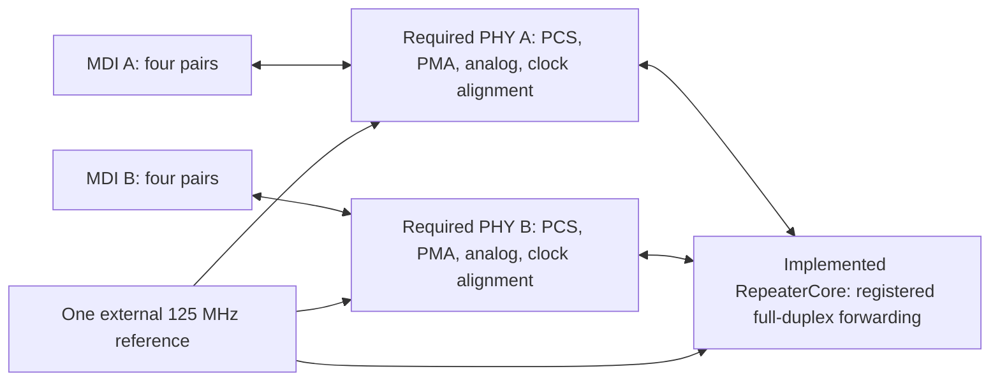

# Single-reference 1G repeater implementation project

The implemented C++RTL top is [`RepeaterCore`](repeater.hpp). It forwards two
clock-aligned GMII streams in opposite directions at 125 MHz, one octet per
clock per direction. The flow converts that class with the root `cpphdl` tool,
synthesizes actual IHP SG13G2 cells, places and routes the core, extracts routed
wire RC, and produces GDSII checked by the IHP KLayout DRC and transistor LVS decks.
The [recorded validation](validation.md) reports the passing core implementation.

**This is the digital core of the requested repeater, not a complete integrated
1000BASE-T copper repeater.** Complete physical PHYs and chip integration remain
open. New hardware clock alignment, partial PCS datapaths, MOS-biased drivers and
a real IHP padframe are described in [chip assembly and verification](chip.md).
The padframe does not yet pass transistor LVS. `--target chip` reports missing blocks and exits with
status 2. The earlier [`1G/`](../../1G/README.md) PAM5 models include sampled
simulation algorithms and ideal sources that cannot become physical cells
automatically. See [requirements and remaining work](requirements.md).

GDSII describes IC masks. PCB Gerber files require a separate board design,
package, magnetics and connectors; this project does not generate PCB files.

## One reference clock

The intended chip has **one external 125 MHz reference**. Its two copper PHYs
still require receive phase recovery and explicit clock alignment. The initial
integration plan uses both ports as MASTER, with their partners as SLAVE. A
different negotiated role requires additional clock-domain/elastic-buffer
implementation and validation; an unrelated receive clock cannot feed the core.



The PHY interfaces must already be aligned to `ref_clock`; the core has no
recovered-clock input or implicit CDC. This is a two-port full-duplex regenerator
architecture, not a half-duplex collision-domain repeater hub.

## Sources and tests

- `repeater.hpp`, `repeater.cpp`: C++RTL forwarding core.
- `constraints.sdc`: 8 ns clock, 100 ps uncertainty, 1 ns input/output interface
  budgets, 100 ps input slew, 6 fF output loads and maximum fanout 8.
- `place_route.tcl`: power grid, placement, clock tree, fanout repair, routing,
  OpenRCX extraction and slow/fast cell timing checks.
- `stream.py`, `fill_core.py`: real GDS master merge and foundry fill.
- `route_tech.py`: a local routing LEF with area-safe fixed vias.
- `checks.py`, `flow.py`: report checking and executable implementation flow.
- [`tests/`](tests/README.md): native, frame,
  RTL/gate, failure-detection and full implementation regression.

## Run

Prepare the PDK using [`../.prepare_IHPSG13G2.sh`](../.prepare_IHPSG13G2.sh), and
build the root `cpphdl` converter. A C++ compiler, Python, `make` and Verilator
are prerequisites. Physical tools are pinned for Ubuntu 22.04 x86-64 and need
no sudo; they occupy roughly 800 MB including download archives.

```bash
cd ~/cpphdl
/usr/bin/python3 analog/pdk/1G_repeater_IHPSG13G2/prepare_tools.py
python3 analog/pdk/1G_repeater_IHPSG13G2/flow.py --target core
```

Tool setup verifies SHA256 hashes for OpenROAD, KLayout, sv2v, the IHP RC model
and exact Ubuntu packages listed in `tool_packages.tsv`. Packages are extracted
locally, without system installation. Existing downloads are verified and reused.
Retirement of a pinned Ubuntu package requires reviewing/updating its pin.

The flow checks:

1. Native C++RTL and generated RTL separately against the forwarding oracle.
2. Independent Ethernet CRC32, preamble/SFD and 12-octet IFG checks.
3. Mapped gates and the post-route netlist against every native vector.
4. Extracted routed RC and nonnegative setup/hold slack with IHP slow/fast cells;
   slew, capacitance and fanout limits must pass.
5. Real GDS standard-cell masters, rejecting missing/empty cells.
6. Full IHP DRC including density, extra, antenna, off-grid and angle checks.
7. Transistor-level LVS in deep mode, checking all 48 signal and supply ports.

After passing, the core layout is `results/core/repeater_core.gds`. That directory
retains RTL, mapped/routed netlists, DEF/OpenDB, CDL, SPEF/SDF, vectors, logs and
KLayout databases. `flow.json` records scope, stages, hashes and remaining chip
work. Generated artifacts and downloaded tools are ignored by Git.

```bash
python3 analog/pdk/1G_repeater_IHPSG13G2/flow.py --target chip
```

This intentionally incomplete target writes `results/chip/flow.json` with the
physical blockers. There is no force option that turns a missing PHY into a
successful chip result. CMake also exposes `repeater-core-gds` and
`repeater-chip-gds` through the existing root/analog build.

## Physical verification boundary

The layout is a **120 x 120 um core block** with nominal 1.2 V supply and actual
IHP standard cells/power grid. It has no padframe, sealring, package or analog
PHY. Foundry filler macros normally use the interior of a chip sealring. For
this standalone block, `fill_core.py` uses its extent and the macros' supported
1 um Metal1–5 fill spacing. PDK exclusion distances and DRC rules are retained.

Default stacked vias can leave intermediate Metal2/Metal3 islands below minimum
area. The local routing LEF filters undersized alternatives and adds single-cut
Via2–4 variants with 0.38 um square or 0.20 x 0.72 um oriented landing pads.
The 0.19 um cut and 20 Ohm resistance follow the PDK single-cut vias. Routing
and GDS import use the same LEF, with automatic via generation disabled.
Installed PDK files and all DRC limits remain unchanged. Final IHP DRC/LVS checks
verify the new physical geometry and connections.

OpenRCX extracts routed DEF using the pinned IHP model from OpenROAD flow scripts.
Timing includes propagated clocks, nominal routed RC, slow 1.08 V/125 C cells
and fast 1.32 V/-40 C cells. It **does not include post-fill coupling extraction**,
analog PHY/pad/package timing, crosstalk, power integrity or full-chip signoff.

Gate simulation uses functional models generated from actual IHP Liberty.
The pinned PDK Verilog models require delayed timing-check signals unsupported
by Icarus 11. No PDK file is patched. Functional comparison is not presented as
an SDF timing simulation; STA is checked separately.

## Primary references

- [IEEE 802.3ab architecture tutorial](https://www.ieee802.org/3/tutorial/march98/mick_170398.pdf):
  four-pair PAM5, hybrid/echo cancellation, PCS/PMA and link timing architecture.
- [IEEE master/slave negotiation contribution](https://www.ieee802.org/3/ab/public/feb98/an1.pdf):
  role resolution and incompatible forced roles. These historical contributions
  are architecture references, not substitutes for normative compliance testing.
- [IHP public PDK](https://github.com/IHP-GmbH/IHP-Open-PDK): actual cells and
  KLayout DRC/LVS decks; the local revision is pinned by the PDK setup script.
- [OpenROAD IHP platform](https://github.com/The-OpenROAD-Project/OpenROAD-flow-scripts/tree/7bcaf475c884e15f674e428aa04dbf92bd0426ed/flow/platforms/ihp-sg13g2):
  platform conventions and RC extraction model.
- [OpenROAD installation](https://openroad.readthedocs.io/en/latest/user/Build.html)
  and [KLayout downloads](https://www.klayout.de/build.html): physical tool binaries.
