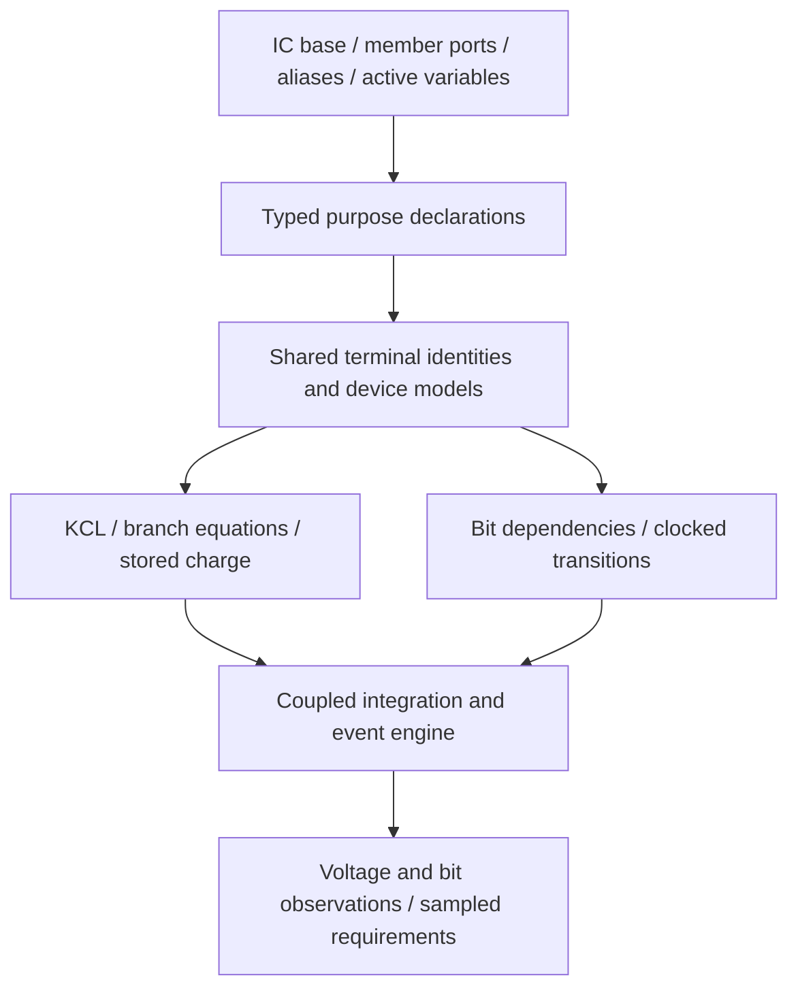

# C++HDL Analog

This reference collects all Markdown documents from `analog/doc/`. Each chapter
includes one source document; code examples and commands retain their original
content. Commands use the working directory specified in the source text.

## Table of Contents

1. [Analog Language](#1-analog-language)
2. [Analog Requirements](#2-analog-requirements)
3. [Analog C++ Specification (Version 0.3)](#3-analog-c-specification-version-03)
4. [Design Decisions](#4-design-decisions)
5. [Native C++ Prototype Architecture](#5-native-c-prototype-architecture)
6. [Class-Controlled Simulation](#6-class-controlled-simulation)
7. [Transient Integration](#7-transient-integration)
8. [Continuing a Transient Simulation](#8-continuing-a-transient-simulation)
9. [Optional Sparse Equation Backend](#9-optional-sparse-equation-backend)
10. [Shared C++HDL and Analog Runtime](#10-shared-chdl-and-analog-runtime)
11. [Regenerating Excluded Artifacts](#11-regenerating-excluded-artifacts)

## 1. Analog Language

Source: [`analog/doc/language.md`](../analog/doc/language.md).

Analog describes connected electronic components using C++20 classes, member
ports and purpose declarations. The surface is ordinary C++; the framework
supplies device equations and evolves the connected network during simulation.

Include `<analog.hpp>` for the core, `<basic/basic.hpp>` for reusable schemas,
or `<cpphdl_analog.h>` for the native C++HDL simulation bridge and schemas.
The namespace is `analog`, also available as `cpphdl::analog`. Link the CMake
target `cpphdl::analog`. The [specification](#3-analog-c-specification-version-03) defines the detailed
semantics; [requirements](#2-analog-requirements) states the design requirements.

The opt-in [class-based simulation backend](#6-class-controlled-simulation) adds inherited device
behavior and replaceable solver, integration and timestep-control classes. It
shares the existing `IC` and wire definitions; it is not yet the default solver
or a qualified replacement for the IHP PSP flow.

### Components and purpose declarations

An IC is a class derived from `IC`. Declare `_PORT(...)` members and put device
purposes in `_assign()`. The base supplies separate `Vdd` and `Vss` ports for
every instance. Bind ports by name, then call `elaborate()` once before running.

The transistor description in [inverter.hpp](../analog/basic/inverter.hpp) illustrates
intention-first descriptions: first enable the output, then add the device that
disables it. Both purposes act on the same wire. The example below puts those
declarations directly in an IC class.

```cpp
#include <analog.hpp>

using namespace analog;
using namespace analog::literals;

class Inverter : public IC {
public:
    _PORT(electrical) A;
    _PORT(electrical) Y;
    mos_model transistor_parameters{};

    void _assign() override {
        auto pmos_vdd = pmos::from(Vdd, transistor_parameters);
        Y = pmos_vdd(A); // First purpose: enable the output from Vdd when A is low.
        Vss = nmos(A, Y, transistor_parameters); // Second purpose: disable it by pulling toward Vss when A is high.
    }
};

int main() {
    simulation sim;
    electrical A, Vdd, Vss;
    sim.reference(Vss);
    Vdd = sim_voltage_source(Vss, 1.2_V);
    A = sim_voltage_source(Vss, 0_V, 1_us, 1.2_V);

    Inverter gate;
    gate.A = A;
    gate.Vdd = Vdd;
    gate.Vss = Vss;
    gate.elaborate();
    gate.Y = capacitor(Vss, 10_pF); // External storage participates in the same network.

    sim.observe("Y", gate.Y, Vss);
    sim.assume_voltage("supply range", Vdd, Vss, 1.1_V, 1.3_V);
    sim.require_final_voltage("output low", gate.Y, Vss, 0_V, .05_V);
    sim.run(2_us, 5_ns);
    return sim.status() == "sampled_pass" ? 0 : 1;
}
```

`=` is a purpose declaration that also handles assignment/connection according
to the participating types. The two transistor purposes remain present together.
Connected loads, stored charge and supply impedances can change the achieved
output. The solver combines their terminal relations across all class boundaries.

`_assign()` creates the model graph during elaboration. The registered equations
continue to act throughout simulated time. Source order does not isolate one
device's behavior from the next device or from external components.

Circuits whose purpose can be expressed as a sequence of functional blocks—such
as a PLL, VCO or inverter—fit this language well. Describe the main intentions
first, then add secondary elements for biasing, compensation, decoupling or
protection. This ordering keeps the purpose readable while allowing supporting
and corrective elements to be developed afterward. Once declared, all elements
participate together in the physical equations, including feedback and loading;
their order in the description is not a sequence of simulation steps.

### Wires, active variables and hierarchy

`electrical` holds a shared node identity. An active type such as
`capacitance Y{10_pF, Vss}` adds charge storage to that node. Ports pass directly
to devices; they do not need a getter call.

Parent ICs contain child IC members, bind their ports and call each child's
`elaborate()`. Parents connect child supply ports explicitly. C++ classes and
templates select implementations: for example, `cmos<channel_model>` declares
MOS devices, while `cmos<fast_model>` uses a controlled-conductance approximation.
A model's accuracy must be established for the intended operating conditions.
See [class variants](../analog/examples/class_variants/README.md).

The [basic schemas](../analog/basic/README.md) define inverters, amplifiers and a
regulator through visible device connections. Their names do not select hidden
circuit topologies in the solver.

### Checks and observations

These are implemented C++ calls on a `simulation` object:

- **Call:** `sim.reference(Vss)`

  **Meaning:** Choose the electrical zero reference

- **Call:** `sim.observe("Y", Y, Vss)`

  **Meaning:** Record a voltage difference

- **Call:** `sim.observe("Q", Q)`

  **Meaning:** Record a managed bit signal

- **Call:** `sim.assume_voltage(name, A, Vss, low, high)`

  **Meaning:** Check a sampled experiment envelope

- **Call:** `sim.require_final_voltage(name, Y, Vss, low, high)`

  **Meaning:** Check the final achieved voltage

- **Call:** `sim.require_final(name, Q, expected)`

  **Meaning:** Check a final managed bit value

- **Call:** `sim.require_trace(name, predicate)`

  **Meaning:** Check measured behavior over the completed trajectory

- **Call:** `sim.run(stop, step)`

  **Meaning:** Integrate the declared network and evaluate its checks

- **Call:** `sim.write(directory)`

  **Meaning:** Write generated equations, traces and a report

Declare observations and checks before `run()`. Requirements evaluate the chosen
circuit and trajectory; they do not choose an implementation or force a node to
meet its goal. Reports distinguish sampled pass, failure, missing evidence and
violated assumptions. A passing sampled check does not prove all operating cases.

`require_trace` takes a testbench callback receiving `const std::vector<sample>&`.
Return `true` for a sampled pass, `false` for failure, or `std::nullopt` for missing
evidence. Sample values follow observation order. The callback runs after integration;
it adds no physical law or feedback. A violated global assumption suppresses it and
marks its requirement out of contract. See the commented
[LDO](../analog/examples/ldo/main.cpp), [PLL](../analog/examples/pll/main.cpp) and
[AGC](../analog/examples/agc/main.cpp) for settling, edge/phase and peak measurements.

### Simulation-only behavior and digital boundaries

The `sim_` prefix marks ideal behavior or host simulation adapters. For example,
`sim_voltage_source` supplies an ideal stimulus, `sim_store` implements ideal bit
storage, and `sim_sense` interprets voltage thresholds. `sim_sense` contains no
physical sensing circuit. `sim_driver` supplies a behavioral finite-resistance
output path. The [primitive naming contract](#simulation-only-primitives)
lists these APIs.

Native C++HDL `Module`, `logic` and `reg` classes participate through explicit
`sim_to_cpphdl`, `sim_clock_cpphdl` and `sim_registered_output` adapters. All active
next states are computed before any state commits. The
[mixed-signal example](../analog/examples/mixed_signal/README.md) demonstrates the
implemented bridge and its physical loading and charge-continuity checks.

### Execution and validation

Elaboration collects device laws and connections. The engine assembles shared
node-current equations, solves the nonlinear network and integrates capacitor
state with backward Euler by default or explicit [BDF2](#7-transient-integration).
Both require time-step refinement; neither provides local-error adaptivity.
Threshold views and digital events are
coordinated with that solve. Physical equations are generated from the declared
devices; there is no automatic topology synthesis from a function name.

From the package root:

```bash
cmake -S analog -B analog/build -DCMAKE_BUILD_TYPE=Release \
  -DBUILD_TESTING=ON -DCPPHDL_BUILD_ANALOG_TESTS=ON
cmake --build analog/build -j 4
ctest --test-dir analog/build --output-on-failure -L analog
```

The [CTest suite](../analog/tests/README.md) checks physical behavior, IC hierarchy,
simulation boundaries and native digital interoperability. The
[architecture](#5-native-c-prototype-architecture) and [specification](#3-analog-c-specification-version-03) document
model and numerical limitations.

### Verilog-A output

`cpphdl --verilog-a source.hpp --top MyIC --ports Vdd,Vss,IN,OUT --output MyIC.va`
compiles and elaborates the native class before emitting its physical relations.
The [backend guide](../analog/VerilogA/README.md) defines its supported subset, C++ API,
initial-condition contract and independent OpenVAF/ngspice comparisons. This path
adds no alternate electronic description syntax.

## 2. Analog Requirements

Source: [`analog/doc/requirements.md`](../analog/doc/requirements.md).

### 1. Purpose first; connected components influence one another

During component development, describe its purpose/intention briefly. The framework
provides its underlying formulas. Connected components influence and change one
another's behavior as simulated physical time evolves. A load, supply impedance,
or feedback connection can correct an IC's behavior, prevent its purpose from
being achieved, or drive it outside its operating envelope.

The integration/simulation engine combines all connected terminal relations,
conservation equations, continuous state, and discrete events. An intention never
forces the numerical result to satisfy itself. Functional failure and physical
damage are different; damage requires an explicit thermal/failure model.

Acceptance: [shared supply and switched loading](../analog/examples/mutual_influence/README.md),
[feedback](../analog/examples/opamp_feedback/README.md), and
[native mixed-domain composition](../analog/examples/mixed_signal/README.md).

### 2. Declare ICs line by line in C++, adding devices and connecting them with wires

**The language is native C++.** Describe each IC as a C++ class derived from `IC`.
Inherit the public `Vdd` and `Vss` electrical ports from `IC`; declare additional
ports as `_PORT(...)` members, following C++HDL. Pass ports directly to
devices and digital purposes, without getter calls. Supply ports are per instance and
connect explicitly, including between parents and children. Inheritance adds no
voltage source or reference. Unused ports require no equations; physically used
floating rails remain errors. Put its purposes in
`_assign()` and connect member ports externally; do not define IC constructors. Add one device
to deliver a function; add another to correct, constrain, disable, or complement
that function. Declare wires and use them to connect the devices. Each line states
a purpose; together the devices determine actual behavior.

```cpp
electrical Y; // Declare the common output wire.
auto pmos_vdd = pmos::from(Vdd); // Alias for a PMOS supplied from Vdd.
Y = pmos_vdd(A); // First device enables the output when A is low.
Vss = nmos(A, Y); // Second disables it by pulling Y low when A is high.
```

`=` is a **purpose declaration that also handles assignment/connection**, with
semantics supplied by the participating C++ types. Both electrical declarations
remain present; the second does not erase the first. Their shared wire makes
their physical effects interact. `IC::elaborate()` calls `_assign()` once, before integration;
their physical laws remain active throughout simulation.

Types can express more than plain connectivity. An active variable such as
`capacitance Y{10_pF, Vss};` adds charge storage to its connected node. Device/IC
types such as `pmos`, `nmos`, and `cmos<>` are usable as C++ variables. Aliases,
classes, templates, and model policies support reuse and faster versus more detailed
versions. There is no separate text grammar or `&` composition operator.

Define functional blocks such as an inverter, op-amp or regulator as ordinary IC classes composed of
devices and feedback connections. Their names must not select a special solver
law. Put reusable basic schemas in [basic/](../analog/basic/README.md). Define amplifiers
from visible device connections, including bias, compensation and load paths.
Any approximate model must expose its mathematical boundary and limitations.
See the [level inverter](../analog/basic/level_inverter.hpp), [op-amp](../analog/basic/opamp.hpp) and
[regulator](../analog/basic/regulator.hpp). Fast approximations must also expose their
component connections; reusable elemental model laws belong in the framework.

Acceptance: [exact two-purpose form and active variables](../analog/examples/two_transistor_expression/README.md),
[named device variables](../analog/examples/transistor_pair/README.md), and
[model types](../analog/examples/class_variants/README.md).

### 3. Purpose declarations, mathematical models, and constraints stay distinct

A device class declares its purpose and terminal contract. Its selected model
supplies equations. Separate assumptions and requirements describe the operating
envelope and acceptance bounds. A target is not evidence that the result reached
it. Reports must distinguish sampled pass, sampled fail, unknown/unverified, and
out of contract. Unsupported observations must not acquire invented precision.

### 4. Types and terminal identities determine meaning

`electrical` represents a shared bidirectional connection. Copy construction
references the same wire; an electrical purpose/connection preserves the target
wire identity and joins terminal relations. Digital `bits<W>` represents a
single-writer value; a purpose computes or stores its assigned value. Physical
quantities have distinct C++ types, so capacitance cannot be supplied as resistance.
Supply rails are real network nodes, and voltage always has a reference.

### 5. Class hierarchy must retain connected physical interaction

`IC` provides shared simulation membership, identity, optional naming, and a
guarded declaration lifecycle. Native IC objects are noncopyable and nonmovable;
wire handles remain copyable. An IC can contain devices and other IC instances. Class boundaries are never
simulation isolation boundaries. All connected terminal equations are assembled
together. Model policies such as `cmos<fast_model>` and `cmos<channel_model>` expose
the same port shape and purpose, but replacement accuracy requires evidence over
specified observations and an operating envelope. More detail does not prove
greater accuracy. Native C++ inheritance does not prove behavioral substitutability.

### 6. Continuous state and digital state require coordinated execution

The prototype integrates explicit capacitor charge, solves algebraic
feedback, and coordinates threshold views and digital edge events. Registers
compute next state from one old-state snapshot and commit simultaneously, following
the useful separation in C++HDL work/strobe examples. Known stimulus discontinuities
preserve continuous state. Unknown bits cannot silently select a physical rail.

### 7. Evidence must declare its scope and model limitations

A successful execution checks one sampled trajectory of selected models. It is
not a proof across every load, temperature, process corner or time. A numerical
failure is not proof of physical impossibility. Model provenance and source
locations accompany generated equations. Power, noise, jitter, metastability,
and damage need dedicated validated models and analyses.

### 8. Share C++HDL definitions and preserve mixed-domain state semantics

The framework belongs in the C++HDL package under `analog/`. Keep the intersection
minimal: `IC` and digital `Module` are independent bases, sharing only the typed
`_PORT` declaration selector. `IC` must not inherit the digital
module lifecycle. Analog ports retain shared-node identities; native digital ports
retain lazy value bindings. Select by port type, without a runtime mode flag or
implicit owner detection. Keep physical types distinct from digital values and
preserve the existing native `logic<W>`/`reg<T>` definitions. The analog core must
build without the digital port implementation or native cache clock.

Native modules use explicit known-value and clock boundaries. Compute all next
states before committing any state on an edge. Re-solve physical equations after
commit while preserving capacitor charge. Unknown analog interpretations must
not become invented two-state native inputs or clocks. Retain native module
ownership for the full run. Demonstrate this in [mixed_signal/main.cpp](../analog/examples/mixed_signal/main.cpp)
and run regressions from [tests/](../analog/tests/README.md). Native co-simulation does not
imply mixed-signal SystemVerilog synthesis.

### 9. Examples and explanations must match the executable language

Every current example uses commented C++ source (`main.cpp`), a folder explanation,
build/run instructions, equations, trace and report where applicable. Include
positive behavior and deliberate failures. Regression checks use independent
physical expectations and event semantics. Generate equations, traces and reports
locally; they are not required source files.

### 10. Simulation-only primitives must be explicit

Prefix primitives that supply ideal behavior, external stimuli, direct bit
evaluation or host co-simulation with `sim_`. Examples and generated equations
must use those names too, without unprefixed compatibility aliases. Device-law
primitives such as `pmos`, `nmos`, `resistor` and `capacitor` retain their names;
their model approximations remain documented separately. A `sim_sense` purpose
interprets a voltage and provides no physical receiver circuit. Compound hardware
functions still require explicit classes in `basic/`.

### 11. Simulation behavior and numerical control use C++ classes and inherited traits

Each simulated object owns an overridable behavior implementation. Derived
device classes inherit ports, parameters and traits, and specialize their
physical equations or internal state through virtual overrides and ordinary
C++ overloads. Traits describe capabilities and model limits; inheritance alone
does not establish accuracy or equivalence.

Linear solving, nonlinear solving, integration, timestep control and overall
simulation coordination must also have replaceable class interfaces. Device
objects contribute to a shared coupled solve so their connections retain mutual
influence. Stateful objects commit once on acceptance and restore state on a
rejected trial; an object must not independently advance past connected objects.

The [class-based backend](#6-class-controlled-simulation) implements an opt-in prototype and
regressions. Complete legacy mixed-signal integration and the IHP PSP/ngspice
replacement remain unfinished. Replacement requires the same model inputs,
independent electrical checks on both outputs, complete waveform comparison and
measured performance; a declared speed target is not a benchmark result.

### 12. Native simulation first; short development and full qualification profiles

C++RTL is the primary simulation engine. Ngspice supplies an independent
correctness reference, using the same circuit, model parameters, initial state,
stimuli, loads and physical time window. Check each output against the same
independent circuit requirements before comparing the outputs. A native failure
must not fall back to ngspice and report native success. Process-model
equivalence requires the actual PSP/MOSVAR models, not a generic MOS surrogate.

Cover distinct numerical workloads, not merely many parameter variations of
one circuit: DC bias/sweeps, charge and flux storage, nonlinear devices, source
breakpoints, switching, coupled parasitics, feedback, oscillators, digital/analog
events, ADC conversion, transmitter/receiver signal paths and process corners.
Unsupported workloads remain explicit coverage gaps.

Development regressions use small representative circuits, short event windows
and a few sweep points, with bounded runtime and retained waveform size. Preserve
edge resolution, sampling apertures and required dynamics; reducing saved output
alone does not reduce integration work. Long startup, lock, drift and complete
ASIC qualification remain separate profiles with their full original contracts.
Smoke success cannot satisfy those qualification requirements.

Use [tests/workloads](../analog/tests/workloads/README.md) for process-independent
solver checks and [tests/IHPSG13G2](../analog/tests/IHPSG13G2/README.md) for process
solver coverage. Circuit-level and full-chip verification keep their existing
locations. Record build/queue/solver/checker timings separately where available;
never interpret total CTest elapsed time as measured solver CPU time.

## 3. Analog C++ Specification (Version 0.3)

Source: [`analog/doc/specification.md`](../analog/doc/specification.md).

The surface language is C++20. There is no custom parser, separate grammar, or
model-composition operator. Include `<cpphdl_analog.h>` for the shared runtime,
bridge and schemas, or `<analog.hpp>` for the analog core and
`<basic/basic.hpp>` for reusable schemas. Namespace `cpphdl::analog` aliases
`::analog`; physical literals remain available through its `literals` namespace. This specification defines the library's
purpose declarations, typed variables, elaboration and execution semantics.

### 1. Class and purpose model

An IC is a C++ class derived from `IC`, with `_PORT(...)` members and an overridden
`_assign()` containing its device purposes. It has no user-defined constructor.
Default construction creates member handles; named member bindings establish the
interface before one-time elaboration.
A purpose can deliver a function, correct it, store a result or constrain a shared
connection. Each device supplies terminal laws and state through its model class.
The minimal inverter is:

```cpp
electrical Y;
auto pmos_vdd = pmos::from(Vdd);
Y = pmos_vdd(A);
Vss = nmos(A, Y);
```

The first device's purpose enables Y from Vdd when A is low. The second disables
that output by conducting Y toward Vss when A is high. Both use Y throughout
simulation. The meanings are conditional on the actual terminal voltages; they
are not ideal digital switches or unconditional voltage assignments.

`=` is a purpose declaration that also handles assignment/connection. Its semantic
effect is type-directed. For electrical purposes, it retains the LHS wire identity
and adds the selected device terminal relation to that wire. For digital purposes,
it binds the computation or storage that will assign the signal's value. Native
C++ calls and overload resolution perform elaboration; physical solving happens
later. Ordinary C++ numeric `=` retains ordinary C++ semantics outside these types.

The chosen C++ spelling does not prove the requested purpose succeeds. A load can
prevent Y reaching a valid high level. Separate constraints record acceptance
requirements. The inverter class contains its two device lines explicitly;
its name does not create hidden topology.

#### Common IC base and member ports

```cpp
class Inverter : public IC {
public:
    _PORT(electrical) A;
    _PORT(electrical) Y;

    void _assign() override {
        auto pmos_vdd = pmos::from(Vdd); // Source-bound alias, using the inherited supply port.
        Y = pmos_vdd(A); // Enable the output when A is low.
        Vss = nmos(A, Y); // Correct/disable it by pulling the same Y low when A is high.
    }
};

Inverter gate;
gate.A = A;
gate.Vdd = Vdd;
gate.Vss = Vss;
gate.name("gate"); // Optional label; identity is unique within its simulation.
gate.elaborate();
```

`IC` declares public `_PORT(electrical) Vdd;` and `_PORT(electrical) Vss;`.
Derived classes inherit these ports and must not redeclare/shadow them. Each
instance has a distinct pair; there are no global or automatically connected rails.
A parent binds child rails explicitly, for example `child.Vdd = Vdd;` and
`child.Vss = Vss;`. Additional supply domains use additional named ports.

`IC` is abstract, noncopyable and nonmovable, with a virtual destructor and
`virtual void _assign() = 0`. `owner()`, `id()` and `name()` supply common identity
and context. Its protected default construction registers a descriptor in the
current simulation. No C++ object pointers are retained in that descriptor.
A component must be elaborated in its owning simulation before a run.

`elaborate()` is the lifecycle entry point: it dispatches `_assign()`, records
success, restores the enclosing component context, and makes repeat requests
idempotent. Recursive declaration or a previously failed declaration is rejected.
A simulation with an undeclared/failed IC cannot run. `_assign()` is the override
hook; call `elaborate()` externally and for child ICs so the lifecycle guard applies.
Do not invoke the hook directly to bypass that guard.

`_PORT(T)` uses the shared `cpphdl::port<T>` selector. Electrical/active ports
and analog-engine `bits<W>` select `analog::port<T>`. Native digital values
such as `cpphdl::logic<W>` retain `cpphdl::function_ref<T>`. An electrical port has the same shared
wire semantics as its underlying type. Pass ports directly, for example
`sim_controlled_resistor(Vdd, A, Vss, R, low, high)`. Primitive electrical parameters
bind to the underlying wire by ordinary C++ inheritance. This does not sample a
voltage or advance time. Active electrical ports retain their registered device
models. Digital templates likewise accept bit ports and deduce their widths.
Electrical member bindings join nodes, while bit member bindings declare value-copy
relations with the existing one-writer checks. Nested port connections preserve
old-state/simultaneous-commit semantics.

`_PORT(capacitance) Y{10_pF, Vss};` declares an active member port using the
inherited Vss. Base members initialize before derived members, so the reference
already exists when the active port registers its storage model. Member initializers configure
active types without IC constructor arguments. Primitive/model classes still use
ordinary C++ object initialization internally.

`IC` groups multiple typed ports rather than representing a single node. Its
inherited supply ports are ordinary wires; the base creates neither a voltage
source nor a ground reference. Unused rails may remain unbound in logical or
passive models. A rail used by a physical model, observation, or voltage constraint
must participate in the physical solve; a floating rail remains an error. Reading
an unused, unsolved rail after a run raises `E_UNVERIFIED`.
Its instance boundary never isolates physical equations. Device descriptors
created inside `_assign()` carry that IC's identity, and reports list registered
components. Intrinsic models from active-variable initializers and external loads
can exist outside that hook; they remain in the same global equation system.

The selector lives in the package's `cpphdl_port_traits.h`; both include orders
use the same macro. `IC` and native `Module` are independent bases, each owning
its instance label `__inst_name` and lifecycle.
`IC` does not inherit digital scheduling or port evaluation. Native digital ports retain
their lazy callable bindings while analog ports retain shared-node identities;
selection depends on the port type, not an inferred enclosing class or runtime flag.
Legacy `CPPHDL_STATIC` is rejected for analog schemas, which need per-instance ports.

### 2. Wires, terminal contracts, and identity

#### Simulation-only primitives

The `sim_` prefix identifies ideal behavioral primitives and host integration.
It does not claim that other device models are exact or that analog RTL synthesis
is implemented. Transistor and passive-device laws retain their device names.
Compound physical functions belong in explicit `basic/` schemas. There are no
unprefixed aliases for the following simulation-only APIs:

- **Primitive:** `sim_voltage_source`

  **Simulation behavior supplied:** Ideal constant or stepped voltage stimulus with unrestricted drive

- **Primitive:** `sim_buffered_track`

  **Simulation behavior supplied:** Ideal unloaded input buffer and finite clock-controlled output drive; storage must be explicit

- **Primitive:** `sim_pwl_voltage_source`

  **Simulation behavior supplied:** Prescribed continuous piecewise-linear bench voltage waveform

- **Primitive:** `sim_controlled_resistor`

  **Simulation behavior supplied:** Prescribed conductance transfer with ideal, unloaded control terminals

- **Primitive:** `sim_driver`

  **Simulation behavior supplied:** Bit-controlled resistance to actual rails, without an output-stage circuit

- **Primitive:** `sim_add`, `sim_invert`

  **Simulation behavior supplied:** Direct computation of managed bit values, without gate topology

- **Primitive:** `sim_store`

  **Simulation behavior supplied:** Ideal edge-triggered bit storage, without register circuitry

- **Primitive:** `sim_sense`

  **Simulation behavior supplied:** Threshold interpretation of solved voltage, without input loading or a sensing circuit

- **Primitive:** `sim_cpphdl_value`, `sim_to_cpphdl`

  **Simulation behavior supplied:** Read and bind managed signals to host-executed C++HDL values

- **Primitive:** `sim_clock_cpphdl`, `sim_registered_output`

  **Simulation behavior supplied:** Schedule native module callbacks and read committed state

Operations on an explicit `simulation` object, such as `sim.clock()` and
`sim.observe()`, already declare their simulator scope. They keep their member
names. Wire types, units, device parameters and reusable IC class names are unchanged.

`electrical Y;` creates a node handle in the currently active `simulation`.
Construct the simulation before constructing circuit variables. All terminals in
a connection must belong to that simulation. `sim.reference(Vss)` identifies the
reference node with zero, fixing the voltage gauge. Rails remain ordinary wires.
No supply voltage is invented by a name such as Vdd.

A device class constructs its model and exposes a terminal handle for the purpose
on the LHS. The core contracts are:

- **C++ expression:** `pmos(A, Vdd)` or `pmos_vdd(A)`

  **Purpose target on LHS:** Drain/output

  **Other terminals / effect:** Gate A, source Vdd; enable from high rail at low A

- **C++ expression:** `nmos(A, Y)`

  **Purpose target on LHS:** Source/low-rail connection

  **Other terminals / effect:** Gate A, drain Y; pull Y toward the target at high A

- **C++ expression:** `resistor(IN, R)`

  **Purpose target on LHS:** Other end of the resistor

  **Other terminals / effect:** One end IN; conduct according to voltage difference

- **C++ expression:** `sim_controlled_resistor(IN, CONTROL, REF, R, low, high, response)`

  **Purpose target on LHS:** Other path terminal

  **Other terminals / effect:** Bidirectional conductance controlled by CONTROL relative to REF

- **C++ expression:** `inductor(REF, L, initial_current)`

  **Purpose target on LHS:** Other branch terminal

  **Other terminals / effect:** Store branch current; V = L dI/dt

- **C++ expression:** `transconductor(REF, PLUS, MINUS, gm)`

  **Purpose target on LHS:** Output terminal

  **Other terminals / effect:** I(output -> REF) = -gm V(PLUS, MINUS)

- **C++ expression:** `diode(CATHODE, Ron, drop, Rleak)`

  **Purpose target on LHS:** Anode

  **Other terminals / effect:** Piecewise-linear forward path and explicit reverse leakage

- **C++ expression:** `sim_buffered_track(IN, CLK, REF, R, low, high, response)`

  **Purpose target on LHS:** Buffered output

  **Other terminals / effect:** I(output -> REF) = G(CLK) V(output, IN); zero input current

- **C++ expression:** `capacitor(Vss, C, initial)`

  **Purpose target on LHS:** Charge-storage node

  **Other terminals / effect:** Other end Vss; retain differential voltage state

- **C++ expression:** `sim_voltage_source(Vss, V)`

  **Purpose target on LHS:** Source positive terminal

  **Other terminals / effect:** Negative/reference terminal Vss

- **C++ expression:** `sim_driver(bit, Vdd, Vss, R)`

  **Purpose target on LHS:** Driven output

  **Other terminals / effect:** Bit selects finite resistance to an actual rail

The PMOS/NMOS call orientations intentionally follow the requested enable/disable
purposes. They are declared API contracts, not inferred from a technology label.
Underlying channel laws still depend on all terminal voltages and support reversed
channel current. The PMOS alias is an ordinary C++ callable with its source bound:
`auto pmos_vdd = pmos::from(Vdd, model);`.

Electrical copy construction references the same node: `electrical alias = Y;`.
Electrical purpose/assignment `alias = other_wire;` joins node identities rather
than rebinding and abandoning the existing network. There is no electrical
single-writer rule: many device purposes can influence the same node.

Device objects such as `pmos pull_up{A, Vdd};` represent one physical model and expose
its purpose terminal via conversion to an electrical handle. They are noncopyable;
wire handles remain copyable. Destroying a construction handle does not remove a
model: the simulation owns the elaborated descriptors until it is destroyed.
Adding a new purpose after integration starts is rejected as `E_ELABORATION`.

### 3. Active variables and reusable IC types

```cpp
capacitance Y{10_pF, Vss, 0_V};
Y = pmos_vdd(A);
Vss = nmos(A, Y);
```

`capacitance` is an active variable type: it contains a node with a capacitor model
to the supplied reference. The value argument has type `capacitance_value`.
Its initial voltage is explicit or defaults to 0 V. It remains usable anywhere an
electrical connection is expected. These exact same two transistor purposes now
interact with charge storage. An `electrical Y` plus `Y = capacitor(Vss, 10_pF)`
has equivalent equations at matched initialization.

An IC is also a C++ type. `cmos<> gate;` instantiates the library's
explicit two-device inverter class. Bind `gate.A`, `gate.Vdd` and `gate.Vss`,
then call `gate.elaborate()`; `gate.Y` is its output wire. Here `cmos` is a
specific library class name, not an implicit assertion that CMOS technology means
inversion. Its body and model policies are visible in the header.

`cmos<fast_model>` elaborates a `level_inverter` child with two explicit
controlled-resistor paths to the actual rails;
`cmos<channel_model>` uses the two square-law device purposes. Both remain electrical
and load-dependent. Their shape is compatible in C++; behavior/accuracy equivalence
requires observations, an envelope and error bounds. C++ inheritance or templates
alone provide no physical equivalence proof. Classes can contain other class
instances, as the nested digital pipeline demonstrates. There is no numerical
isolation at class boundaries.

Reusable schemas live in [basic/](../analog/basic/README.md). The library includes
`cmos<Model>`, `level_inverter`, `rc_filter`, `resistor_divider`, `nmos_differential_pair`,
`pmos_current_mirror`, `opamp`, `non_inverting_amplifier`, and `regulator`.
Include an individual `<basic/name.hpp>` or the `<basic/basic.hpp>` umbrella.
All schemas use inherited rails, member ports, and `_assign()`.

`opamp` contains a two-NMOS input pair and a two-PMOS current mirror. The input
pair shares a source node returned through a tail resistor. Its PLUS branch
controls the mirror; the mirror supplies the MINUS/output branch. Increasing PLUS
relative to MINUS increases output charging current. The output also connects to
an explicit compensation capacitor and a shunt resistor. The mirror has an
explicit weak bias-return resistor to define its gate voltage when the input
branch is off. These elements all participate in the physical solve.

Gain and bandwidth are consequences of transistor parameters, bias, capacitance,
and loading. There is no op-amp gain parameter, artificial rail clamp, hidden state,
or amplifier-specific backend law. This is a single-stage educational OTA used
as an op-amp, with restricted common-mode range, voltage swing, and available
current. It is not a general precision or rail-to-rail amplifier. Explicit resistor
and capacitor values, initialization, and topology are documented in basic/.

`non_inverting_amplifier` connects an op-amp and a resistor divider. A 1:1 divider
intends a closed-loop gain of two, while its loading and finite transistor drive
cause error. `regulator` connects a PMOS pass device and an `opamp` child. It binds
`error.PLUS = OUT;`, `error.MINUS = REF;`, and `error.OUT = CONTROL;`, sharing its
rails with the child. Excess output raises the pass gate and reduces current.
REF is an electrical input, supplied by an explicit reference stimulus in the
example. Output storage and load are external. Both amplifier and pass-device
supply currents load the actual shared supply wire.

Neither class name selects a special equation. The regulator expands recursively
into five MOS devices, resistors, and a capacitor; the global engine knows only
their terminal relations. There is no numerical boundary between those classes.

### 4. Dimensions and defaults

Voltage, duration, resistance, capacitance value, and channel strength are distinct
C++ types with explicit SI representations. Constructors do not implicitly convert
between dimensions. Examples use `_V`, `_mV`, `_us`, `_ns`, `_ms`, `_Ohm`, `_kOhm`,
`_pF`, `_nF`, `_uF` and `_mA_per_V2`. Supplying `1_nF` as a resistance is a C++
compile error. R, C, beta and threshold are positive. Schema configuration uses
the same dimensioned types as elementary device models.

`mos_model` has shared educational defaults beta=1 mA/V² and threshold magnitude
0.35 V. Override with `mos_model{2_mA_per_V2, .4_V}` or a model policy. Defaults
are versioned framework model parameters, not hidden constants per IC. The selected
parameters and model source locations are written to the equation artifact.

### 5. Consequence laws and automatic coupled lowering

After port binding and `_assign()` elaboration, node aliases are canonicalized.
Nodes used by physical models, analog sensing, observations, or voltage constraints
enter the equation system. Every participating nonreference node gets one voltage
unknown and KCL equation. Completely unused wires, including inherited rails, have
no solved voltage and introduce no equation. Ideal sources and capacitors add branch
current unknowns. Capacitor initial conditions supply continuous state. Positive current from
a to b contributes +I at a and -I at b.

```text
R: I(a->b) = (Va-Vb)/R
C: I(a->b) = C*d(Va-Vb)/dt; initial Va-Vb is supplied
source: Va-Vb = prescribed waveform; branch current is solved
NMOS: ov=Vg-Vs-Vt; ds=Vd-Vs
      I=0 if ov<=0
      I=beta*(ov*ds-ds²/2) if 0<=ds<ov
      I=beta*ov²/2 otherwise
      swap drain/source and negate current if Vd<Vs
PMOS: apply the NMOS law to negated voltages, then negate current
```

MOS gate current is zero; intrinsic charge, body effects, leakage and foundry
corners are omitted. External capacitance supplies the example's charge storage.
Channel and rail-driver models stamp their terminal currents on both connected
rails. The amplifier schemas inherit these laws: their bias and load currents
are present in the shared supply network. Intrinsic transistor charge, body
junctions, channel-length modulation, thermal effects, and failure models remain
omitted, so topology alone does not establish physical accuracy.

The general controlled-resistor law uses
`f = clip((Vcontrol-Vreference-low)/(high-low), 0, 1)` and `I(a->b)=G*(Va-Vb)`.
A rising control response has `G=f/R`; a falling response has `G=(1-f)/R`.
R is positive and finite, and the finite control interval satisfies low < high.
Its control/reference terminals draw no current; the two path terminals retain
bidirectional electrical influence. There is no implicit source or ground.

The [level inverter](../analog/basic/level_inverter.hpp) binds one falling path between
Vdd and Y and one rising path between Y and Vss. Both use A relative to Vss as the
control. The solver sees two controlled resistors, with ordinary shared-node KCL.
The resulting approximation preserves finite drive, supply loading and arbitrary
external coupling. It adds no intrinsic storage or special inverter equation.
Its interpolated conductances are an explicit approximation, not a measured
transistor transfer characteristic.

### 6. Digital purposes and hybrid composition

`bits<W>` is an unsigned value signal, 1<=W<=64. One purpose or external stimulus
assigns it. Examples: `SUM = sim_add(A, B);`, `Q = sim_store(D, CLK);`, `DATA = sim_sense(A, Vss, low, high);`, and `Y = sim_driver(Q, Vdd, Vss, R);`. Digital wire copy construction aliases
a signal; copy assignment declares a value-copy purpose. Addition wraps modulo
2^W, including exact unsigned 64-bit wrapping. Wider arithmetic is deferred.

`sim_store` initializes to 0 unless a third initial-value argument is supplied. It
captures on definite 0→1 clock transitions. Every active register computes from
one settled old-state snapshot; all updates commit simultaneously. A captured
unknown data value remains unknown. Ambiguous 0→unknown or unknown→1 clock changes
make capture unknown rather than inventing retention. Initial clock levels cause
no synthetic edge.

`sim_sense` gives 0 for V<=low, 1 for V>=high and unknown in between. Unknown propagates
through bit computations, is JSON null/empty CSV, and cannot select a physical
driver rail. A threshold view does not model metastability. Pure combinational
cycles are rejected; storage explicitly breaks them.

Native C++HDL registers can also participate. `sim_to_cpphdl(signal)` binds a known
analog-engine signal to a native input. `sim_clock_cpphdl(shared_module, CLK)` calls
its `_assign()`, retains ownership, resets it once at run initialization, and
advances `_work(false)` on definite rising clock edges. `sim_registered_output<W>`
exposes pure registered-state outputs as analog-engine signals. Unknown inputs or
clocks raise `E_UNKNOWN_CPPHDL`; widths above 64 are rejected at compilation.
On an edge, all native work and all internal store sampling precede every commit.
After commits, algebraic variables settle while capacitor voltages stay continuous.
Native output ports must expose stored state, not arbitrary combinational input
paths. The [integration contract](#10-shared-chdl-and-analog-runtime) defines lifecycle, cache
epochs, ownership and supported interfaces.

### 7. Simulation ordering and evidence

`sim.run(stop, step)` checks IC lifecycle states, freezes topology, and checks read bit signals/writers/dependencies,
seeds known sources and charge, and solves the initial algebraic system at fixed
continuous state. A run can be executed only once for an elaborated simulation.
Known source steps and clock events supplement the regular integration grid.

For each next timestamp, integrate to the left side with the selected method
(backward Euler by default, or explicit [BDF2](#7-transient-integration)), apply
right-sided source changes holding capacitor charge, settle physical/bit
views, commit all active register next states together, and settle generated event
deltas. Record the right-sided sample. Exact event timestamps take priority over
nearly equal floating-point grid points. Unknown analog crossings are sampled;
root localization is not implemented.

The dense solver uses finite-difference Jacobians, scaled partial pivoting and
damped Newton. KCL/current rows scale by 1mA and voltage/state rows by 1V;
normalized residual tolerance is 1e-8. Before backtracking, the trial voltage
change is bounded by one quarter of the current voltage scale (at least 1 V).
This limits enormous updates from off channels with weak physical returns;
it adds no conductance or state constraint. A rank check is performed even at zero
residual. Limits: 60 Newton iterations, 24 line-search/boundary/event iterations,
100000 regular steps and 100000 half-period events per clock. A singular or
nonconvergent solve is not proof of physical infeasibility.

`assume_voltage` checks a sampled global experiment envelope. Final voltage/bit
requirements check actual final values. Voltage comparisons allow 1e-8 V numerical
tolerance, assumptions 1e-9 V; bit comparisons are exact. A violated global
assumption marks quantitative requirements out of contract. Per-class conditional
assume/guarantee inference is a future extension of this native prototype.

`require_trace(name, predicate)` registers a completed-trajectory bench requirement.
The callback receives `const std::vector<sample>&` in observation order and returns
`std::optional<bool>`: true passes, false fails, and no value is unverified. It is
evaluated after integration and ordinary requirements, only when global assumptions
hold. Its status participates in the same aggregate result and report obligations.
Declare it before `run()`; an empty predicate is E_VALUE and a late declaration is
E_ELABORATION. It adds no network equations. Exceptions from a predicate propagate;
they are not converted into successful checks.

`sampled_pass`, `failed`, `unverified`, and `out_of_contract` are separate report
statuses. A run without explicit requirements establishes no quantitative purpose
guarantee. Fixed-step numerical residual convergence is not an accuracy bound on
a trajectory or a continuous-time proof. Left-side extrema can be missed.

### 8. Diagnostics and deferred guarantees

Runtime codes include E_CONTEXT, E_ELABORATION, E_TYPE, E_WIDTH, E_DRIVER, E_UNKNOWN_CPPHDL,
E_UNDERCONSTRAINED, E_DIGITAL_CYCLE, E_VALUE, E_INFEASIBLE, E_SINGULAR,
E_NONCONVERGENCE, E_UNKNOWN_PHYSICAL, E_HYBRID_CYCLE, E_EVENT_CYCLE,
E_OUT_OF_CONTRACT, E_UNVERIFIED and E_IO. Dimension/signature errors are C++
compile errors. E_INFEASIBLE currently detects an empty numeric interval, not a
general physical synthesis contradiction. Failed construction aborts elaboration;
it is not a transactional graph edit to resume from.

Noise, jitter, physical timing, setup/hold, area, power, thermal damage, PLL lock
and all-load stability require additional models and analyses. The implementation
provides simulation and sampled checks, not automatic technology synthesis or a
C++HDL/SystemVerilog export backend.

## 4. Design Decisions

Source: [`analog/doc/design-decisions.md`](../analog/doc/design-decisions.md).

The [language](#1-analog-language) uses native C++ classes derived from `IC`, C++HDL-style
member ports, `_assign()` for line-by-line purposes, and types that can add active
behavior. Purpose declarations build a circuit; constraints check its achieved
behavior; the integration engine computes its physical consequences.

### Purpose declarations are the surface

```cpp
electrical Y;
Y = pmos_vdd(A); // Enable output from the high rail.
Vss = nmos(A, Y); // Correct it by pulling low under the complementary condition.
```

The two purposes work together. Electrical `=` retains both device relations
through their shared wire. Digital `=` binds computation or storage. This is a
purpose declaration with assignment/connection semantics supplied by the
participating C++ types.

A model returning a terminal is the implementation mechanism; the public meaning
is the device's purpose on the named target. The signature must say which terminal
is targeted. PMOS enables its returned output from a supplied source. NMOS connects
its drain toward the targeted low rail. The mathematical model, not C++ source
ordering, determines currents and voltages after elaboration.

### A purpose does not guarantee success

Enabling Y toward Vdd can fail to deliver a high output under excessive load.
The NMOS and external circuits remain able to influence Y. An op-amp purpose can
be corrected by feedback yet retain finite-gain error. A regulator reference enters
an amplifier through an ordinary port and does not become an ideal source on its output. These are
conditional design purposes with measurable requirements, not ideal-value forcing.

Physical damage is not inferred from an endpoint failing. It needs additional
thermal, limit and failure-state models. MOS threshold is a device parameter;
logic conversion has a separately declared voltage interpretation.

### Native C++ types provide reuse and active behavior

`electrical` provides connection identity. `capacitance` adds charge storage.
`pmos` and `nmos` are device types, while `cmos<Model>` is an ordinary reusable IC
type whose body is explicit. A source-bound alias is a C++ callable. Repeated IC
declaration creates member ports; `_assign()` elaboration instantiates its device
purposes. ICs have no user constructors. Wire copies reference existing connectivity.
The base supplies public per-instance `Vdd` and `Vss` ports. Derived classes use
them directly and bind child supplies explicitly. Rails remain normal shared
network nodes; inheritance provides no power source. Unused rails introduce no
equations, allowing pure digital and passive classes to use the same base.
Model policies select fidelity with the same class usage pattern.

This follows the useful approach in C++HDL examples: classes, members, templates,
typed member ports and bindings, `_assign()`, and separate state advancement/commit. The simulation
engine must additionally solve coupled electrical equations. The runtime shares
only typed port declaration plumbing with C++HDL. Analog `IC` and digital `Module`
have independent lifecycles; the explicit adapter executes
native clocked modules inside the physical-time engine. Mixed-signal synthesis
is a separate capability.

### Do not infer a circuit from a technology name

The C++ `cmos<>` class contains a model policy whose channel implementation has
the two transistor purpose declarations. Its name is a library choice for this IC; CMOS technology
also supports many other circuit classes. They must have their own class bodies.

The fast realization is also a schema: `level_inverter` in
[basic/level_inverter.hpp](../analog/basic/level_inverter.hpp) connects two complementary
`sim_controlled_resistor` paths. This simulation-only law describes one bidirectional
conductance controlled by a voltage difference. It does not contain rail selection
or inverter topology. The schema supplies those connections. This keeps the
approximation explicit while retaining load and supply coupling.

### More detail requires validation

The [basic schema library](../analog/basic/README.md) defines the op-amp from an NMOS
input pair, a PMOS current mirror, explicit resistors, and a capacitor. The regulator
then composes that amplifier with a pass PMOS. Neither function has a backend
primitive. Supply current, finite drive, startup and load interaction follow from
those device connections. The reference in the experiment remains an explicit
ideal stimulus; it can later be replaced with a reference-generating schema.

The differential pair uses a resistor tail, so its bias varies with input common
mode. The mirror's weak return resistor establishes an off-state gate voltage.
Its current is retained in KCL, not inserted as a hidden numerical conductance.
The output shunt sets finite gain in a square-law model that omits channel-length
modulation. This is an explicit educational circuit, not a validated precision
amplifier or foundry topology. Its transistor parameters, headroom and capacitance
need validation before asserting an accuracy advantage over a simpler model.

A fast finite-drive model retains physical loading. A two-channel model captures
additional terminal dependence, but omits intrinsic charge, leakage and body effects.
Neither deserves an accuracy claim without a reference, envelope and error metric.
Class/template compatibility establishes shape, not quantitative substitutability.

### Numerical and event semantics must remain explicit

Electrical class boundaries cannot isolate nodes numerically. KCL and state laws
compose across all connected devices, so feedback and shared supplies are solved
together. Fixed-step backward Euler is a transparent minimal prototype, with
numerical damping and sampled threshold crossings. It is not a validated general
adaptive DAE backend. Numerical convergence is not a guarantee of trajectory accuracy.

Digital next values use one old-state snapshot and commit simultaneously. Unknown
values propagate; they cannot silently select a physical drive rail. Modulo-width
addition is an explicit library contract, including exact unsigned 64-bit behavior.
Sampled assumptions/requirements retain a clear evidence scope; a passing example
is not a universal proof of the designer's purpose.

## 5. Native C++ Prototype Architecture

Source: [`analog/doc/architecture.md`](../analog/doc/architecture.md).

The circuit description is compiled C++20. Classes and purpose declarations build
one shared model graph; a C++ integration engine computes the consequences.



### Public and backend boundaries

- **File:** [units.hpp](../analog/include/units.hpp)

  **Responsibility:** Distinct C++ physical quantity types and literals

- **File:** [analog.hpp](../analog/include/analog.hpp)

  **Responsibility:** IC lifecycle, typed member ports, wires/values, device classes, purpose overloads and model policies

- **File:** [solver.hpp](../analog/include/solver.hpp)

  **Responsibility:** Graph finalization, coupled equations, nonlinear integration, events and reports

- **File:** [basic/](../analog/basic/README.md)

  **Responsibility:** Reusable circuit schemas: transistor amplifier, current mirror, input pair, feedback amplifier, regulator, channel/level inverter, divider, and RC filter

- **File:** [cpphdl.hpp](../analog/include/cpphdl.hpp)

  **Responsibility:** Native C++HDL value and clocked-module bridge

- **File:** [semantics.cpp](../analog/tests/semantics.cpp)

  **Responsibility:** Independent physical/event checks plus compile-time dimension checks

- **File:** [RunExample.cmake](../analog/tests/RunExample.cmake)

  **Responsibility:** CTest driver checking each example's exact exit code and report status

There is no parser or generated C++ frontend. ICs derive from `IC`, declare
`_PORT(...)` members, and override `_assign()` instead of defining constructors.
`IC` supplies per-instance public `Vdd` and `Vss` ports, inherited by every
component. Parents explicitly bind child rails; no global supply is implied.
Unused wires add no solver unknowns, while all nodes referenced by physical models,
analog sensing, observations, or voltage constraints remain in the solve.
After external port binding, `elaborate()` runs that hook once. Primitive device
expressions create model descriptors whose terminals are node handles. `Y = pmos_vdd(A)` declares the
PMOS output purpose on Y; `Vss = nmos(A, Y)` adds the correcting NMOS purpose to
the same physical network. Node union preserves both relations. The simulation
owns the model descriptors even after local C++ construction handles leave scope.

`capacitance` adds a storage model in its constructor and retains electrical
connectivity. `cmos<Model>` is a normal C++ IC class with a typed output and a
model policy. Libraries can define additional class hierarchies and policies
without changing how terminal equations are assembled. The built-in descriptors
support inspection of the declared models; there is no public model-plugin API.

Functional ICs live in root `basic/`, outside the elementary device layer.
`level_inverter` composes two complementary voltage-controlled resistor paths;
`cmos<fast_model>` elaborates it as a child IC. The generic controlled-resistor
law depends on a separate control/reference voltage and stamps a bidirectional
path current, so it can also model loads and switches outside an inverter.
`opamp` composes an NMOS input pair, PMOS current mirror, bias/shunt resistors,
and an output capacitor. `regulator` contains that op-amp and a PMOS pass device.
`non_inverting_amplifier` contains an op-amp and a resistor divider. Every child
has ordinary member ports and participates in the same solve. Neither level inverter, op-amp,
nor regulator has an entry in the backend law enumeration or a special state
coordinate. Their gain, dynamics, supply current, and loading follow from the
composed devices. CMake exposes `analog/` for `<basic/...>`, `analog/include/` for
`<analog.hpp>` and `<cpphdl.hpp>`, and the shared package `include/` for C++HDL
runtime headers.

The simulation stores stable component descriptors (ID, optional name and lifecycle
state), not pointers to temporary C++ IC handles. Descriptors and physical models
survive handle destruction during elaboration. The active declaration context
attributes primitive models to the IC whose `_assign()` created them; nested
elaboration restores its parent's context. Simulation compilation rejects incomplete
or failed components. All models remain in one global physical equation graph.

### Shared C++HDL conventions

[Buffer.h](../lib/basic/Buffer.h) demonstrates class templates,
member ports/registers and separate `_work`/`_strobe` phases.
[Fifo.h](../lib/basic/Fifo.h) demonstrates nested components and
compile-time variants. [Fifo2clk.h](../examples/cdc/Fifo2clk.h)
demonstrates named clock domains and their distinct work/commit methods.
The local [spec](spec.md) and [lowering design](lowering.md)
preserve bit widths and distinguish execution from synthesis policy.

Analog follows the native class/type approach and shared old-state/next-state
commit semantics. Physical pins additionally need bidirectional terminal laws,
charge and simultaneous analog solving. The core shares only the typed `_PORT`
selector; `IC` is independent of the digital `Module` lifecycle. The native adapter
reuses `logic<W>`, `reg<T>`, `_work()` and `_strobe()`. It executes
registered native modules inside the analog scheduler, preserving width, old-state
snapshots and charge continuity. See [cpphdl-integration.md](#10-shared-chdl-and-analog-runtime).
Mixed-signal synthesis remains outside this native co-simulation implementation.

### Elaboration and live model behavior

1. Construct a `simulation`, then default-declare IC objects and typed member ports.
2. Bind named ports, then call `elaborate()`. The common IC lifecycle dispatches
   `_assign()` once; parent declarations bind child ports and elaborate child ICs.
   Purpose declarations register terminal relations or bit computations.
3. Freeze topology, canonicalize wire identities and validate digital writers/dependencies.
4. Assemble one voltage/KCL unknown per participating nonreference node, source/capacitor/inductor branch
   currents and explicit charge-storage state. Analog feedback is not topologically evaluated.
5. Integrate and solve the combined network while coordinating sampled conversions,
   source steps and simultaneous register events.
6. Record observations, final requirements, sampled assumptions and model limitations.

Physical behavior does not stop at C++ class boundaries. An external load changes
its IC output current, shared supply voltage and neighboring IC responses in the
same coupled solve. Lines are not rerun to simulate devices; their declared laws
remain active and interact throughout integration.

### Equation and state substrate

The general substrate is `0 = R(z, x, xdot, u, t)` plus discrete transition/reset maps.
The initial subset uses modified nodal equations and backward Euler by default.
An explicit [BDF2 option](#7-transient-integration) provides second-order accepted-state
history with first-order restarts at discontinuities. Charge
states have explicit initialization. Known stimulus events preserve
continuous state while algebraic variables settle; clocked bit next states are
computed together from the precommit snapshot. Unknown thresholds remain unknown.

The solver supports finite-difference and optional analytic piecewise Jacobians,
scaled pivot elimination and damped Newton. Capacitor evolution uses the equivalent
integral-voltage residual to avoid amplifying roundoff by C/dt for large DC blocks.
Optional `minimum_step` bisection retries failed Newton steps; it does not estimate
local integration error. The default retains fixed-step failure behavior. It checks rank even for a zero residual, diagnosing floating nets instead
of treating their zero-valued initial guess as a uniquely determined solution.
Independent sources and capacitor charges seed Newton iteration; resistor
connections propagate tentative voltage guesses without imposing extra constraints.
Consistent capacitor-voltage loops use a spanning constraint basis during startup
and zero-time holds. Dependent capacitor multipliers receive a zero-current gauge;
all capacitor voltage conditions are still checked, and every capacitor retains
its full integration equation. This avoids singular initialization without
discarding stored charge or depending on declaration order. Contradictory initial
voltages produce `E_INITIAL_CHARGE`. An ideal source jump incompatible with held
loop charge produces `E_CHARGE_DISCONTINUITY`; finite PWL edges are supported.
General impulsive charge redistribution is not implemented by this hold scheme.
Trial voltage updates are limited before backtracking, scaled to the current
voltage magnitude, to avoid enormous steps through cutoff channels with weak
return paths. This changes the iteration, not the physical network.
Numerical failure does not prove physical infeasibility. Dense cost is roughly
cubic per Newton solve; this prototype explains and tests small circuits, not chips.

### Model fidelity and future work

Fast versus detailed classes must expose the same intended interface and state
contract. A richer device model can still be less accurate for an omitted effect.
An accuracy certificate needs observations, operating envelope, metric/bound,
reference data/model, initial-state mapping and timing alignment. No class name,
C++ subtype or number of equations proves precision.

An [optional sparse QR backend](#9-optional-sparse-equation-backend) now consumes the same Jacobian
stamps and has independent rank, circuit-response and dense-equivalence tests.
A production backend still needs adaptive DAE integration,
consistent-initialization analysis, root-localized events, validated foundry/device
models, supply energy accounting, noise and thermal coupling. Shared environmental
and technology contexts should supply defaults while retaining important local
charge/leakage/noise. The current model defaults are shared C++ value types.

Topology is currently fixed during a run. A future active/model type can switch
behavior through its state law; physically replacing a model requires charge,
flux, phase and digital-state transfer rather than copying just an output voltage.
Hard real-time wall-clock execution needs its own timing and error contract.

Formal assume/guarantee composition, all-envelope refinement and technology synthesis
remain outside the implemented scope. Basic PLL/oscillator examples and the
[10G SFP+ prototype](../analog/10G/README.md) exercise the existing coupled solver; they
are selected-model experiments, not validated silicon libraries.

### Completed-trajectory checks

`simulation::require_trace` retains named testbench predicates until integration
finishes. They inspect immutable sample rows and report pass, failure or missing
evidence, subject to the same global assumption envelope as final-value checks.
They do not participate in the physical residual or supply ideal control behavior.
Feedback examples measure settling windows, interpolated edges/phase and positive
peaks through this interface. CTest separately compares coarse and refined traces.

### Verilog-A backend

[VerilogA/](../analog/VerilogA/README.md) exports the elaborated physical network to
Verilog-A branch contributions. Native C++ resolves class hierarchy and model
configuration; the backend preserves canonical node aliases, device laws and
source/component attribution in one flat module. The root `cpphdl --verilog-a`
entry and standalone driver share the same native elaboration implementation.
Top electrical members are explicit compiler-checked interface arguments.

The backend reads the existing element list and node identities. The core adds
only a const observation-list accessor; no analog export traits or methods enter
digital `Module` or its port lifecycle. Simulator sources/control approximations
are rejected in reusable IC export and supported explicitly in experiment bundles.

OpenVAF compiles generated modules to OSDI; ngspice independently integrates them.
Tests normalize observations to native CSV names/units and check selected-model
agreement, analytic RC behavior, refinement and detection of an intentionally
altered exported resistor. Initial charge and clock-edge approximation are recorded
bench conditions. Shared elaborated connectivity remains a common-mode limitation
of this validation; agreement is not a proof of all source/topology/device physics.

## 6. Class-Controlled Simulation

Source: [`analog/doc/behavior.md`](../analog/doc/behavior.md).

`include/behavior.hpp` is an opt-in, working prototype of the class-based
backend. `include/behavior_devices.hpp` supplies resistor, capacitor and
simulation voltage-source classes. It uses the existing `IC`, `_PORT(electrical)`
and electrical connection identities. The existing solver remains the default.

Each device owns its physical behavior. Its virtual `evaluate()` contributes
currents **F**, stored charges **Q**, and their analytic derivatives to the
connected network. The shared solver satisfies

```
F(x, t) + dQ(x, t)/dt = 0
```

at every accepted time. A connected load changes the equations and therefore
the solution of every affected device. An object cannot independently advance
its own terminal voltage and still guarantee simultaneous electrical coupling.
Its implementation can specialize evaluation, internal state and breakpoints;
the coordinator owns the shared accepted time.

### Classes and inheritance

- **Base class:** `device : IC`

  **Responsibility:** Bind unknowns; evaluate local equations; report breakpoints

  **Implemented subclasses:** `two_terminal`, typed resistor/capacitor/source

- **Base class:** `stateful_device : device`

  **Responsibility:** Begin trial, commit and restore internal state

  **Implemented subclasses:** Exercised by the transaction regression

- **Base class:** `linear_solver`

  **Responsibility:** Solve the assembled linear system; detect rank loss

  **Implemented subclasses:** `dense_solver`, `backend_solver` adapter for existing sparse backends

- **Base class:** `nonlinear_solver`

  **Responsibility:** Find a consistent coupled solution

  **Implemented subclasses:** `damped_newton`

- **Base class:** `integration`

  **Responsibility:** Form derivative weights from accepted history

  **Implemented subclasses:** `backward_euler`, derived `bdf2`

- **Base class:** `step_control`

  **Responsibility:** Propose intervals, retry failures and receive acceptance

  **Implemented subclasses:** `fixed_step` with optional failure bisection

- **Base class:** `transient_solver`

  **Responsibility:** Coordinate the full run

  **Implemented subclasses:** `coupled_solver`

All bases have virtual destructors (devices inherit `IC`'s destructor).
Specialized methods use `override`; overloads can be added with ordinary C++
`using Base::method` when an overload set must remain visible. Physical IC ports
remain class members, without constructor port arguments.

`traits<Derived> : traits<Base>` inherits model metadata. A model can use
`typed_device<Derived, Base>` to expose its traits through virtual dispatch.
For example:

```cpp
class nonlinear_storage;

template <> struct traits<nonlinear_storage> : traits<capacitor> {
    static constexpr std::string_view name = "nonlinear storage";
};

class nonlinear_storage : public typed_device<nonlinear_storage, capacitor> {
public:
    double alpha = 1;

    void evaluate(const evaluation& state, equations& out) override {
        const double v = state.value(p_) - state.value(n_);
        const double c = capacitance.value;
        out.branch(p_, n_, 0, c * (v + alpha * v * v * v),
                   0, c * (1 + 3 * alpha * v * v));
    }
};
```

This example belongs in namespace `analog::behavior`. It inherits ports, binding,
the capacitance parameter and charge capability. It overrides the physical law.
The solver integrates **Q(V)**; multiplying a voltage-dependent capacitance by
voltage would generally give a different physical model.

Solver strategies are replaceable through base-class pointers. A specialized
solver may inherit `coupled_solver`, replace its `linear`, `nonlinear` or
`integrator` member, and override `run()` if the coordination itself changes.
The linear result is independently checked against the assembled equations.

### Declaring and running a circuit

```cpp
analog::simulation context; // Existing IC and wire declaration context.
analog::behavior::resistor load;
analog::behavior::sim_pwl_voltage_source stimulus;

context.reference(load.N);
stimulus.N = load.N;
load.P = stimulus.P;
stimulus.points = {{0, 0}, {1e-9, 1}};
load.elaborate();
stimulus.elaborate();

analog::behavior::network network(context);
analog::behavior::coupled_solver solver;
analog::behavior::fixed_step steps(1e-11);
const auto trace = solver.run(network, 2e-9, steps);
```

The backend discovers live behavior objects in the declaration context,
including members of nested ICs. The devices and context must outlive the
network. All ICs must be elaborated before running. Changes to bound connections
or device membership are rejected. Legacy enum-based devices and digital
operations are explicitly rejected by this prototype; they are not silently
omitted. Existing `simulation::run()`, observations and requirements are not yet
forwarded to this opt-in backend. Read its returned trajectory using
`network.index(wire)`; `network.index(ground_wire)` returns the ground sentinel.

The initial solve is DC unless the caller supplies a complete vector of initial
unknowns. Supplying that vector starts from the specified state; it is not yet
an implementation of ngspice's complete `.ic`, `.nodeset` and UIC semantics.

### State and failures

`begin_step()` starts a transaction. `evaluate()` may run repeatedly during
Newton iteration and line search. `accept()` commits once after the coupled
solution succeeds. `reject()` restores state on a failed attempt. Stateful
devices inherit `stateful_device`, whose three lifecycle operations are pure
virtual. Evaluation must be repeatable for a trial solution and must not change
the last accepted history. Acceptance and rollback must not throw.

Charges, integration history and time advance only on acceptance. BDF2 restarts
at source breakpoints and uses accepted interval lengths after retries.
The current step controller bisects convergence failures; it does **not** yet
implement a local truncation error controller. Singular equations and invalid
models are errors rather than reasons to silently change the circuit.

### Current ngspice replacement status

The active reference is the complete extracted **transmitter** transient, not a
complete 1G PHY system. Auditing its selected model libraries identifies PSP
and MOSVAR compact models, parameter expressions, conditional subcircuits,
temperature, extracted RC, behavioral sources, UIC and ngspice's convergence
and transient error control. The audit includes declarations in conditional
branches and unused subcircuits, so its counts are lexical declarations rather
than elaborated instance counts.

The new class backend has **not** simulated that deck. The remaining work is:

1. A SPICE frontend preserving library selection, parameters, conditionals,
   model geometry, hierarchy and observation expressions.
2. An OSDI device subclass evaluating the **same compiled PSP/MOSVAR models**,
   with model parameters, temperature, internal unknowns, node collapse,
   terminal charges, derivatives and transactional model state. OSDI is a
   simulator-independent model interface; it does not provide a full solver.
   See the [OSDI specification](https://openvaf.semimod.de/osdi/osdi_v0p3.pdf).
3. Equivalent initialization, limiting, convergence and adaptive integration,
   plus the legacy analog and digital event adapters.
4. Independent electrical checks on both complete outputs, then all-sample
   comparison and measured runtime. A transistor-model approximation, cached
   reference output or ngspice wrapper does not establish native equivalence.

Bitwise output identity and 100× faster execution remain unachieved targets.
Even the same differential equations do not imply bitwise identity when the
integration grid or floating-point operation order changes. Numerical-tolerance
comparisons must be reported separately from strict identity.

### Tests and reference workflow

The [short workload suite](../analog/tests/workloads/README.md) adds bounded,
native-first DC and transient checks against independent ngspice solutions.
The [IHP workload catalog](../analog/tests/IHPSG13G2/README.md) tracks missing process
coverage. These short fixtures do not establish full PSP-deck replacement.

Configure with `CPPHDL_BUILD_ANALOG_TESTS=ON`, build `analog_behavior`, then run:

```sh
ctest --test-dir build/behavior -R 'analog.behavior|analog.1g.native_reference.contract' --output-on-failure
```

The C++ regression checks analytic loaded RC response, inherited nonlinear
charge, solver dispatch, breakpoint landing, rejected-step rollback, singular
networks, stale topology and rejection of an inaccurate custom linear solver.
The Python regression tests the reference comparison gate with deliberately
incorrect, truncated and nonfinite waveforms. Its synthetic runtimes test the
gate logic and are **not** performance measurements.

Audit a completed or still-running deck without opening its output stream:

```sh
python3 1G/tests/native_reference.py --output build/reference-audit.json audit \
    --deck /path/to/physical/bench.cir \
    --osdi /path/to/psp103.osdi --osdi /path/to/mosvar.osdi
```

The audit hashes the deck and recursively selected library dependencies. Supply
every model binary used by the run with `--osdi`. It records options, temperature
and observations, and explicitly reports that the full native deck is unsupported.

The strict waveform comparator checks every column and every retained row,
including repeated timestamps. It requires identical sample times, rejects
truncation and nonfinite values, and never interpolates or subsamples. A future
native runner must emit requested observations on the reference observation grid
without consuming the reference **values** as stimuli.

`native_reference.py system` consumes two completed runner receipts. Each needs
`engine` (`ngspice` or `cpphdl`), `status` (`complete`), `input_sha256` (all circuit
and model file paths and hashes), `columns` (starting with `time_s`), `stop_s`,
`numerical_contract`, `host`, `trace`, `trace_sha256`, `checks` (the same named
independent electrical checks, all true), and `timing` with `scope` equal to
`simulation_and_output`, `threads` equal to 1, and measured positive `wall_s`.
Paths in receipts must be absolute. Receipts are trusted runner records; this
comparator does not execute or attest the simulator executable.

The system gate requires matching inputs/settings/host/checks, full strict
output identity, and measured speedup of at least 100. Enable its CTest entry
with both `CPPHDL_1G_NGSPICE_RECEIPT` and `CPPHDL_1G_NATIVE_RECEIPT`. Without
completed runs the system gate is **not run**; passing the unit regressions
does not qualify the 1G replacement. The active ngspice trace must finish before
it can become a completed reference receipt.

The optional [IHP native process adapter](../analog/basic/IHPSG13G2/README.md) now
loads PSP OSDI equations directly into this backend. Its [bounded process tests](../analog/tests/IHPSG13G2/README.md)
check LV/HV N/P devices, corners, temperature, intrinsic charge and rollback.
These passing device-level comparisons are prerequisites; they do not satisfy
the full-system identity/performance gate above.

## 7. Transient Integration

Source: [`analog/doc/integration.md`](../analog/doc/integration.md).

The coupled solver uses backward Euler by default. Select second-order
backward differentiation explicitly before starting a transient:

```cpp
analog::simulation simulation;
simulation.method = analog::integration_method::bdf2;
```

Both methods use the same physical graph, Kirchhoff equations, nonlinear
device laws, Newton acceptance checks and event processing. This option
changes the derivative approximation for capacitors and inductors. It does
not select a different transistor model or replace a component's equations
with its intended output.

For a current step `h`, preceding accepted step `k`, and `r = h / k`, BDF2 uses

```
a = (1 + 2 r) / (1 + r)
b = r² / (1 + r)
dx/dt ≈ [a (x[n] - x[n-1]) - b (x[n-1] - x[n-2])] / h
```

The capacitor state is its terminal voltage difference; the inductor state
is its branch current. Residuals and analytic Jacobians use the same leading
coefficient. Only accepted steps update the history. A failed Newton attempt
can subdivide the step without replacing accepted history.

The first step uses backward Euler. The solver also restarts with backward
Euler after a source step, PWL knot, scheduled digital event, register commit,
or sensed digital change that can switch a physical driver. A step larger
than twice its predecessor uses backward Euler. `advance_to()` preserves
accepted history, including event identity when a segment ends at an event.
Initial-charge constraints and instantaneous charge continuity still use the
existing held-state equations.

The requested step bounds the regular time grid. Known events add points,
and optional `minimum_step` permits Newton-failure subdivision. **Neither
method currently estimates local truncation error.** A converged Newton
solve establishes equation consistency for the chosen discretization; it
does not establish waveform accuracy. Refine the time step and compare
independent physical simulations before accepting a timing or voltage limit.
Analog threshold detection remains limited by the sampled event grid.

`tests/integration_bdf2.cpp` checks analytic RC, RL and LC responses, source
steps, triangular PWL excitation, continuation across event boundaries,
rejected-step recovery, sensed driver switching, nonlinear MOS discharge and
coupled capacitors. It compares finite-difference and analytic Jacobians,
checks absolute errors, and requires the expected improvement under step
refinement. Run it through CTest as `analog.integration_bdf2`; existing solver
regressions continue to exercise the default backward-Euler behavior.

## 8. Continuing a Transient Simulation

Source: [`analog/doc/continuation.md`](../analog/doc/continuation.md).

`run(stop, step)` initializes the circuit and native controllers once.
`advance_to(stop, step)` continues to a later **absolute** time. It preserves
capacitor/inductor state, hysteretic interpretations, stored bits, native
registers and previous clock levels. The graph stays frozen. A continuation
does not elaborate devices again or replay reset.

```cpp
sim.run(duration(50e-6), duration(1e-9));
check_and_save(sim.trace);
sim.discard_trace();

sim.advance_to(duration(100e-6), duration(1e-9));
check_and_save(sim.trace);
sim.discard_trace();
```

The example retains at most one window of observations. Sources and clock
phases still use their original absolute time coordinates. `elapsed()` returns
the last accepted time independently of the retained trace. Use a new
simulation object for a fresh run.

Each window keeps the 100,000 regular-step limit and allows at most 200,000
distinct scheduled events, including source and clock edges. Subdivision of
rejected Newton steps remains bounded. Changing the requested step or stopping
off its grid can add integration points; check time-step convergence when
comparing such trajectories. Aligned windows with the same step use the same
absolute grid and do not duplicate a boundary observation or clock edge.

Numerical assumptions retain their accumulated truth value and final
requirements retain their latest observation, using constant storage per
requirement. An earlier assumption violation remains visible after trace
disposal and later recovery of the voltage. Final-only requirements are
evaluated at each completed window; an early sampled failure does not prevent
continuation. A trace predicate needs its full trajectory, so `discard_trace()`
rejects that combination with `E_TRACE_HISTORY`.

Invalid timing arguments are rejected before advancing a healthy session. An
exception during integration marks its result unverified and prevents further
continuation: a native callback might already have changed state, so a failed
session cannot safely be resumed as if nothing happened.

The new `analog.continuation` contract compares segmented and uninterrupted
RC/native/store trajectories, including a clock and data edge on a boundary.
It also checks four milliseconds of a 125 MHz native counter in twenty bounded
windows, retained assumption violations, trace-history guards and failed
session handling. These checks and the seven accompanying solver, interop,
hysteresis and requirement regressions pass. Run them with:

```sh
cmake --build analog/build --target check-analog-transient
```

## 9. Optional Sparse Equation Backend

Source: [`analog/doc/sparse_solver.md`](../analog/doc/sparse_solver.md).

The integration engine can pass its Jacobian coefficients to a different linear
solver without changing device equations, physical connections, Newton
acceptance, charge continuity or time integration. The default backend remains
the existing dense Gaussian elimination and has no additional dependency.

```cpp
#include <sparse.hpp>  // Requires Eigen 3 headers.

analog::simulation sim;
sim.analytic_jacobian = true;
analog::use_sparse_solver(sim);
// Declare and connect ICs, then run the ordinary simulation.
```

`sparse.hpp` is separate from `analog.hpp`: digital code and ordinary analog
users do not include Eigen. It configures `simulation::linear_backend` with
Eigen's sparse QR solver and column ordering. The engine stamps coefficients
directly into sparse entries when this backend is selected, so it does not
first allocate a dense matrix. Finite-difference Jacobians remain available as
an independent derivative path.

Repeated contributions to the same coefficient are summed before scaling.
Row normalization followed by twelve row/column equilibration rounds handles
the differing units of voltage and charge/current unknowns. Solutions are
converted back to the original variables; up to three correction solves refine
the result. The acceptance check still uses the original row-normalized
equations and its existing residual tolerance.
Zero rows and numerical rank deficiency fail even when the nonlinear residual
is already zero. The backend checks the computed linear residual and rejects
nonfinite or incomplete solutions. Symbolic analysis is reused only while the
complete sparsity pattern remains identical. It never solves connected ICs
independently or discards their shared supply/loading equations.

`sparse_strategy::newton_directions` optionally uses sparse LU for intermediate
Newton directions and falls back to QR if that solve fails its accuracy check.
Before the integration engine accepts any state, including a zero-residual
state, QR still verifies the Jacobian's numerical rank. The engine and backend
share the convergence threshold. The default strategy uses QR for every solve.
Both strategies reuse a numeric factorization only when its complete matrix
pattern and coefficients match exactly; failed factorizations invalidate it.

`sparse_strategy::certified_lu` also permits LU at an accepted Newton state
when an independent sufficient rank bound succeeds. Otherwise it uses QR.
[`sparse_rank.hpp`](../analog/include/sparse_rank.hpp) constructs absolute triangular
recurrences bounding the one- and infinity-norms of the inverse factors. It
also measures the permuted factorization residual and includes conservative
floating-point margins. The singular-value perturbation bound then gives

```text
sigma_min(A) >= 1 / sqrt(inverse_one_bound * inverse_infinity_bound)
                - factorization_error_bound
```

The sufficient test requires this lower bound to exceed twice the unchanged
1e-12 QR pivot threshold. An inconclusive or overflowing bound does not imply
singularity: it requests QR. The backend still solves every requested direction
and checks/refines it against the original row-normalized equations. This
changes no Newton acceptance rule, physical equation or integration step.

An independent dense-SVD regression checks the bound on nonsymmetric,
permuted and badly scaled matrices, along with tiny pivots, stale factors and
overflow. The captured 1,357-unknown ADC matrix needs about 2.3 ms for LU plus
the bound, compared with 214 ms for QR on this workstation; the difficult
349-unknown fixture correctly requests QR. These are individual matrix timings.
All nine one/four/sixteen-slice 250 MS/s ADC flow checks and the three focused
solver tests pass with the production backend in 829 s. The native sixteen-slice
prototype and Verilog-A return exactly matching codes; the superseded long QR
run was intentionally stopped and is not counted as passing evidence.

An inaccurate finite direction reports `E_LINEAR_ACCURACY`. With a declared
`minimum_step`, the engine rejects that attempted interval, restores its prior
state and retries a half interval. It preserves the residual bound and fails
when subdivision is exhausted. Initial, structural-rank and malformed-backend
failures are not retried. The captured ADC system and independent RC fault
tests cover this distinction.

Tests compare dense and sparse trajectories, use independently known solutions
over twelve decades of independent row and column scaling, reject singular zero-residual systems, and
check coupled RC arrays through 128 branches against their closed-form pole.
Refinement reduces continuous-time error. MOS arrays check the independent DC
operating point under finite common supply impedance and cross-node charge.
The existing capacitor-mesh declaration-order, charge/impulse and both-Jacobian
contracts also run through the sparse backend. The two focused sparse CTests
pass in 54.22 s after equilibration/refinement. Before this sparse-only change,
all 332 selected analog CTests passed after the common stamping refactor.
This is selected-circuit evidence, not proof for arbitrary models.

```bash
cmake --build analog/build --target analog_sparse_solver analog_capacitor_loops_sparse
ctest --test-dir analog/build -R 'analog\.(sparse_solver|capacitor_loops)' --output-on-failure
```

CMake registers these optional regressions when Eigen 3 is available. Backward
Euler remains the default; [BDF2](#7-transient-integration) is an explicit option. Both
use a prescribed regular grid with optional Newton-failure subdivision.
Sparse factorization does not supply truncation-error
adaptivity or establish long-term clock/ADC accuracy. See
[Eigen's sparse QR contract](https://libeigen.gitlab.io/eigen/docs-nightly/classEigen_1_1SparseQR.html)
for its rank threshold and the requirement to check solution accuracy.

## 10. Shared C++HDL and Analog Runtime

Source: [`analog/doc/cpphdl-integration.md`](../analog/doc/cpphdl-integration.md).

The package owns the analog framework under `analog/`, including its source files,
examples, basic schemas and tests. Build products and generated results stay outside Git;
builds use `analog/build/` or the root package's `build/analog/` directory.

### Which definitions are shared

- **Header:** [cpphdl_port_traits.h](../include/cpphdl_port_traits.h)

  **Use:** One `_PORT(T)` macro and typed port selection for both domains

- **Header:** [cpphdl_module.h](../include/cpphdl_module.h)

  **Use:** Native digital `Module` lifecycle; used by the bridge, not the analog core

- **Header:** [cpphdl.h](../include/cpphdl.h)

  **Use:** Native digital umbrella: value types, registers, lazy ports and binding macros

- **Header:** [cpphdl_logic.h](../include/cpphdl_logic.h)

  **Use:** Native two-state `logic<W>` values used at the boundary

- **Header:** [cpphdl_reg.h](../include/cpphdl_reg.h)

  **Use:** Native old-value/next-value registers and explicit strobe

- **Header:** [cpphdl_port.h](../include/cpphdl_port.h)

  **Use:** Existing lazy `function_ref<T>` value ports, including their cache behavior

- **Header:** [cpphdl_analog.h](../include/cpphdl_analog.h)

  **Use:** Public umbrella for digital runtime, analog core, native bridge and basic schemas

- **Header:** [cpphdl.hpp](../analog/include/cpphdl.hpp)

  **Use:** Explicit native input, output and clock adapters

The analog core includes only the lightweight shared port-trait header.
The bridge includes `cpphdl.h`; it reuses the existing native types rather than
copying `logic` or register implementations. CMake exports `cpphdl::runtime` and
`cpphdl::analog`; linking the latter supplies all three include roots and C++20.
The digital-only runtime remains usable in C++17.

`cpphdl::analog` aliases the `::analog` namespace, exposing its class
names and physical literals. Native `cpphdl::logic<W>` is a value; analog-domain
`bits<W>` is a managed signal identity that can also represent unknown. These are
different abstractions, so neither is silently substituted for the other.

### Shared syntax without losing port meaning

`_PORT(T)` expands through `cpphdl::port<T>`. Ordinary native digital types select
exactly the existing `cpphdl::function_ref<T>`. Analog connection types advertise
a connection tag and a port-rebinding alias; electrical types, active electrical
subclasses and analog-domain `bits<W>` select `analog::port<T>` instead.
The electrical marker is inherited by types such as `capacitance`, so active
member initialization and purpose declarations retain their intrinsic models.

Both header include orders are compiled in the regression suite. Native digital
ports still bind lazy callables and are read with their existing `port()` syntax.
Analog ports pass directly to primitives, for example `pmos(A, Vdd)`. Connecting
electrical ports joins node identities; connecting managed bit ports declares a
single-writer copy purpose. A lazy digital value binding cannot replace a physical
node, because external components must influence all terminal relations at once.

`IC` and native `Module` are independent bases, each owning its instance label
`__inst_name` and lifecycle. `IC` remains abstract and noncopyable, and its `name()`
setter supplies that label.
Analog `_assign()` creates the model graph once through `elaborate()`; native
`_assign()` binds digital ports. Analog components do not inherit `_strobe()`,
`_work_neg()` or native interface-wiring helpers. Legacy
`CPPHDL_STATIC` is rejected for analog components because their rails and devices
must belong to individual simulation instances.

#### Minimal shared interface

The shared core contract is typed port declaration plumbing.
Lazy callable evaluation belongs to native `function_ref<T>` ports; analog ports
hold network identities and register relations for the coupled solver. The bridge
coordinates the two execution models explicitly. Neither domain's base class
imposes its execution model on the other. Instance naming uses the same spelling
in both domains without introducing a shared base or changing native inheritance.

A module's inheritance can be inspected with `std::is_base_of_v<cpphdl::Module, T>`
when a template receives its type. The bridge already uses this check; it needs no
stored marker. It cannot make `_PORT(T)` discover its enclosing class: that macro
receives only `T`, and a nonstatic data member's type cannot use `decltype(this)`
to supply the missing owner. An inherited member alias is possible, but templates
with dependent bases then need an explicit alias import; unrelated interface
classes and existing standalone port declarations also need a policy. Literal
lexical nesting does not inherit a surrounding class's policy either.

For this prototype, selection therefore stays type-directed and independent of
the owner's base. No runtime flag is stored. Electrical ports retain node identity
even inside a native module, and a mixed wrapper uses explicit native modules and
adapters for lazy digital evaluation. An automatic owner-only policy would require
an additional declaration convention rather than an invisible behavior change.

### Native clocked bridge

The native module must derive from `cpphdl::Module`, provide `_work(bool reset)`
and `_strobe()`, and expose outputs that read committed register state only.
A module may contain its own native child hierarchy. Bind it as follows:

```cpp
module->D = sim_to_cpphdl(DATA);
sim_clock_cpphdl(module, CLK);
Q = sim_registered_output<1>(module, &NativeModule::Q);
Y = sim_driver(Q, Vdd, Vss, 100_Ohm);
```

`module` is a `std::shared_ptr<NativeModule>`. Bridge callbacks retain ownership
throughout simulation, including when the construction handle leaves scope.
`sim_to_cpphdl` captures the managed input handle by value and reads it at native work
time. It produces the native `logic<W>` value with the same width. The bridge
currently supports widths 1 through 64; it rejects a wider native output at compile
time and incompatible destination widths with `E_TYPE`.

`sim_clock_cpphdl` calls native `_assign()` once on registration. It registers the
module with the clock's owning simulation, checks context and duplicate registration,
and retains work/strobe callbacks. At run initialization all native `_work(true)`
calls execute before any native `_strobe()`. Reset code must establish state without
reading unknown input ports. Initial clock levels create no synthetic rising edge.
There is no separately scheduled asynchronous reset port in this first adapter.

At each simulation timestamp:

1. Integrate analog charge to the event's left side and apply right-side stimuli.
2. Settle analog equations, threshold interpretations and bit computations.
3. Detect clock edges and collect managed-store input values from the old state.
4. Run `_work(false)` for every active native module, with that same old state.
5. Commit all managed stores and native `_strobe()` calls.
6. Refresh native output values and settle the physical network while holding
   capacitor charge continuous. Repeat for generated clock-event deltas.
7. Record the right-sided sample and evaluate the declared experiment requirements.

Different native modules may use different clock signals. All modules active on
the same timestamp share the work-before-commit barrier, regardless of registration
order. The analog scheduler preserves its existing sampled threshold and event
limits. Native code is not called at every Newton iteration to update register state.

The bridge checks that registered outputs belong to a clocked module and that their
lazy ports are bound. `sim_registered_output` is a state-source contract: it is not an
adapter for arbitrary combinational functions of live inputs. Such an adapter needs
explicit dependency and cycle semantics. Native modules with named/multiple clock
methods need a dedicated lifecycle adapter; the current helper handles the ordinary
`_work(bool)`/`_strobe()` pair. Mixed analog/digital RTL synthesis is not implemented.

### Unknown values and native caches

Unknown analog interpretations stay unknown in managed signals. Reading one as a
native two-state input raises `E_UNKNOWN_CPPHDL`; an ambiguous native clock also
raises that diagnostic. Unknown never silently becomes zero. The circuit can supply
an explicit hysteresis, synchronization or validity design before crossing this
boundary; the bridge itself does not invent one.

As in existing C++HDL native programs, each bridge executable defines
`long _system_clock = 0;` once. The bridge advances this counter to invalidate lazy
port caches before work and registered-output reads. It is a cache epoch, not
physical time or a count of hardware clock edges. Models should base their behavior
on ports and register state; physical time belongs to the analog scheduler. The
adapter currently runs on one host thread.

### Reviewable example and regressions

[mixed_signal/main.cpp](../analog/examples/mixed_signal/main.cpp) combines a loaded RC input, threshold sensing,
a native two-stage C++HDL pipeline, a finite output driver, output capacitance,
a load resistor and return sensing. Its assertions check native latency, capacitor
continuity and the loaded final voltage. The [example explanation](../analog/examples/mixed_signal/README.md)
describes timing and the generated artifacts.

[tests/README.md](../analog/tests/README.md) documents the 40 analog semantic checks,
12 native interoperability checks, digital C++17/include-order compatibility,
compile-rejection cases and reproducible experiment runner. The root C++HDL CTest
suite registers these tests with label `analog`; no analog test depends on LLVM
or a Verilog converter when built directly from `analog/`.

## 11. Regenerating Excluded Artifacts

Source: [`analog/doc/regeneration.md`](../analog/doc/regeneration.md).

Keep authored C++ models, generators, tests, setup scripts and dependency pins
in Git. Generated RTL/Verilog-A, downloaded PDKs/tools, build trees and simulation
outputs can be recreated. Existing historical generated files may still be
tracked; regenerate after changing sources or checking out a source checkpoint.

### Source catalogs

From the cpphdl repository root, with the compiler dependencies described in
the root README installed:

```sh
cmake -S . -B build -DCPPHDL_BUILD_ANALOG=ON
cmake --build build --target generate-analog --parallel 1
```

`generate-analog` builds the model exporters and examples, builds the root
converter when it belongs to this CMake project, and regenerates:

- **Output:** `analog/basic/generated/`

  **Authored generator:** `VerilogA/generate_models.cpp` and `VerilogA/generate.py`

- **Output:** `analog/examples/generated/`

  **Authored generator:** Example `main.cpp` files and `VerilogA/generate.py`

- **Output:** `analog/1G/generated/*.sv`, `*.f`

  **Authored generator:** `1G/generate_rtl.py` and C++RTL module entry points

- **Output:** `analog/1G/generated/*.va`, `analog/1G/IHPSG13G2/generated/*.va`

  **Authored generator:** `1G/generate.cpp`

- **Output:** `analog/10G/generated/*.va`

  **Authored generator:** `10G/generate.cpp`

The RTL generator creates a complete file list for each clock-specialized
hierarchy and removes obsolete catalog names. It rejects unrelated RTL files
in its destination. Verilog-A export elaborates the real C++ components; it
does not need OpenVAF, ngspice or a PDK.

A standalone analog build needs an existing converter supplied explicitly:

```sh
cmake -S analog -B analog/build \
  -DCPPHDL_1G_CONVERTER="$PWD/build/cpphdl"
cmake --build analog/build --target generate-analog --parallel 1
```

To verify regeneration without touching source-tree catalogs or running
simulations, use a separate build and an initially empty output directory:

```sh
cmake -S analog -B analog/build/regeneration \
  -DBUILD_TESTING=OFF -DCPPHDL_BUILD_ANALOG_TESTS=OFF \
  -DCPPHDL_1G_CONVERTER="$PWD/build/cpphdl" \
  -DCPPHDL_ANALOG_GENERATED_ROOT="$PWD/analog/build/regeneration/catalog"
cmake --build analog/build/regeneration --target generate-analog --parallel 1
```

The normal `check-analog`, `check-veriloga` and `check-1g` build targets regenerate
the catalogs they check before invoking CTest. Direct `ctest` commands do not
build anything: run the generation target first. Generation-comparison tests
use `CPPHDL_ANALOG_GENERATED_ROOT` when an alternate destination is selected.
Standalone analog checks still work without the digital converter: RTL catalog
checks and their generation dependency are enabled when the converter is
available. The explicit `generate-analog` target requires it.

### Downloaded dependencies

Run these commands from the repository root as needed. Setup is explicit;
ordinary catalog generation does not download tools or run physical verification.

- **Dependency:** Root C++RTL converter and runtime

  **Reproduction entry point:** Root `CMakeLists.txt`, `include/`, and root README compiler setup

- **Dependency:** OpenVAF and ngspice, including XSPICE headers

  **Reproduction entry point:** [Pinned toolchain recipe](../analog/VerilogA/toolchain.md)

- **Dependency:** Public IHP SG13G2 and compiled PSP models

  **Reproduction entry point:**

  ```sh
  bash analog/pdk/.prepare_IHPSG13G2.sh --openvaf /path/to/openvaf --ngspice /path/to/ngspice
  ```

- **Dependency:** OpenROAD, KLayout, Yosys, Icarus, sv2v and RC extraction rules

  **Reproduction entry point:**

  ```sh
  python3 analog/pdk/1G_repeater_IHPSG13G2/prepare_tools.py
  ```

- **Dependency:** Magic with corrected sidewall extraction

  **Reproduction entry point:**

  ```sh
  python3 analog/1G/IHPSG13G2/prepare_magic.py --full-sidewall --destination analog/out/magic-sidewall
  ```

- **Dependency:** FasterCap binary

  **Reproduction entry point:**

  ```sh
  python3 analog/1G/IHPSG13G2/prepare_fastercap.py --destination analog/out/fastercap-toolchain
  ```

- **Dependency:** FasterCap source build with the matrix-offset correction

  **Reproduction entry point:**

  ```sh
  python3 analog/1G/IHPSG13G2/prepare_fastercap_source.py --destination analog/out/fastercap-source-build
  ```

- **Dependency:** KLayout-PEX Python environment

  **Reproduction entry point:**

  ```sh
  python3 analog/1G/IHPSG13G2/prepare_kpex.py --destination analog/out/kpex-toolchain
  ```

The recipes retain revision/hash pins and reject mismatches. The PDK has its own
upstream Python requirements; `prepare_tools.py` uses the committed
`tool_packages.tsv`, and KLayout-PEX uses `kpex-requirements.txt`. Host packages,
network availability and the documented platform requirements still apply.

### Simulation and physical outputs

CMake rebuilds the benches and exporters. The individual CTest/physical-flow
scripts regenerate vectors, mapped netlists, host adapter libraries, simulator
decks, waveforms, reports, GDSII and extracted parasitics. Follow
[physical flow setup](../analog/pdk/1G_repeater_IHPSG13G2/README.md) and
[extraction setup](../analog/1G/IHPSG13G2/analog-extraction.md) for their stage inputs.

Qualification receipts are evidence from actual runs: regenerate their upstream
tests in order, rather than replacing missing receipts or copying a pass flag.
A regenerated artifact is not automatically a passing artifact. Full-chip
qualification remains incomplete, as recorded in
[the current status](../analog/1G/IHPSG13G2/qualification-status.md). Historical failed
experiments and logs are not required to build the design, and no promise of
byte-identical results across different tool versions or hosts is made.

